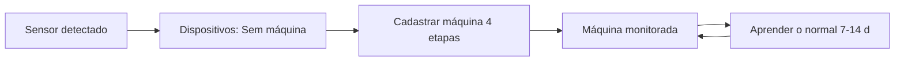
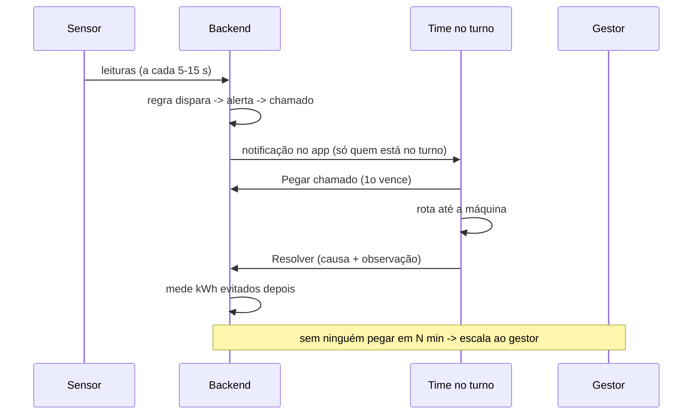

# App MapaVolt: especificação completa (telas, fluxos, regras e dados)

> 29/10/2026. Documento de referência do app. Nome provisório **MapaVolt** (nome não decidido; 10 sugestões em `solucao.md` §0).
> Fontes: `solucao.md` (solução), `prototipo-claude-design.md` (protótipo atual), `equipamentos.md` (hardware), `../dados/pecem.md` e `../dados/arcelormittal-brasil.md`.
> Marcação: **[Exemplo]** número ou nome ilustrativo, simulado · **[Estimativa]** nossa · **[Verificar]** suposição a confirmar · **[Decidido]** decisão já tomada · **[Aberto]** ainda sem decisão.
> Todos os números de tela deste documento são **[Exemplo]**, salvo quando dito o contrário.

---

## 1. Visão geral

### 1.1 O que é
Um app para celular e PC que monitora máquinas industriais com sensores elétricos (tensão, corrente, potência, fator de potência, kWh, frequência). Ele:
1. mostra cada máquina ao vivo, numa lista e num mapa desenhado da unidade;
2. detecta sobreuso e anomalias em tempo real, com regras explicáveis;
3. abre um **chamado** para o time ou cargo responsável (só quem está no turno);
4. leva o técnico até a máquina, traçando a rota a partir de um ponto de referência;
5. mede a economia de energia gerada pelas correções (kWh, R$, CO₂).

### 1.2 Para quem
Técnicos de manutenção e instrumentação, líderes e supervisores de turno, gestores e coordenadores, engenharia de energia. Contexto de uso: ArcelorMittal Pecém (hackathon "Trilha da Inovação", desafio 8 Eficiência Energética), com estrutura pensada para as outras unidades do grupo no Brasil.

### 1.3 Princípios
| Princípio | O que significa na prática |
|---|---|
| **Mobile first** [Decidido] | Desenhado primeiro para o celular: uma mão, botões grandes, barra inferior. O PC reaproveita as mesmas telas com mais colunas. O editor do mapa funciona no celular, mas desenhar a planta inteira é mais confortável no PC. |
| **Aviso só dentro do app** [Decidido] | Caixa de chamados, banner/som com o app aberto e notificação do próprio app em segundo plano. Sem WhatsApp, SMS ou e-mail. |
| **Regras explicáveis** | Todo alerta mostra qual regra disparou, o valor medido, o esperado e há quanto tempo. Nada de "caixa preta". |
| **Fechar o ciclo** | Detectar, avisar a pessoa certa, levar até a máquina, registrar a causa, medir a economia. |
| **Só lê, nunca comanda** | O app não envia comando às máquinas (segurança de rede industrial, OT). |
| **Uma cor, um significado** | As mesmas cores de estado em painel, lista, mapa e gráficos. |

### 1.4 Cores de estado [Decidido]
| Estado | Cor | Quando |
|---|---|---|
| Normal | Verde | Dentro da faixa esperada |
| Atenção | Amarelo | Começou a sair da faixa (ainda sem completar o tempo mínimo) ou tensão, FP ou desbalanço fora do limite |
| **Sobreuso** | **Vermelho** | Consumo acima do esperado pelo tempo mínimo |
| **Parada** | **Cinza** (cheio) | Potência abaixo do nível de parada |
| Sem sinal | Cinza com **contorno tracejado** e ícone | Sensor sem enviar leitura há mais de 2 min |

Cor nunca é o único sinal: cada estado também tem ícone e texto (acessibilidade e uso com luvas/sol).

---

## 2. Conceitos e glossário
| Termo | Definição |
|---|---|
| **Unidade** | Planta industrial da empresa. A ArcelorMittal usa "unidade" ou "usina". Nível mais alto da hierarquia. Ex.: Pecém/CE. |
| **Área** | Divisão de uma unidade. Ex.: Aciaria. Pode ter **sub-áreas** (ex.: Aciaria > Casa de bombas). |
| **Máquina** | Equipamento monitorado (motor, bomba, compressor, ventilador, correia, ponte rolante…), com TAG da planta. |
| **Sensor** | Medidor elétrico ligado à máquina (ex.: PZEM-004T na demo, multimedidor Modbus no piloto). |
| **Gateway** | Equipamento que junta os sensores de um painel e envia as leituras ao servidor (RS485 para Wi-Fi/Ethernet/4G). |
| **Dispositivo** | Sensor que o gateway detectou na rede. Fica "sem máquina" até ser cadastrado. |
| **Estado** | Normal, Atenção, Sobreuso, Parada ou Sem sinal (cores em 1.4). |
| **Alerta** | Registro de que uma regra de detecção disparou (R1–R10). Um alerta aberto por máquina e por tipo. |
| **Chamado** | Tarefa criada a partir de um alerta (corretivo) ou de um plano de preventiva. Tem dono, status e histórico. |
| **Preventiva** | Revisão planejada de uma máquina, por calendário, horas de operação ou condição. |
| **Time** | Grupo de funcionários responsável por máquinas de uma ou mais áreas. |
| **Cargo** | Função do funcionário (ex.: Técnico de Manutenção Elétrica). |
| **Turno** | Escala de trabalho (turmas A/B/C/D em revezamento, ou administrativo). Define quem está de plantão agora. |
| **Gestor responsável** | Pessoa que recebe o chamado quando não há responsável disponível ou ninguém pega a tempo. |
| **Ponto de referência** | Local fixo marcado no mapa desenhado (portaria, sala de controle, oficina) de onde a rota parte. |
| **Consumo esperado** | Potência média que a máquina deve ter no estado de operação, definida no cadastro ou aprendida. |
| **kWh acima do esperado** | Energia medida menos a esperada, somada no período. É a medida do desperdício. |

---

## 3. Perfis de acesso e permissões
Quatro perfis. Um usuário pode ter acesso a várias unidades, com perfil por unidade [Verificar: um perfil único ou um por unidade].

| Ação | Administrador | Gestor | Técnico | Leitura |
|---|:-:|:-:|:-:|:-:|
| Ver painel, lista, detalhe de máquina, mapa | Sim | Sim | Sim | Sim |
| Ver chamados e preventivas | Sim | Sim | Sim | Sim |
| Pegar, devolver, resolver chamado | Sim | Sim | Sim (do próprio time/cargo) | Não |
| Transferir chamado para outra pessoa | Sim | Sim | Sim (dentro do time) | Não |
| Reatribuir chamado escalado / fechar sem resolver | Sim | Sim | Não | Não |
| Usar rota | Sim | Sim | Sim | Sim |
| Editar mapa (formas, áreas, pontos, caminhos) | Sim | Sim (áreas do seu time) | Não | Não |
| Ver Analytics | Sim | Sim | Resumo do próprio time | Sim |
| Dispositivos e cadastro de máquina | Sim | Sim | Não | Não |
| Governança (times, funcionários, cargos, turnos) | Sim | Sim (só o próprio time) | Não | Não |
| Plano de preventiva (criar/editar) | Sim | Sim | Não | Não |
| Configurações (preço do MWh, limites padrão) | Sim | Não | Não | Não |
| Silenciar alerta (com motivo) | Sim | Sim | Não | Não |

Regras:
- **Governança** e **Dispositivos** só aparecem no menu "Mais" para Administrador e Gestor [Decidido].
- Gestor edita apenas times e máquinas sob sua gestão; Administrador edita tudo da unidade.
- Toda alteração de cadastro, mapa e limites grava autor e data (trilha de auditoria).

---

## 4. Mapa de navegação

```
App
├─ Topo (em todas as telas): chip "ArcelorMittal Pecém · CE ▾" -> Seleção de unidade (folha) · sino de notificações
└─ Barra inferior (5 itens)
   ├─ Painel
   │   ├─ Detalhe da máquina
   │   │   └─ Histórico (chamados e preventivas da máquina)
   │   └─ Lista de máquinas (filtros)
   ├─ Mapa
   │   ├─ Visão (ao vivo) -> cartão da máquina -> Rota
   │   └─ Edição (Admin/Gestor)
   ├─ Chamados
   │   ├─ Abertos · Meus · Preventivas · Resolvidos
   │   ├─ Detalhe do chamado -> Rota
   │   └─ Preventiva: plano e execução (checklist)
   ├─ Analytics
   └─ Mais
       ├─ Dispositivos (Admin/Gestor) -> Cadastro de máquina (4 etapas)
       ├─ Governança (Admin/Gestor): Times · Funcionários · Cargos · Turnos
       │   ├─ Detalhe do time
       │   └─ Cadastro de funcionário
       ├─ Perfil / turno
       └─ Configurações (Admin)
```

No PC, a barra inferior vira menu lateral; as telas de lista e detalhe podem aparecer lado a lado.

---

## 5. Telas

Padrão de estados usado em todas as telas, salvo exceção descrita:
- **Carregando:** esqueleto (skeleton) no lugar dos cartões; nada de tela em branco.
- **Vazio:** mensagem curta + ação sugerida (ex.: "Nenhum chamado aberto. Tudo certo por aqui.").
- **Erro:** faixa no topo "Não foi possível atualizar. Tentando de novo" com botão "Tentar agora"; dados em cache continuam visíveis com a hora da última atualização.
- **Sem sinal (sensor):** o dado mostra a última leitura em cinza tracejado, com "sem sinal há X min". **Sem conexão do celular:** banner "Você está offline. Mostrando dados de HH:MM"; o mapa e a rota continuam funcionando (ver 5.7).

### 5.1 Seleção de unidade

**Objetivo.** Trocar a unidade em que o usuário está trabalhando. Tudo no app (painel, mapa, chamados, analytics, governança) filtra pela unidade escolhida.

**Quem usa.** Todos que têm acesso a mais de uma unidade. Quem tem uma só vê o chip sem seta.

**Componentes.**
- **Chip no topo:** "ArcelorMittal Pecém · CE ▾", visível em todas as telas.
- **Folha (bottom sheet)** ao tocar no chip: lista de unidades com, por unidade, nome e estado (UF), nº de máquinas, alertas abertos, estado geral (cor da pior máquina) e selo "sem dados" se ainda não há sensores.
- Busca por nome e favorita/última usada no topo.
- Hierarquia: **Unidade → Área → sub-área**. A área é escolhida dentro de cada tela (filtro), não na folha.

**Unidades da ArcelorMittal Brasil** [Fato: `../dados/arcelormittal-brasil.md` §1]: Pecém/CE, Tubarão/ES, Vega/SC, João Monlevade/MG, Juiz de Fora/MG, Piracicaba/SP, Barra Mansa/RJ, Resende/RJ. A lista exibida é a das unidades cadastradas no app e liberadas ao usuário; só o Pecém tem dados no escopo do hackathon.

**Áreas do Pecém** (usina integrada que produz **placas**; **não tem laminação** hoje) [Fato: `../dados/pecem.md` §3]:
Pátio de Matérias-Primas · Sinterização · Coqueria · Alto-Forno · Aciaria · Lingotamento Contínuo · Termelétrica/Utilidades · Subestação · Pátio de Placas · Logística (correia até o porto).
> Correção ao protótipo: o protótipo atual tem a área "Laminação". Trocar pelas áreas acima. A laminação a quente é só um projeto em estudo (R$ 35 mi aprovados para engenharia em jul/2026) [Fato: `pecem.md` §9]; se for aprovada, vira nova área.

**Ações.** Tocar numa unidade: troca o contexto, fecha a folha e volta para o Painel da unidade. A escolha fica salva por usuário.

**Estados.** Carregando contadores: números com esqueleto. Erro ao carregar uma unidade: linha "Sem conexão com a unidade" e não permite trocar para ela. Usuário sem unidades: tela "Peça acesso ao administrador".

**Exemplo [Exemplo].**
| Unidade | Máquinas | Alertas abertos | Estado |
|---|---:|---:|---|
| ArcelorMittal Pecém · CE | 42 | 5 | Vermelho (1 em sobreuso) |
| ArcelorMittal Tubarão · ES | 0 | 0 | Sem dados (não instalada) |
| ArcelorMittal Vega · SC | 0 | 0 | Sem dados (não instalada) |

### 5.2 Painel

**Objetivo.** Dar a visão geral da unidade em 5 segundos: o que está errado, quanto a usina demanda e quanto já se economizou.

**Quem usa.** Todos. Para técnico, é a porta de entrada; para gestor, o resumo do turno.

**Componentes (de cima para baixo no celular).**
1. **Cabeçalho:** chip de unidade, "Turno B · 14:32" (turno atual do usuário), sino com contador.
2. **Demanda total da unidade (MW)** com gráfico das últimas horas (linha) [Exemplo: 142 MW].
3. **Contadores por estado** (toque filtra a lista): Sobreuso (vermelho) · Atenção (amarelo) · Normal (verde) · **Parada (cinza)** · **Sem sinal (cinza tracejado)**.
4. **Mini cartão "Economia do mês":** R$ e MWh evitados no mês corrente vs. mês anterior [Exemplo: R$ 48,3 mil · 231 MWh · +12%]. Toque abre Analytics.
5. **Cartão "Energia acima do esperado hoje":** kWh e R$ somados da unidade [Exemplo: 3.420 kWh · R$ 715].
6. **Alertas ativos** (os mais graves primeiro): tipo, máquina, área, desvio, tempo; botões "Localizar no mapa" e "Detalhes"; selo se há chamado e quem pegou.
7. **Máquinas:** lista com filtro Todas / Com alerta, filtros por área, time, estado e criticidade (ver 5.3).

**Ações.** Tocar num contador filtra; tocar num alerta abre o chamado; tocar na máquina abre o detalhe; pull-to-refresh.

**Estados.** Vazio de alertas: "Nenhum alerta ativo". Gateway fora: faixa "Gateway Aciaria-01 sem comunicação" e as máquinas dele ficam Sem sinal. Dados em tempo real chegam por WebSocket; se cair, cai para atualização a cada 15 s.

**Exemplo [Exemplo].** Pecém · Turno B: 1 Sobreuso, 2 Atenção, 34 Normais, 3 Paradas, 2 Sem sinal. Alerta: "Sobreuso · Ventilador de despoeiramento AC-02 · Aciaria · +17% há 12 min".

### 5.3 Lista de máquinas

**Objetivo.** Ver todas as máquinas da unidade com valor ao vivo e achar rápido as que têm problema.

**Quem usa.** Todos.

**Componentes.**
- Cartão por máquina: nome, TAG, área, **bolinha/barra de estado** (cor + ícone), potência atual vs. esperada (`48,2 kW / 40 kW esperado (+21%)`), corrente, tensão, FP, hora da última leitura, mini-gráfico (últimos minutos).
- Filtros: área, time, estado, criticidade; busca por nome ou TAG.
- Ordenação padrão: problemas primeiro (Sobreuso, Atenção, Sem sinal, Parada, Normal).
- Tensão exibida com a nominal ao lado (ex.: "6.566 V · 6,6 kV nominal"), para não parecer erro (ajuste apontado em `prototipo-claude-design.md`).

**Ações.** Tocar abre o Detalhe; segurar/menu: "Localizar no mapa", "Ver chamados".

**Estados.** Máquina Sem sinal: valores em cinza com "última leitura 14:07". Máquina Parada dentro do horário: cinza + selo "parada". Parada fora do horário: cinza simples, sem alerta [Aberto: proposta de `solucao.md`, ver §13].

**Exemplo [Exemplo].** AC-02 Ventilador de despoeiramento · Aciaria · Sobreuso · 48,2 / 40 kW (+21%) · 92 A (fase B) · FP 0,89.

### 5.4 Detalhe da máquina

**Objetivo.** Entender o que a máquina está fazendo agora e no histórico, e quanto está desperdiçando.

**Quem usa.** Técnico (diagnóstico), gestor e engenharia de energia (análise).

**Componentes.**
- **Cabeçalho:** nome, TAG, área, estado (cor + texto), criticidade, responsável (time ou cargo), gestor.
- **Cartão "Energia acima do esperado":** kWh e R$ no período selecionado, com o preço do MWh configurado [Exemplo: 612 kWh · R$ 128 nos últimos 7 dias].
- **Seletor de período:** Ao vivo (15 min) · 1 h · 24 h · 7 d · 30 d · intervalo livre.
- **Um gráfico por métrica, separados:**
  | Gráfico | Detalhe |
  |---|---|
  | Potência ativa (kW) | Faixa esperada sombreada, linha do limite de sobreuso, marcadores de alertas/chamados |
  | Corrente por fase (A) | Três linhas (A, B, C); linha da corrente nominal |
  | Tensão por fase (V) | Três linhas; faixa adequada sombreada |
  | Fator de potência | Linha do limite 0,92 |
  | Energia (kWh) | Barras por hora (24 h) ou por dia (7/30 d) |
  | Frequência (Hz) | Linha em torno de 60 Hz |
- **Resumo:** kWh hoje e no mês, custo estimado, horas ligada, horas em sobreuso.
- **Ficha:** fabricante/modelo, tipo, dados nominais, sensor/gateway, limites, horário de operação, responsáveis, data de instalação.
- **Histórico da máquina:** chamados (corretivos) e preventivas (plano, próxima data, última execução), com causa e observação.
- **Botões:** "Pegar chamado" (se houver chamado aberto e o usuário for destinatário), "Localizar no mapa", "Ir até a máquina".

**Ações.** Zoom/arrastar nos gráficos; tocar num marcador abre o chamado; editar cadastro (Admin/Gestor); silenciar alerta com motivo e duração.

**Estados.** Sem sinal: gráficos mostram a lacuna tracejada e faixa "Sem sinal há 8 min". Sem histórico suficiente: faixa esperada vem do cadastro e a sugestão de "aprender o normal" fica desabilitada até 7 dias.

**Exemplo [Exemplo].** AC-02: potência 48,2 kW vs. esperado 40 kW (limite 46 kW); corrente B 92 A; FP 0,89; 3 chamados nos últimos 90 dias; próxima preventiva em 12 dias.

### 5.5 Mapa (visão)

**Objetivo.** Achar o problema "de longe" e chegar até ele.

**Quem usa.** Todos.

**Componentes.**
- Mapa desenhado da unidade (planta baixa, foto aérea ou fundo em branco), com **áreas** e **sub-áreas** navegáveis (Visão geral → Aciaria → Casa de bombas).
- Cada máquina: ícone com **cor do estado**; sobreuso pisca; parada cinza; sem sinal cinza tracejado.
- Cada área: contorno com a **pior cor** das máquinas dentro e resumo ("2 em sobreuso, 1 parada").
- Pontos de referência (portaria, sala de controle, oficina) com ícone próprio.
- Filtros: estado, time, tipo. Busca por TAG.
- **Cartão da máquina** ao tocar: estado, potência vs. esperada, últimas métricas, "Ver detalhes", "Pegar chamado" (se houver), "Ir até a máquina".
- Botão "Editar mapa" (Admin/Gestor).

**Estados.** Sem mapa desenhado: "Esta unidade ainda não tem mapa. Crie em Editar mapa" (Admin) ou mostra lista (demais). Máquina sem posição: aparece numa lista "Sem posição no mapa" (cadastro incompleto). Mostra "última edição por X em DD/MM" no rodapé [para evitar mapa desatualizado].

**Exemplo [Exemplo].** Visão da Aciaria: AC-02 vermelho pulsando, AC-05 verde, AC-07 cinza (parada); a área Aciaria com contorno vermelho e selo "1 sobreuso · 1 parada".

### 5.6 Mapa (edição)

**Objetivo.** Desenhar a unidade e posicionar máquinas, áreas, pontos de referência e caminhos.

**Quem usa.** Administrador; Gestor nas áreas do seu time.

**Ferramentas.**
| Ferramenta | Uso |
|---|---|
| Fundo | Importar imagem da planta baixa/foto aérea ou fundo em branco; ajustar opacidade |
| Linha | Paredes, correias, cercas; cor e espessura |
| Forma | Retângulo, polígono, círculo (áreas como "Casa de bombas") |
| Rótulo | Texto livre |
| **Área / sub-área** | Transformar uma forma em área com nome; escolher a área-pai; clicar nela abre o sub-mapa |
| Máquina | Arrastar da lista "sem posição" para o mapa; arrastar de novo para mover; salva no cadastro |
| **Ponto de referência** | Criar com nome e ícone (portaria, sala de controle, oficina, estacionamento) |
| **Caminho** | Desenhar corredores e vias como linhas conectadas; marcar portas/acessos; conectar áreas |
| Escala | Marcar dois pontos e informar a distância real (m) para o app calcular metros e tempo a pé |

**Ações.** Desfazer/refazer; salvar rascunho; **publicar** (só então vale para todos); histórico de versões com autor e data; pré-visualizar rota entre dois pontos para testar a conectividade dos caminhos.

**Validações.** Aviso se existe máquina sem caminho ligado a algum ponto de referência (a rota até ela não fecha); aviso de caminhos soltos.

**Estados.** No celular, as ferramentas ficam numa barra inferior deslizante; edição de planta completa recomenda PC. Conflito de edição: se outra pessoa publicou antes, mostrar "Mapa alterado por X às HH:MM. Recarregar?".

**Exemplo [Exemplo].** Pontos: Portaria Principal, Sala de Controle Aciaria, Oficina Elétrica. Caminho Portaria → Corredor Central → Aciaria. Escala: 100 px = 25 m.

### 5.7 Rota

**Objetivo.** Levar o técnico da sua posição de referência até a máquina, sem GPS [Decidido].

**Quem usa.** Técnicos e gestores.

**Componentes.**
- Seletor **"Saindo de: [ponto de referência] ▾"**; o app lembra o último usado e sugere o mais próximo da área do técnico.
- Rota destacada no mapa, **distância e tempo a pé** (ex.: 180 m, ~3 min), passos curtos ("Siga o corredor central até a Aciaria", "Entre pela porta 4"), e trecho de cada área quando a rota cruza várias.
- Botão "Cheguei" (marca no chamado "no local").
- Troca de partida recalcula na hora.

**Como calcula.** Menor caminho sobre o grafo dos caminhos desenhados (Dijkstra/A*). Roda no próprio aparelho, então funciona sem rede [Decidido: sem GPS].

**Estados.** Sem caminho: "Não há caminho cadastrado entre Portaria e AC-02" + "Avisar gestor do mapa". Offline: funciona com o mapa em cache. Rota bloqueada (via interditada marcada no mapa): recalcula por outro caminho e avisa o desvio.

**Evolução:** QR Code em cada ponto de referência ("li o QR da porta 4, estou aqui") [fora do escopo agora].

### 5.8 Chamados (lista)

**Objetivo.** Caixa de entrada do trabalho: o que precisa de ação agora, o que é meu, o que é preventivo.

**Quem usa.** Todos (técnico vê principalmente os do próprio time/cargo no turno).

**Componentes.**
- **Abas/filtros:** Abertos · Meus · Preventivas · Resolvidos. Contador em cada.
- **Card do chamado:** ID (CH-1042), tipo (corretivo por alerta / preventivo), máquina + área, severidade (cor), status (Aberto, Em atendimento, Escalado, Resolvido), destinatário (Time X ou Cargo Y), tempo desde a abertura, botão **"Pegar chamado"** (só para destinatários, só se Aberto).
- Chamado já pego: no lugar do botão, "Pego por Carlos Menezes às 14:07".
- Filtros adicionais: área, severidade, time. Ordenação: severidade e tempo.

**Ações.** "Pegar chamado"; tocar no card abre o detalhe; deslizar para devolver (se for o dono).

**Estados.** Vazio: "Nenhum chamado aberto." Novo chamado chega por WebSocket com banner e som (se o app estiver aberto) ou notificação do app. Se dois técnicos tocam "Pegar" ao mesmo tempo, o primeiro vence e o segundo vê "Já foi pego por X".

**Exemplos [Exemplo].**
| ID | Tipo/regra | Máquina · Área | Status | Destinatário / observação |
|---|---|---|---|---|
| CH-1042 | Sobreuso (+17% há 12 min) | Ventilador de despoeiramento AC-02 · Aciaria | Aberto | Time Manutenção Elétrica – Aciaria |
| CH-1041 | Queda de tensão | Ponte rolante 80 t LC-02 · Lingotamento Contínuo | Em atendimento | Pego por Carlos Menezes |
| CH-1039 | Ligada fora de horário | Compressor de ar 3 UT-04 · Utilidades | Escalado | Para o gestor (ninguém do cargo no turno) |
| CH-1037 | Parada inesperada | Bomba de resfriamento AF-02 · Alto-Forno | Resolvido | Causa: disjuntor desarmado |
| CH-1035 | Desbalanço de corrente | Exaustor principal SN-01 · Sinterização | Resolvido | Causa: mau contato em borne |
| CH-1033 | Sem sinal | Sensor PM-2B11 · Instrumentação | Aberto | Time Instrumentação |

Aba **Preventivas** [Exemplo]:
| ID | Máquina · Área | Gatilho | Status |
|---|---|---|---|
| PV-210 | Compressor centrífugo UT-01 | A cada 500 h de operação | Vence em 2 dias |
| PV-208 | Bomba de alimentação da caldeira TE-02 · Termelétrica | Termografia mensal | Atrasada 1 dia |
| PV-205 | Correia transportadora PM-03 · Pátio de Matérias-Primas | Por condição: consumo +8% por 7 dias sugere inspeção | Programada |
| PV-201 | Exaustor SN-01 · Sinterização | Checklist trimestral | Concluída |

### 5.9 Detalhe do chamado

**Objetivo.** Conduzir o atendimento do início ao fim e registrar o que foi feito.

**Quem usa.** Dono do chamado, demais destinatários (leitura), gestor.

**Componentes.**
- **Cabeçalho:** ID, tipo, severidade, status, máquina + área, destinatário, tempo aberto.
- **Resumo do alerta:** regra que disparou (ex.: R1 Sobreuso vs. esperado), valor medido, esperado, desvio, mini-gráfico de potência com a faixa esperada.
- **Linha do tempo:**
  1. Alerta disparado (com a regra e os valores)
  2. Notificados: N pessoas do turno (lista expansível)
  3. Pego por X às HH:MM
  4. A caminho (com a rota usada e o ponto de partida)
  5. No local
  6. Resolvido: causa (lista) + observação + foto opcional
  7. **kWh evitados**, medidos depois (comparação antes/depois, ver §10)
  - Eventos extras: devolvido, transferido para Y, escalado ao gestor às HH:MM, silenciado, "normalizou sozinho".
- **Botões:** Pegar chamado · Ir até a máquina · Ver gráfico da máquina · Devolver · Transferir · Resolver.
- **Escalonamento:** mostra "Será escalado ao gestor Fulano em 09:40" (contagem regressiva) e o motivo quando já escalado.

**Resolver.** Obrigatório escolher a **causa** (rolamento, desalinhamento, válvula/bypass, ligada sem necessidade, ajuste de processo, disjuntor desarmado, mau contato/borne, falha de sensor, falso alarme, outra) e observação curta. Isso alimenta o histórico por máquina e, no futuro, a IA de causa provável.

**Devolver / transferir.** Devolver reabre o chamado para o time e reinicia o aviso. Transferir escolhe outra pessoa do time/cargo (ou do gestor).

**Estados.** Alerta normalizou antes de alguém pegar: chamado fecha como "Normalizou sozinho" e fica registrado. Alerta reabre dentro de 30 min após resolvido: o chamado reabre em vez de criar outro [Estimativa; Verificar].

### 5.10 Preventivas (plano e execução)

**Objetivo.** Programar e executar revisões planejadas, com os mesmos mecanismos de chamado.

**Quem usa.** Gestor e Administrador criam planos; técnicos executam.

**Plano de preventiva (por máquina).**
| Campo | Detalhe |
|---|---|
| Máquina | Uma máquina (ou modelo aplicado a várias) |
| Gatilho | **Calendário** (a cada X dias) · **Horas de operação** (a cada X h; o sensor conta as horas ligada) · **Condição** (tendência de consumo ou desbalanço, ex.: consumo +8% por 7 dias; desbalanço > 6% por 3 dias) |
| Checklist | Itens: medir corrente por fase, termografia, reaperto de bornes, lubrificação, limpeza, outros (livre) |
| Antecedência | Dias antes do vencimento para criar o chamado (padrão 3) |
| Responsáveis | Time ou cargo e gestor (herda da máquina, pode mudar) |
| Duração estimada | Horas |

**Status.** Programada (no prazo) · Vencendo (faltam poucos dias; padrão ≤ 3 dias ou ≤ 10% das horas) · Atrasada · Concluída.

**Execução.** A preventiva vira **chamado do mesmo jeito** do corretivo: mesmas regras de destinatário (§8). O técnico pega, vai à máquina (rota), marca cada item do checklist, anota medições (ex.: corrente por fase) e conclui. Ao concluir, o app reinicia o contador (próxima data/horas) e guarda a execução. [Verificar: usar o ID PV-xxx para o plano/ocorrência e CH-xxxx para o chamado gerado, ou fundir em um só ID].

**Estados.** Concluída com item reprovado: opção de abrir chamado corretivo vinculado. Máquina sem sensor de horas: usa só calendário.

**Exemplo [Exemplo].** PV-210 Compressor centrífugo UT-01: gatilho 500 h, faltam 14 h (~2 dias), checklist de 6 itens, time Utilidades e Termelétrica.

### 5.11 Analytics

**Objetivo.** Provar o valor: quanto se economizou, onde está o desperdício e como o time responde.

**Quem usa.** Gestor, engenharia de energia, administrador; técnico vê só o resumo do próprio time.

**Filtros.** Período (mês / trimestre / ano) e unidade/área.

**KPIs (cartões).** Definições em §10.
| KPI | Exemplo [Exemplo] |
|---|---|
| Economia do mês | R$ 48,3 mil = 231 MWh × R$ 209/MWh; +12% vs. mês anterior |
| Economia acumulada no ano | R$ 391 mil |
| Desperdício identificado vs. recuperado | 410 MWh identificados, 231 MWh recuperados (56%) |
| CO₂ evitado | ≈ 10,6 t (231 MWh × 46,0 gCO₂/kWh) |
| Chamados abertos / resolvidos | 5 / 38 |
| MTTA (tempo até pegar) | 6 min |
| MTTR (tempo até resolver) | 2 h 10 min |
| % escalados | 8% |
| Preventivas em dia | 87% |
| Horas de parada inesperada | 14 h |

**Gráficos.**
1. **Economia mensal** (barras, 12 meses, com linha de meta).
2. **Consumo real vs. esperado** (linhas, período do filtro).
3. **Ranking das 10 máquinas que mais desperdiçam** (kWh e R$).
4. **Desperdício por área** (barras).
5. **Horas por estado** (normal / sobreuso / parada), empilhado por área.
6. **Causas mais comuns** dos chamados resolvidos.
7. **Desempenho por time** (tabela: nº de chamados, MTTA, MTTR, % escalados).

**Fórmula da economia.** `economia (R$) = (consumo esperado ou consumo antes da correção − consumo depois da correção) × preço do MWh`. O preço é configurável (Configurações); padrão inicial R$ 209/MWh, dentro da faixa pública de R$ 178–250/MWh [Fato: `../dados/precos-e-tarifas.md`, citado em `pecem.md`]. **Trocar pelo preço interno da empresa** quando disponível. Toda tela mostra o preço usado e o rodapé "Valores calculados com R$ X/MWh".

**Aviso fixo na tela.** "Números de exemplo/simulados" enquanto o app estiver na demo.

**Estados.** Sem dados no período: "Ainda não há chamados resolvidos neste período". Período parcial (mês corrente): rotular "até hoje". Exportar PDF/CSV [fora do escopo agora].

### 5.12 Dispositivos

**Objetivo.** Ver os sensores que os gateways detectaram e transformá-los em máquinas monitoradas.

**Quem usa.** Administrador e Gestor (em "Mais").

**Componentes.**
- Cabeçalho: "6 gateways IoT online" [Exemplo], com lista expansível (nome, área, status, nº de sensores).
- Seções: **Sem máquina** (novos) e **Vinculados**.
- Card do dispositivo: ID (ex.: PM-2B11), tipo (medidor trifásico, sensor de corrente), gateway, área pré-identificada, **leitura ao vivo** (V, A, kW), qualidade do sinal.
- Ações por card: **Cadastrar máquina** (abre o cadastro), **Ignorar** (esconde com motivo), **Procurar** (rescan) no topo.

**Estados.** Vazio: "Nenhum sensor novo. Última busca às HH:MM." Gateway offline: card cinza tracejado "Gateway sem comunicação". Sensor vinculado sem sinal: aparece em "Vinculados" com selo e gera alerta R10.

### 5.13 Cadastro de máquina (4 etapas)

**Objetivo.** Transformar um sensor detectado em máquina monitorada, com limites já sugeridos pela leitura. A máquina passa a ser monitorada assim que o cadastro termina.

**Quem usa.** Administrador e Gestor.

**Barra de progresso** com 4 etapas; "Voltar", "Salvar rascunho", "Próximo". Etapas 1 e 3 e 4 são obrigatórias para concluir; etapa 2 tem sugestões que o usuário aceita ou ajusta.

**Etapa 1. Identificação.**
| Campo | Observação |
|---|---|
| Unidade e área | Pré-selecionadas pelo gateway; editáveis |
| Nome | Ex.: Ventilador de despoeiramento |
| TAG da planta | Ex.: AC-02; único na unidade |
| Tipo | Motor, bomba, compressor, ventilador, correia, ponte rolante, prensa, forno, transformador, outro |
| Fabricante / modelo | Texto |
| Criticidade | Baixa, média, alta (muda a urgência e a severidade) |
| Foto | Opcional |

**Etapa 2. Dados nominais e comportamento.**
| Grupo | Campos |
|---|---|
| Nominais (placa) | Tensão (V), corrente (A), potência (kW), FP, nº de fases |
| Comportamento | **Potência média esperada** e **faixa normal** (mín–máx) **sugeridas pela leitura atual**; potência de parada/standby; horário e turnos de operação; tempo normal de partida |
| **Aprender o normal** | Opção "aprender em 7–14 dias": o app sugere nova média e faixa com o histórico e o usuário aceita ou ajusta. Até lá, vale o valor sugerido/manual |
| Limites | Sobreuso % (padrão 15) + tempo mínimo (padrão 5 min); faixa de tensão; desbalanço (padrão 10%); FP mínimo (padrão 0,92) |

Os dados nominais são recomendados; se faltarem, só valem as regras baseadas em esperado/aprendido (R2 desabilitada) [Aberto: obrigatórios ou só aprendidos, ver §13].

**Etapa 3. Responsáveis.**
- Alternador **Time** OU **Cargo**: escolher um time (todos do time) ou um cargo (todas as pessoas daquele cargo).
- **Gestor responsável** (obrigatório): recebe quando não há ninguém no turno ou ninguém pega.
- **Tempo de escalonamento:** padrão 15 min.
- **Plano de preventiva** (opcional): criar agora ou depois (5.10).

**Etapa 4. Posição no mapa.** Mapa da unidade/área; arrastar o marcador até o local. Aviso se não há caminho ligado ao ponto (rota não fecha).

**Validações.** TAG única; potência esperada > potência de parada; limites coerentes; gestor obrigatório.

**Estados.** Perda de conexão no meio: rascunho salvo. Sensor já vinculado por outra pessoa: "Este sensor acabou de ser cadastrado por X".

### 5.14 Governança

Acesso: Administrador e Gestor. Sub-abas: **Times · Funcionários · Cargos · Turnos**.

#### 5.14.1 Times
**Objetivo.** Gerenciar os grupos que recebem chamados.

**Componentes.** Lista em **cards**. Cada card:
| Item | Exemplo [Exemplo] |
|---|---|
| Nome | Manutenção Elétrica – Aciaria |
| Área(s) | Aciaria |
| Gestor (avatar + nome) | Marina Castro |
| Nº de membros | 8 |
| No turno agora | 3/8 |
| Máquinas sob responsabilidade | 14 |
| Chamados abertos | 2 |

Times de exemplo [Exemplo]: Manutenção Elétrica – Aciaria · Manutenção Mecânica – Aciaria e Lingotamento · Manutenção Mecânica – Pátio de Matérias-Primas e Sinterização · Instrumentação · Utilidades e Termelétrica · Inspeção Preditiva · Engenharia de Energia.

**Ações.** "Novo time"; tocar no card abre o detalhe; filtrar por área.

#### 5.14.2 Detalhe do time
- **Membros:** nome, cargo, turno, status (no turno agora / fora do turno / férias / afastado).
- **Máquinas** do time, com estado atual.
- **Regra de escalonamento:** gestor, tempo (padrão 15 min), segundo nível opcional (coordenador) [Verificar].
- **Chamados** do time (abertos e recentes) e indicadores resumidos (MTTA, MTTR).
- Editar nome, áreas, gestor, membros (adicionar/remover). Remover alguém que é o único do time no turno mostra aviso de cobertura.

#### 5.14.3 Funcionários
Lista com busca e filtros (cargo, time, turno, status). Cada item: avatar, nome, matrícula, cargo, time(s), turno, status.

#### 5.14.4 Cadastro de funcionário
| Campo | Detalhe |
|---|---|
| Nome | Texto |
| Matrícula | Única |
| Cargo | Da lista de cargos |
| Time(s) | Um ou mais |
| Turno | Escala de revezamento (turma A, B, C ou D) ou administrativo |
| Status | Disponível · Férias · Afastado (período de início e fim) |
| Perfil de acesso | Administrador · Gestor · Técnico · Leitura |
| Unidades com acesso | Uma ou várias |

O app **não guarda contato externo** (telefone/WhatsApp), pois o aviso é só dentro do app [Decidido; ver inconsistência registrada na seção final].

#### 5.14.5 Cargos
Lista de cargos com nº de pessoas. Exemplos [Exemplo]: Técnico de Manutenção Elétrica · Técnico de Instrumentação · Mecânico de Manutenção · Líder de Manutenção · Supervisor de Turno · Coordenador de Manutenção · Engenheiro de Energia. Criar/editar/excluir (excluir só sem pessoas).

#### 5.14.6 Turnos
- Cadastro das escalas: nome (Turma A/B/C/D, Administrativo), padrão de revezamento, horários de início e fim, data-base do ciclo.
- Visão "Agora": **quem está no turno agora**, por time e cargo. Isso define quem recebe o chamado.
- Exceções pontuais: troca de turno, hora extra, ausência.
- Os horários exatos das escalas da ArcelorMittal Pecém [Verificar]; no app, o administrador cadastra.

**Estados (Governança).** Time sem gestor: bloqueia salvar. Máquina com responsável sem ninguém em turno: aviso "Esta máquina escalará direto para o gestor" no detalhe do time.

### 5.15 Perfil / turno
- Foto, nome, matrícula, cargo, time(s), **turno atual** e próximo turno.
- Botão **"Estou indisponível"** (pausa de recebimento por motivo, ex.: pausa/refeição) com duração; aparece para o gestor [Verificar].
- Preferências de notificação **dentro do app** (som, vibração, silenciar fora do turno, nunca silenciar severidade alta).
- Tema (claro/escuro), idioma, sair.
- Histórico pessoal: chamados que pegou e tempo médio.

### 5.16 Configurações (Administrador)
| Item | Padrão | Observação |
|---|---|---|
| **Preço do MWh** | R$ 209 [Estimativa] | Faixa pública R$ 178–250; trocar pelo preço interno. Mantém histórico de valores com data (os cálculos antigos não mudam) |
| Fator de emissão | 46,0 gCO₂/kWh | Da própria empresa [Fato: `../dados/RANKING-DADOS-POR-IMPORTANCIA.md`, item 10] |
| Limites padrão | Sobreuso 15% por 5 min; tensão 0,92–1,05; desbalanço 10% por 5 min; FP < 0,92 por 15 min; sem sinal 2 min | Cada máquina pode sobrescrever |
| Escalonamento padrão | 15 min | Sobrescrito por máquina/time |
| Anti-spam | Um alerta aberto por tipo e máquina | Silenciar com motivo |
| Retenção de dados | 13 meses de leituras agregadas [Estimativa] | |
| Unidades | Cadastro e liberação de unidades | |

---

## 6. Fluxos passo a passo

### 6.a Sensor detectado, cadastro e monitoramento
1. O gateway detecta um sensor novo; ele aparece em **Dispositivos > Sem máquina** com leitura ao vivo.
2. Administrador/Gestor toca em **Cadastrar máquina**.
3. Etapa 1: confere unidade/área (pré-selecionadas), preenche nome, TAG, tipo, fabricante, criticidade.
4. Etapa 2: aceita ou ajusta potência esperada e faixa sugeridas pela leitura; informa nominais, horário de operação e limites; opta por "aprender o normal" em 7–14 dias.
5. Etapa 3: escolhe Time ou Cargo, gestor responsável, tempo de escalonamento; opcional: plano de preventiva.
6. Etapa 4: arrasta a máquina até o local no mapa.
7. Confirma. A máquina vira "Normal/…" conforme a leitura e entra em Painel, Lista, Mapa e regras de detecção.
8. Após 7–14 dias, o app propõe novo "normal"; o usuário aceita ou ajusta.



### 6.b Anomalia, chamado e economia medida
1. O backend recebe a leitura e avalia as regras (R1–R10).
2. Uma regra dispara (ex.: R1: +17% por mais de 5 min). Cria-se o **alerta** (um por máquina e tipo) e o estado muda (vermelho).
3. O sistema cria o **chamado** CH-xxxx (severidade = desvio × criticidade) e define destinatários (§8).
4. Os destinatários **no turno** recebem banner/som ou notificação do app. Os demais não.
5. O primeiro que toca **Pegar chamado** vira dono; os outros veem "Pego por X às HH:MM". Status: Em atendimento.
6. O dono toca **Ir até a máquina**, escolhe "Saindo de: [ponto]" e segue a rota; marca "Cheguei".
7. Corrige o problema e toca **Resolver**: escolhe causa e escreve observação.
8. O estado da máquina volta ao normal (com histerese).
9. Após uma janela de comparação (padrão 7 dias), o app calcula os **kWh evitados** (antes × depois) e anexa ao chamado e ao Analytics.



### 6.c Ninguém no turno ou ninguém pega: escala ao gestor
1. Ao criar o chamado, o app lista os responsáveis (time ou cargo) **no turno e disponíveis**.
2. **Caso A, lista vazia:** o chamado nasce **Escalado** e vai direto ao gestor responsável (motivo: "ninguém do cargo no turno").
3. **Caso B, lista com pessoas:** todas são avisadas; o relógio de escalonamento começa (padrão 15 min).
4. Se alguém pega antes do prazo, o relógio para.
5. Se ninguém pega até N min, o chamado passa a **Escalado**: o gestor é notificado e o chamado continua visível para o time. O gestor pode pegar, atribuir a alguém ou chamar outro time.
6. Se o gestor também não está disponível (férias/afastado/fora do turno de gestão): sobe para o gestor substituto ou coordenador da área [Verificar: nível seguinte].
7. Toda escalada fica na linha do tempo com o motivo.

```
Chamado criado
  -> há alguém do time/cargo no turno?
       não -> ESCALADO: gestor responsável
       sim -> avisa todos no turno -> alguém pega em N min?
                                       sim -> EM ATENDIMENTO
                                       não -> ESCALADO: gestor
```

### 6.d Preventiva (calendário, horas ou condição) vira chamado
1. Gestor cria o **plano** da máquina: gatilho + checklist + responsáveis (5.10).
2. O app acompanha o gatilho:
   - calendário: data de vencimento;
   - horas: contador de horas ligada vindo do sensor;
   - condição: tendência de consumo ou desbalanço (ex.: +8% por 7 dias).
3. Na antecedência configurada (ou quando a condição ocorre), o status passa a **Vencendo** e o app cria o **chamado preventivo**.
4. Destinatários seguem as **mesmas regras** de time/cargo/turno/escala (§8).
5. O técnico pega, vai à máquina (rota), executa o checklist (medições, termografia, reaperto de bornes, lubrificação, limpeza) e conclui.
6. O app grava a execução, reinicia o contador e marca **Concluída**; a próxima ocorrência fica **Programada**.
7. Passou o prazo sem conclusão: **Atrasada** e escala ao gestor pelo mesmo relógio.

### 6.e Editar o mapa e criar ponto de referência
1. Admin/Gestor: Mapa > **Editar mapa**.
2. Escolhe o fundo (planta baixa/foto ou em branco) e a escala.
3. Desenha formas e linhas; transforma formas em **áreas** e **sub-áreas** com nome.
4. Arrasta máquinas da lista "sem posição" ou move as existentes.
5. Cria **pontos de referência** (nome + ícone) em locais fixos (portaria, sala de controle, oficina).
6. Desenha os **caminhos** (corredores) ligando pontos de referência, portas e áreas.
7. Testa: **pré-visualizar rota** entre um ponto e uma máquina; corrige avisos de "sem caminho".
8. **Publica**. O mapa novo vale para todos; fica registrado autor e data.

### 6.f Trocar de unidade
1. Toca no chip "ArcelorMittal Pecém · CE ▾".
2. A folha lista as unidades com máquinas, alertas abertos e estado.
3. Toca em outra unidade (ex.: Tubarão).
4. O app recarrega Painel, Mapa, Chamados, Analytics e Governança filtrados pela nova unidade; o chip muda.
5. As notificações continuam chegando de **todas** as unidades do usuário, com a unidade indicada no texto; tocar nelas muda a unidade automaticamente [Verificar].

### 6.g Cadastrar time e funcionário
1. Mais > Governança > **Cargos**: confirma que os cargos existem (cria se faltar).
2. **Turnos**: confirma as escalas (turmas A/B/C/D, administrativo).
3. **Times > Novo time**: nome, área(s), gestor, regra de escalonamento.
4. **Funcionários > Novo**: nome, matrícula, cargo, time(s), turno, status, perfil de acesso, unidades.
5. No detalhe do time, confere os membros e "no turno agora" (ex.: 3/8).
6. Em **Cadastro de máquina (etapa 3)** ou na ficha da máquina, vincula o time ou cargo.
7. O app avisa se alguma máquina ficaria sem cobertura em algum turno.

### 6.h Consultar analytics e economia do mês
1. Abre **Analytics** (ou toca no mini cartão do Painel).
2. Escolhe o período (mês/trimestre/ano) e a unidade/área.
3. Lê os KPIs: economia do mês (R$ e MWh vs. mês anterior), acumulado no ano, desperdício identificado × recuperado, CO₂.
4. Desce para os gráficos: economia mensal, real × esperado, ranking, por área, horas por estado, causas, desempenho dos times.
5. Toca numa máquina do ranking e vai ao Detalhe (cartão de energia acima do esperado e histórico de chamados).
6. Confere o preço do MWh usado no rodapé; se necessário, o Administrador ajusta em Configurações.

---

## 7. Regras de detecção
Regras simples e explicáveis; ajustáveis por máquina. Padrões vêm de `solucao.md` §6.

| # | Regra | Padrão | Estado / alerta |
|---|---|---|---|
| R1 | Sobreuso vs. esperado | Potência média móvel de 1 min > esperado × (1 + 15%) por ≥ 5 min | Vermelho, "Sobreuso" |
| R2 | Sobreuso vs. nominal | Corrente > 100% da nominal por ≥ 2 min (ou > 120% por ≥ 10 s) | Vermelho, "Acima da nominal" (risco de queimar) |
| R3 | Fora do padrão aprendido | Potência acima do percentil 95 dos últimos 14 dias para aquele horário/turno, por ≥ 10 min | Amarelo; vermelho se persistir |
| R4 | Parada inesperada | Potência < nível de parada **dentro** do horário de operação por ≥ 2 min | Cinza, "Parada" |
| R5 | Ligada fora de horário | Potência acima do standby **fora** do horário/turno por ≥ 15 min | Amarelo, "Ligada fora de horário" |
| R6 | Tensão fora da faixa | Fora de ≈ 0,92–1,05 da nominal (PRODIST módulo 8, baixa tensão) [Verificar tabela vigente; para média tensão usar a faixa da unidade] | Amarelo (ex.: "Queda de tensão") |
| R7 | Desbalanço de corrente | (maior fase − média) ÷ média > 10% por ≥ 5 min | Amarelo |
| R8 | Fator de potência baixo | FP < 0,92 por ≥ 15 min | Amarelo |
| R9 | Partida anormal | Corrente de partida acima do normal ou partida mais longa que o tempo normal | Amarelo |
| R10 | Sem sinal | Nenhuma leitura há > 2 min | Cinza tracejado; chamado para Instrumentação |

Mecanismos contra alarme falso:
- **Tempo mínimo + histerese:** só dispara após o tempo mínimo e só normaliza abaixo do limite − 5% por alguns minutos.
- **Partida ignorada:** os primeiros segundos após ligar não contam para R1/R2.
- **Um alerta por máquina e por tipo:** atualizado, não repetido.
- **Silenciar** por X h com motivo (ex.: manutenção programada).
- **Severidade** = tamanho do desvio × criticidade da máquina (define cor do chamado, som da notificação e urgência na lista).
- **MVP de regras:** R1, R4, R5 e R10 reais; demais depois [`solucao.md` §8].

Relação com o protótipo: hoje o alerta é por limite fixo (pico de kW, tensão mínima, consumo diário); as regras acima trocam isso por "esperado + tempo mínimo".

---

## 8. Regras de notificação e escalonamento

### 8.1 Quem recebe
| Caso | Quem é avisado | Observação |
|---|---|---|
| Máquina com **time** responsável | **Todos do time que estão no turno** e disponíveis | Funcionário em férias/afastado ou fora do turno não recebe |
| Máquina com **só cargo** responsável | **Todas as pessoas com aquele cargo** que estão no turno | Independe do time |
| Máquina com time **e** cargo | [Aberto] Proposta: só quem tem o cargo dentro do time | Ver §13 |
| Ninguém responsável no turno | **Gestor responsável**, chamado já nasce **Escalado** | Motivo registrado |
| Máquina sem time nem cargo | Gestor responsável | Cadastro incompleto: aviso ao administrador |
| Ninguém pega em N min (padrão **15**) | **Escala ao gestor** | N configurável por máquina/time/geral |
| Gestor indisponível | Gestor substituto / coordenador da área [Verificar] | |
| R10 Sem sinal | Time de Instrumentação da área | Em vez do time da máquina |
| Chamado preventivo | Mesmas regras do corretivo | Prazo de escala conta a partir da criação |

### 8.2 Onde chega [Decidido: só dentro do app]
- App aberto: contador na aba Chamados, banner e som conforme severidade.
- App em segundo plano: notificação do próprio app (push do app/PWA).
- Sem WhatsApp, SMS ou e-mail.
- Severidade alta: som e vibração mesmo se o usuário silenciou o app (exceto se estiver "indisponível").

### 8.3 Ciclo de vida do chamado
| Status | Entra quando | Sai quando |
|---|---|---|
| Aberto | Chamado criado e destinatários avisados | Alguém pega, ou escala, ou a anomalia some |
| Em atendimento | Alguém tocou "Pegar chamado" | Resolve, devolve ou transfere |
| Escalado | Ninguém no turno, ou ninguém pegou em N min | Gestor (ou alguém) pega |
| Resolvido | Dono informou causa e observação | Pode reabrir se o alerta voltar em até 30 min [Estimativa] |
| Normalizou sozinho | Anomalia sumiu antes de alguém pegar | Registro mantido para histórico |

Regras adicionais: só uma pessoa é dona; devolver reinicia o relógio de escalonamento; transferir não reinicia; chamado Escalado continua visível para o time original.

---

## 9. Modelo de dados
Entidades principais e campos. Tipos e nomes finais ficam para a implementação (stack: ver §12). Base: `solucao.md` §7, ampliada com unidade, turno e preventiva.

| Entidade | Campos principais |
|---|---|
| **unidade** | id, nome, sigla, uf, tipo (integrada, mini-mill, laminação…), fuso, ativa |
| **area** | id, unidade_id, area_pai_id (sub-área), nome, tipo, geometria no mapa |
| **maquina** | id, unidade_id, area_id, nome, tag (única por unidade), tipo, fabricante, modelo, foto, criticidade, v_nom, i_nom, p_nom, fp_nom, fases, p_esperada, faixa_min, faixa_max, p_parada, horario_operacao, t_partida, limites (sobreuso_pct, sobreuso_min, v_min, v_max, desbalanco_pct, fp_min), aprender_normal, time_id, cargo_id, gestor_id, escalonamento_min, x, y, estado_atual, ativa |
| **gateway** | id, unidade_id, area_id, nome, status, ultimo_contato |
| **sensor** | id, gateway_id, maquina_id (nulo = dispositivo sem máquina), modelo, canal, ultimo_sinal, horas_operacao_acumuladas |
| **leitura** (série temporal) | maquina_id, ts, v_a, v_b, v_c, i_a, i_b, i_c, p_kw, fp, kwh, hz |
| **alerta** | id, maquina_id, regra (R1–R10), severidade, inicio, fim, valor_medido, valor_esperado, silenciado_ate, motivo_silencio |
| **chamado** | id (CH-xxxx), unidade_id, tipo (corretivo/preventivo), alerta_id, execucao_preventiva_id, maquina_id, severidade, status, destinatario_tipo (time/cargo/gestor), time_id, cargo_id, dono_id, criado_em, pego_em, a_caminho_em, no_local_em, resolvido_em, escalado_em, escalado_motivo, causa, observacao, kwh_evitados, reais_evitados |
| **chamado_evento** | id, chamado_id, ts, tipo (disparado, notificado, pego, devolvido, transferido, escalado, a_caminho, no_local, resolvido, reaberto), usuario_id, dados |
| **notificacao** | id, chamado_id, funcionario_id, enviada_em, lida_em, canal (app) |
| **plano_preventiva** | id, maquina_id, nome, gatilho (calendario/horas/condicao), intervalo_dias, intervalo_horas, condicao (métrica, limite, janela), checklist_modelo, antecedencia_dias, time_id, cargo_id, gestor_id, ativo |
| **execucao_preventiva** | id (PV-xxx), plano_id, chamado_id, vencimento, status (programada/vencendo/atrasada/concluida), iniciada_em, concluida_em, executor_id, checklist_resultado (item, ok, medicao), observacao |
| **funcionario** | id, nome, matricula, cargo_id, turno_id, status (disponivel/ferias/afastado), status_inicio, status_fim, perfil (administrador/gestor/tecnico/leitura), usuario_login |
| **funcionario_unidade** | funcionario_id, unidade_id, perfil |
| **cargo** | id, nome, descricao |
| **time** | id, unidade_id, nome, gestor_id, escalonamento_min |
| **time_area** | time_id, area_id |
| **time_membro** | time_id, funcionario_id |
| **turno** | id, nome (Turma A/B/C/D, Administrativo), tipo (revezamento/administrativo), inicio, fim, ciclo_dias, data_base |
| **escala** | id, funcionario_id, turno_id, data, inicio, fim, origem (padrão/troca/extra/ausência) — materializa "quem está de turno agora" |
| **mapa_area** | id, area_id, geometria, mapa_pai_id |
| **mapa_desenho** | id, unidade_id, tipo (linha/forma/rotulo), geometria, estilo, versao |
| **mapa_caminho** | id, unidade_id, no_origem, no_destino, distancia_m, bloqueado |
| **ponto_referencia** | id, unidade_id, area_id, nome, icone, x, y |
| **configuracao** | unidade_id, preco_mwh, vigencia_inicio, fator_co2, limites_padrao, escalonamento_padrao |
| **auditoria** | id, usuario_id, entidade, acao, antes, depois, ts |

Notas:
- "Quem está de turno agora" = `escala` do instante atual, filtrado por `funcionario.status = disponivel`.
- Chamado preventivo e corretivo compartilham a tabela `chamado`.
- Tudo é filtrado por `unidade_id`.

---

## 10. Métricas de Analytics
Todas por unidade, área e período; valores de tela são exemplos.

| KPI | Definição | Fórmula |
|---|---|---|
| **Energia acima do esperado (máquina)** | Energia medida acima do esperado enquanto em operação | Σ max(0, P_medida − P_esperada) × Δt, em kWh |
| **Desperdício identificado** | Soma da energia acima do esperado de todos os alertas R1/R2/R3/R5 no período | Σ kWh acima do esperado |
| **Desperdício recuperado / economia** | Redução de consumo medida após a correção | Σ (consumo antes da correção − consumo depois, com o mesmo regime de operação) por chamado, em kWh |
| **Economia (R$)** | Valor da energia economizada | (kWh antes − kWh depois) ÷ 1000 × preço do MWh |
| **Economia do mês** | Soma das economias dos chamados resolvidos cuja janela de medição cai no mês | R$ 48,3 mil = 231 MWh × R$ 209/MWh [Exemplo] |
| **Variação vs. mês anterior** | Diferença percentual | (mês − mês anterior) ÷ mês anterior |
| **Economia acumulada no ano** | Soma mensal do ano corrente | Σ meses |
| **CO₂ evitado** | Emissão associada à energia economizada | MWh × 1000 × 46,0 g/kWh ÷ 1.000.000 = t; 231 MWh ≈ 10,6 t |
| **Chamados abertos / resolvidos** | Contagem por status no período | — |
| **MTTA** | Tempo médio entre a criação e o "Pegar chamado" | média(pego_em − criado_em) |
| **MTTR** | Tempo médio entre a criação e a resolução | média(resolvido_em − criado_em) |
| **% escalados** | Chamados que foram escalados | escalados ÷ total |
| **Preventivas em dia** | Execuções concluídas até o vencimento | concluídas no prazo ÷ vencidas no período |
| **Horas de parada inesperada** | Tempo em estado Parada dentro do horário de operação | Σ duração dos alertas R4 |
| **Horas por estado** | Tempo em normal / sobreuso / parada | Σ por estado por máquina |
| **Consumo real vs. esperado** | Energia medida e a esperada no período | kWh real; kWh esperado = P_esperada × horas em operação |
| **Ranking de desperdício** | Top 10 máquinas por kWh acima do esperado | ordenação por kWh e R$ |
| **Desempenho por time** | Nº de chamados, MTTA, MTTR, % escalados | por time_id |

Método do "antes × depois": o consumo "antes" é o do período anterior à correção (ou o esperado cadastrado); o "depois" é o de uma janela de comparação (padrão 7 dias) após resolver, no mesmo regime e horário de operação. Quando a produção muda muito, a comparação por kWh/t fica para a evolução. [Estimativa; Verificar com engenharia de energia.]

Rotulagem: no hackathon todos os números são **simulados**; o app mostra o aviso fixo.

---

## 11. Hardware em uma página
Detalhes, preços e fontes em `equipamentos.md` (preços de 29/10/2026; podem ter mudado). O app só lê dados; instalação sempre por eletricista habilitado (NR-10), de preferência com sensor de alicate.

| Caso | Solução | Custo por ponto [Estimativa] |
|---|---|---|
| **Demo do hackathon** | ESP32 + PZEM-004T v3 (V, I, P, FP, kWh, Hz) num ventilador ou motorzinho; frear = sobreuso, desligar = parada | ≈ R$ 150–230 |
| Demo trifásica / piloto barato | 3× PZEM ou Shelly Pro 3EM | R$ 450–1.300 |
| **Piloto em baixa tensão (até 100 A)** | Medidor trifásico Modbus RS485 (genérico 100 A, Metaltex KWX) + gateway RS485 para Wi-Fi/Ethernet/MQTT | R$ 900–1.500 |
| Marca reconhecida | Siemens PAC1020, Schneider EM3155 / PM5110 | R$ 2.300–5.000 |
| **Motor grande / média tensão** | Multimedidor com entrada de 5 A nos TCs/TPs já existentes (ex.: Kron Mult-K 05) | R$ 1.550–2.500 + instalação |
| Máquina que já tem medidor/relé em rede | Ler por Modbus TCP / OPC UA via gateway | ≈ R$ 0 em hardware |
| Complemento opcional | Vibração/temperatura (ex.: WEG Motor Scan) | R$ 700–1.430 |

Arquitetura física [Estimativa]: em cada painel/CCM, um par RS485 liga 10–30 medidores a **1 gateway** (ex.: PUSR USR-DR404) que envia ao broker MQTT. Cabo é mais confiável que Wi-Fi em área metálica; 4G ou LoRaWAN para pontos sem rede.
Piloto de 10 máquinas em baixa tensão: ≈ R$ 9–15 mil em hardware, sem mão de obra [Estimativa].
Antes de comprar: confirmar 220/380 V, faixa AU915 (LoRaWAN) e certificação; perguntar à ArcelorMittal se CCMs e painéis do Pecém já têm multimedidores ou relés em rede (pode dispensar hardware novo).

Fluxo de dados: Máquina → Sensor → Gateway → Broker MQTT → Backend (regras, chamados) → Banco de séries temporais → App.

---

## 12. Fora do escopo agora / evolução
| Item | Situação |
|---|---|
| IA de causa provável (classificador treinado com as causas dos chamados) | Evolução; só em slide no hackathon |
| Baseline com produção (kWh por tonelada) para não confundir mais carga com defeito | Evolução |
| QR Code nos pontos de referência ("estou aqui") | Evolução |
| GPS/rota em tempo real | Fora; a rota usa mapa desenhado [Decidido] |
| Aviso por WhatsApp/SMS/e-mail | Fora [Decidido] |
| Comandar máquinas (ligar/desligar) | Fora; o app só lê |
| Exportar relatórios PDF/CSV | Evolução |
| Integração com historian/EMS/SAP/ordem de serviço da empresa | Evolução [Verificar o que existe] |
| Vibração/temperatura no mesmo painel | Evolução |
| Pitch, modelo de negócio e valor para a banca | Depois (`solucao.md` §9–10) |
| Linguagem e stack | Depois. Sugestão em `solucao.md` §7 (MQTT, banco de séries temporais, WebSocket, app mobile first, Leaflet para o mapa, grafo + Dijkstra/A* para a rota); sem decisão |
| Outras unidades com dados reais | Evolução; a estrutura (unidade/área) já prevê |

Escopo sugerido para a demo do hackathon (09–12/11): cadastro de máquina, lista ao vivo e gráficos, regras R1/R4/R5/R10, chamado com "Pegar" e notificação no app, mapa editável com cores e arrastar, rota a partir de ponto de referência, simulador de 10–20 máquinas e 1 bancada real. Unidades, Analytics, Governança completa e Preventivas **não** estavam no MVP de `solucao.md` §8: decidir quais entram como tela navegável (protótipo) e quais como dado simulado [Aberto].

---

## 13. Decisões tomadas e perguntas em aberto

### 13.1 Decidido
| Decisão | Origem |
|---|---|
| Celular e PC, foco em mobile | 29/10 |
| Aviso só dentro do app (caixa de chamados + notificação do app) | 29/10 |
| Rota parte de ponto de referência criado no mapa desenhado; sem GPS | 29/10 |
| Máquina com time: todos do time; só com cargo: todos do cargo | 29/10 |
| Só quem está no turno recebe | 29/10, 2ª rodada |
| Sem responsável disponível: vai ao gestor responsável | 29/10, 2ª rodada |
| Sem ninguém pegar em N min (padrão 15): escala ao gestor | Este documento (padrão 15 era proposta) |
| Cores: verde normal, amarelo atenção, vermelho sobreuso, cinza parada, cinza tracejado sem sinal | 29/10 |
| Hierarquia Unidade → Área → sub-área e chip de unidade no topo | Este documento |
| Navegação inferior: Painel · Mapa · Chamados · Analytics · Mais | Este documento |
| Governança e Dispositivos só para Administrador/Gestor | Este documento |
| Pecém sem laminação (corrigir protótipo) | Este documento |
| Pitch e stack ficam para depois | 29/10 |

### 13.2 Escopo fechado e perguntas em aberto
**Escopo fechado (29/10, 3ª rodada):** as features são as deste documento; nada novo por enquanto. A entrega agora é **só protótipo, com tudo mockado (dados simulados)**. Regras de backend e casos muito específicos (gestor indisponível, reabertura de chamado, perfil por unidade, IDs de preventiva) **não serão tratados agora**; onde este documento fala delas, vale como referência futura. **Gestor responsável é por time**; o cadastro de máquina pode mostrar o gestor (preenchido a partir do time). No mock valem os padrões propostos: time + cargo → avisa o cargo dentro do time; escala em 15 min; parada fora do horário → cinza, sem alerta; todas as telas com dados simulados.

**Em aberto:**
1. **Nome do app** (MapaVolt é provisório).

### 13.3 Correções e inconsistências a tratar
- **Laminação:** o protótipo usa a área "Laminação"; o Pecém produz placas e não tem laminação. Substituir pelas áreas listadas em 5.1.
- ~~WhatsApp/telefone em `solucao.md` §5.4 e §6~~ e ~~perfis administrador/líder/técnico~~: corrigidos em `solucao.md` em 29/10 (aviso só no app; perfis Administrador/Gestor/Técnico/Leitura).
- **Escopo do MVP:** `solucao.md` §8 não inclui unidades, analytics, preventivas nem governança completa.
