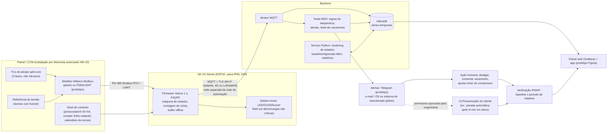
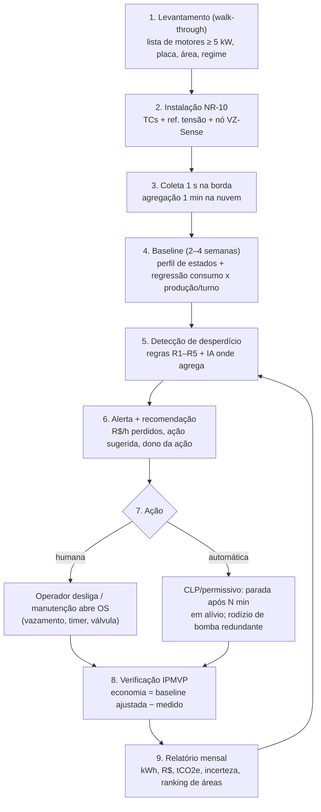

# Solução 1 — VazioZero: caça à operação improdutiva em utilidades industriais

> Trilha da Inovação 2026 (Sebrae/CE + ArcelorMittal Pecém), desafio 8: Eficiência Energética e Fontes Renováveis.
> Documento escrito em 28/10/2026. Arquitetura de referência inspirada no repositório VoltIA (ver seção 0).

**Como ler este documento.** Uso três marcações:
- **[FATO]**: tem fonte, listada na seção 12 (código entre colchetes, ex.: [F7]).
- **[PREMISSA]**: número ou situação que *não* consegui confirmar. Precisa ser validada com a ArcelorMittal (no Ideathon) ou medida no piloto.
- **[SUGESTÃO]**: decisão de projeto ou opinião minha.

---

## 0. Ponto de partida: o que aproveitamos do VoltIA e o que não aproveitamos

**O que é o VoltIA [FATO, F1–F3].** Um ESP32 com MicroPython mede (na simulação do Wokwi) tensão, corrente, potência ativa, reativa e aparente e energia acumulada. A cada 15 s publica 6 feeds por MQTT no Adafruit IO (`voltaje`, `corriente`, `potencia`, `energia`, `estado`, `aparato`) e recebe de volta o limite de potência (`umbral-potencia`). As alertas são **regras fixas no próprio ESP32**: consumo alto, sobrecarga, tensão anômala. Elas acionam LED, buzzer, OLED e Telegram, com antispam de 60 s, e funcionam sem internet. Um Random Forest (500 árvores) identifica o aparelho pelo fator de potência, pela potência reativa e pela variação de potência (NILM). Resultado: F1 macro de 0,918 em episódios não vistos, mas **com dados simulados**: 303 leituras rotuladas, 93 episódios e só 57 leituras no teste final. O hardware real (ZMPT101B + SCT-013, ou PZEM-004T) está apenas previsto.

**Três ideias do VoltIA que vale a pena reaproveitar (como conceito, não como código):**
1. *"Alertas são regras, não IA"*: a decisão crítica fica na borda, é determinística e funciona offline. A IA entra só onde a regra não resolve.
2. **Fator de potência e potência reativa como assinatura.** No VoltIA eles servem para distinguir aparelhos. Aqui servem para distinguir **estados de um motor** (desligado, em vazio/alívio, em carga, sobrecarregado). Um motor de indução em vazio tem FP baixo, abaixo de ~0,3 segundo material didático da UFRN [FATO, F21], e quase a mesma potência reativa que em carga [FATO, F21]. Por isso **corrente sozinha engana**: em motores pequenos, a corrente em vazio pode chegar perto da nominal [FATO, F22]. Medir P, Q e FP é o que permite dizer "esse motor está girando, mas não está produzindo".
3. **Validação honesta**: separar os dados por episódio (StratifiedGroupKFold) para não inflar métricas.

**O que não aproveitamos:** o código. **O repositório não declara licença** [FATO, F1]. Sem licença, valem os direitos autorais padrão, ou seja, ninguém tem permissão para copiar, modificar ou redistribuir [FATO, F4]. Por isso:
- **Nenhuma linha do VoltIA será copiada.** O time escreve firmware, backend e modelos do zero. O VoltIA aparece só como referência de arquitetura e é citado nos créditos.
- [SUGESTÃO] Se o time quiser reutilizar algo, deve pedir ao autor (Ludwin Vásquez) que publique uma licença (MIT, por exemplo) ou dê autorização por escrito.
- As métricas do VoltIA (F1 0,918) **não** são métricas da nossa solução e não devem aparecer no pitch como se fossem.

---

## 1. Problema e proposta de valor

### 1.1 O problema, em uma frase
Em uma indústria, boa parte da energia elétrica vai para **motores de utilidades** (compressores de ar, bombas, ventiladores, exaustores, esteiras) que **continuam ligados quando o processo não precisa deles**: em alívio, em vazio, fora de turno, em redundância desnecessária ou alimentando vazamentos. Ninguém vê esse desperdício, porque a medição costuma ser feita por alimentador ou por subestação, e não por máquina e por estado de operação.

### 1.2 Por que importa (dados)
- **Os motores dominam o consumo industrial.** Os sistemas motrizes respondem por cerca de **68% da eletricidade consumida pela indústria brasileira**, segundo estimativa atribuída ao Procel/Eletrobras e reproduzida pela WEG [FATO, F20]. A indústria respondeu por **36,1% do consumo final de eletricidade do Brasil em 2025** (EPE, via Cenário Energia) [FATO, F29].
- **O ar comprimido é a utilidade mais cara e a mais desperdiçada.** Em uma instalação industrial típica, cerca de **10% da eletricidade** vai para gerar ar comprimido, e em algumas passa de 30%. A eficiência global do sistema pode ser de apenas **10–15%**. A energia representa **76% do custo de vida útil** de um compressor (DOE, Compressed Air Tip Sheet #1) [FATO, F10].
- **Vazamentos.** Podem desperdiçar **20–30% da produção** de um compressor. Uma planta sem manutenção adequada tem vazamento típico de 20%, e um programa ativo de detecção e reparo leva a menos de 10% (Compressed Air Challenge/DOE, Fact Sheet #7, revisão de maio/2026) [FATO, F9].
- **Compressor em alívio continua gastando.** Um compressor parafuso "em alívio" (girando sem comprimir) consome cerca de **25% da potência de plena carga**, valor usado no exemplo do DOE [FATO, F10].
- **A própria ArcelorMittal já provou que esse é o filão:**
  - No concurso **"Power of 1"** da ArcelorMittal USA, uma das ideias vencedoras foi **automatizar uma de duas bombas hidráulicas do lingotamento contínuo**. As duas rodavam 24 h por dia, mesmo quando uma bastava, e a mudança foi feita só reprogramando o CLP, sem custo de capital. Outra foi um **botão que desliga o ar comprimido entre ciclos de desgaseificação** na metalurgia de panela (LMF), com estimativa de redução de **90%** no ar usado nesse processo. A empresa **mede uma linha de base antes e calcula a economia depois** de cada projeto (DOE Better Plants) [FATO, F7].
  - Na **ArcelorMittal Bissen** (Luxemburgo), a análise do ar comprimido e o reparo de vazamentos durante uma parada levaram a cerca de **7% menos eletricidade** para gerar ar comprimido [FATO, F8].

### 1.3 O detalhe que muda a conta na ArcelorMittal Pecém
- A unidade do Pecém produziu **3 milhões de toneladas de placas** em 2024. Uma termelétrica que **reaproveita gases do processo** a torna **autossuficiente em eletricidade**, com 1.367 GWh gerados em 2024 (+7%) [FATO, F11].
- **O excedente é vendido**: para o Sistema Interligado Nacional (SIN) [FATO, F13] e também dentro do grupo [FATO, F12].
- **Consequência [PREMISSA a validar com a ArcelorMittal]:** no Pecém, **cada kWh economizado internamente vira um kWh a mais de excedente para vender**. O ganho não aparece como "conta de luz menor", e sim como **receita extra de energia**. O valor do kWh evitado é, então, o preço de venda desse excedente (desconhecido; usamos faixa de mercado na seção 8).

### 1.4 Proposta de valor
> **VazioZero mostra, máquina por máquina, quanto dinheiro está saindo por motores e compressores que giram sem produzir. Diz ao responsável o que fazer, e prova com medição antes/depois (IPMVP) quanto foi economizado, em kWh, R$ e tCO2e.**

| Para quem | Dor | Ganho |
|---|---|---|
| Gestor de energia/utilidades | Sabe o consumo total, mas não sabe *onde* nem *quando* ele é improdutivo | Ranking "R$ perdidos por dia" por equipamento, com economia verificada |
| Supervisor de manutenção | Vazamento de ar e compressor ciclando só são percebidos com ronda manual | Teste de vazamento automático em toda parada, que abre ordem de serviço |
| Operador | Não sabe que deixar exaustor/bomba ligado custa dinheiro | Alerta simples com ação clara e reconhecimento (gamificação) |
| ESG/diretoria | Precisa reportar eficiência com número auditável | Relatório mensal no padrão IPMVP |

---

## 2. Cliente e segmento

| Ordem | Segmento | Por que pagaria | Quem decide/paga |
|---|---|---|---|
| 1 (piloto) | **ArcelorMittal Pecém**, áreas de utilidades e auxiliares (estações de ar comprimido, bombas de água de resfriamento, exaustores/despoeiramento, esteiras) [PREMISSA: quais equipamentos existem e quais já têm medição individual] | Mais excedente vendável; meta de eficiência/descarbonização; cultura de medir baseline (como no "Power of 1" [F7]) | Gerência de utilidades/energia; manutenção |
| 2 | **Indústrias do Complexo do Pecém (CIPP)**: 28–31 empresas com presença física, ~90–100 atuando na região/associadas à Aecipp [FATO, F28] | Pagam tarifa (A4/A3) ou contrato no mercado livre: kWh evitado é R$ evitado direto | Gerente industrial / dono |
| 3 | **PMEs industriais do Ceará com compressor e motores** (metalúrgicas, alimentos, gelo, plásticos, oficinas), grupo A4 | Tarifa A4 Verde da Enel CE fora de ponta: **R$ 369,17/MWh sem tributos**; na ponta, R$ 1.543,97/MWh [FATO, F14] | Dono/gerente; modelo "shared savings" reduz barreira |
| Vitrine | Campi do IFCE (laboratórios com compressores e motores) [PREMISSA] | Demonstração e dados reais | Direção do campus |

**Por que pagariam (resumo):** o produto se paga com o desperdício que encontra (payback estimado de ≈ 3 a 29 meses, conforme o cliente e o cenário; seção 8). Se o cliente não quiser investir, pode contratar no modelo **"shared savings"**: só paga sobre a economia **verificada**.

---

## 3. Arquitetura ponta a ponta

### 3.1 Diagrama



Versão ASCII (para slide):

```
[TCs alicate + ref. tensão] -> [Medidor Modbus] -> [ESP32 VZ-Sense] --MQTT/TLS--> [Broker]
                                   [contexto: pressão, linha rodando] ^                |
                                                                       +--> [Node-RED regras] -> [Alertas/OS] -> [Ação humana | CLP]
                                                                       +--> [InfluxDB] <-> [Python: estados, baseline, M&V]
                                                                                  |
                                                                       [Painel/App: R$ perdidos, ações, economia verificada]
```

### 3.2 Decisões de borda, transporte e segurança

**Medição: não intrusiva, mas não amadora.**
- **Corrente.** TCs *split-core* (de alicate) abraçam os cabos sem interromper o circuito.
- **Tensão.** Para calcular **P, Q e FP de verdade**, o medidor precisa de uma **referência de tensão**: ligação em bornes com fusível, ou no secundário de TP já existente. Uma referência pode servir vários medidores do mesmo painel. Medir só a corrente e "assumir" tensão e FP **não** serve para nosso caso, porque é justamente o FP que separa "em vazio" de "em carga" (seção 0).
- **Piloto.** O cérebro da medição deve ser um **medidor trifásico comercial com Modbus RTU** (classe 1 ou melhor, padrão DIN; ex.: família Eastron SDM630MCT ou Kron iKron/Mult-K) [FATO sobre a existência e as características dos produtos, F25]. O ESP32 só lê, processa e transmite. Isso resolve precisão, isolamento galvânico e certificação, coisas que um circuito caseiro com ZMPT101B não resolve num CCM de 380/440 V.
- **Protótipo.** PZEM-004T v3/v4: até 100 A, 80–260 VAC, TC incluso, saída TTL [FATO, F25], numa carga monofásica de bancada.

**Ambiente industrial (EMI, poeira, calor).** [SUGESTÃO, boas práticas de instrumentação]
- Caixa IP65 com trilho DIN e fonte DIN isolada.
- RS-485 em par trançado blindado, com o shield aterrado em um único ponto.
- Ferrites nos cabos e prensa-cabos.
- Ficar longe dos cabos de saída de inversores de frequência.
- Faixa de temperatura do medidor compatível com o local (ex.: SDM630MCT opera de −25 a +55 °C [F25]).

**Transporte.** [SUGESTÃO]
- *Protótipo:* Wi-Fi + MQTT.
- *Piloto:* **rede totalmente separada da rede de automação (OT) da ArcelorMittal**, com um destes caminhos:
  - gateway 4G próprio;
  - LoRaWAN, para muitos pontos espalhados, com taxa baixa e alcance alto;
  - Wi-Fi corporativo de visitantes, se a TI liberar.
- O sistema **só lê**: não há caminho de dados da nuvem para a rede OT. Isso segue o princípio de zonas e condutos da série **ISA/IEC 62443** (segurança de automação industrial) [FATO sobre a existência da norma, F24]. [PREMISSA] As regras de TI/OT do Pecém precisam ser validadas.
- **Resiliência.** O ESP32 guarda os dados em fila na flash se o link cair, e a máquina de estados roda localmente, como no VoltIA. O firmware do VoltIA, porém, **trava se a publicação MQTT falhar** (não há tratamento de erro no publish) [FATO, F3]. O nosso deve ter *retry*, *watchdog* e reconexão com *backoff*.
- **Segurança do dado.** MQTT com TLS, credencial por dispositivo, tópicos por cliente, atualização OTA assinada [SUGESTÃO].

**Instalação e NR-10.**
- **Estudantes não abrem painéis.** A instalação em CCM/quadro industrial é feita por **profissional autorizado pela empresa**, nos termos da NR-10: qualificado/habilitado/capacitado e formalmente autorizado, com treinamento e ASO em dia [FATO, F23]. De preferência é o eletricista da própria planta, sob permissão de trabalho e com o circuito desenergizado quando a referência de tensão exigir.
- A **nova redação da NR-10** (Portaria MTE nº 737, de 29/05/2026) **entra em vigor em 1º/06/2027** [FATO, F23]. O piloto deve seguir a redação vigente na data e já estar preparado para a nova.
- **Protótipo da competição:** apenas cargas de tomada (≤ 220 V, ≤ 10 A), com o PZEM dentro de uma caixa fechada e supervisão de professor do IFCE.

---

## 4. Pipeline de processos completo



### 4.1 Etapas em detalhe

**1. Levantamento.** Com a equipe de utilidades, listar os motores ≥ 5 kW das áreas auxiliares (potência de placa, função, regime de turno, se tem inversor ou partida estrela-triângulo) e escolher 5 a 6 pontos para o piloto, com critério "maior potência × maior suspeita de ociosidade". [PREMISSA] É preciso confirmar quais equipamentos do Pecém **não** têm medição individual: se o supervisório já mede tudo, o produto vira uma camada de software sobre medidores existentes (leitura Modbus/OPC), o que reduz custo.

**2. Instalação.** Ver 3.2. O nó é cadastrado no app com foto da placa do motor, que dá potência nominal, tensão e corrente.

**3. Coleta.**
- Na borda, o ESP32 lê o medidor a cada 1 s e calcula P, Q, S, FP e kWh. Também roda a máquina de estados e conta ciclos de carga/alívio, com seus tempos T e t.
- Publica a cada 15–60 s: médias, estado e eventos (mudança de estado na hora).
- Para comparação: o VoltIA publica 6 feeds a cada 15 s, ou 24 pontos/min, para caber no limite gratuito do Adafruit IO, que é de **30 pontos/min e 10 feeds** [FATO, F3, F26]. Esse limite **não escala** para uma planta, por isso o backend do VoltIA é trocado por Mosquitto + InfluxDB (seção 5).

**4. Baseline.**
- Período mínimo de 2 semanas no protótipo/PME e 4 semanas no piloto, cobrindo turnos e pelo menos uma parada programada.
- Saídas da baseline:
  - **Níveis de potência por equipamento** (desligado / vazio-alívio / carga), aprendidos automaticamente por clustering (ver IA, abaixo).
  - **Modelo de consumo**: E_dia = a + b·(horas de produção) + c·(turnos) [+ temperatura, quando relevante].
  - **Inventário de desperdício**: horas por estado improdutivo × potência medida.

**5. Detecção (regras primeiro).**

| Regra | O que detecta | Lógica (resumo) | Base |
|---|---|---|---|
| **R1** Alívio prolongado | Compressor girando sem comprimir | Estado "alívio" (P entre ~15% e 40% de P_carga, FP baixo) por mais de N min **e** sem demanda | Alívio ≈ 25% da plena carga [F10] |
| **R2** Teste de vazamento automático | Vazamento de ar | Em janela sem produção (calendário ou sinal "linha parada"), mede ciclos e calcula **Vazamento % = 100·T/(T+t)** (T = tempo em carga, t = tempo em alívio/desligado). Acima de 10% abre OS | Método do CAC/DOE Fact Sheet #7 [F9] |
| **R3** Ligado sem processo | Exaustor, bomba ou esteira ligada fora de turno/parada | P > P_mín **e** contexto = "linha parada" por mais de N min | Sugestão |
| **R4** Redundância desnecessária | Duas bombas/compressores em paralelo quando um basta | Soma das cargas < capacidade de uma unidade por mais de N min | Caso das bombas do lingotamento, ArcelorMittal USA [F7] |
| **R5** Motor cronicamente subcarregado | Motor superdimensionado ou candidato a inversor | Carga média < 40% e FP < 0,5 por semanas | Sugestão (roadmap: recomendação de troca/inversor) |

**IA: onde agrega e onde não (posição honesta).**
- **Agrega (1): aprender os níveis de cada máquina.** Cada compressor ou motor tem níveis próprios de "alívio" e "carga". Um **clustering** (k-means/GMM) sobre (P, Q, FP) na semana de baseline descobre esses níveis sem configuração manual. Um classificador leve (árvore/Random Forest, a ideia do VoltIA aplicada a *estados* e não a *aparelhos*) passa a rotular os estados em tempo real. Validação por episódio, como no VoltIA.
- **Agrega (2): baseline para M&V.** Regressão consumo × variáveis independentes (produção, turnos), que é exatamente o que o IPMVP pede para ajustar a baseline (seção 8).
- **Agrega (3, roadmap): anomalia.** Detecção de deriva, por exemplo um compressor que precisa de cada vez mais tempo em carga para a mesma demanda, o que indica vazamento crescente ou desgaste.
- **NILM: quando serve e quando não.**
  - **Não serve** como base no ambiente da siderúrgica. Em um alimentador industrial há dezenas de motores grandes, muitos com inversor, com assinaturas parecidas e sobrepostas. Desagregar com confiança exigiria dados rotulados que não temos. Além disso, o custo de um ponto de medição (~R$ 1.800; seção 5) é pequeno perto da energia de um motor de 20–110 kW. **Medir por máquina é mais barato que errar por algoritmo.**
  - **Serve** em PMEs, escolas e residências: um único ponto na entrada e poucas cargas com assinaturas distintas (ar-condicionado, câmara fria, compressor pequeno). Ali o NILM pode indicar *qual* carga está ligada fora de hora (roadmap, segmento 3).
  - Mesmo nesse caso, as métricas do VoltIA vêm de simulação e precisariam ser refeitas com dados reais [F2].

**6. Alerta e recomendação.** Cada alerta diz quatro coisas:
- **o que** está acontecendo ("Compressor C-02 em alívio há 47 min, linha parada");
- **quanto custa** ("R$ 6,90/h" = 27,5 kW × R$ 0,25/kWh, com a premissa de preço mostrada);
- **o que fazer** ("desligar / habilitar parada automática após 10 min");
- **quem é o dono** (área/turno).

Há antispam: um alerta por mudança de estado e agrupamento por turno. A ideia vem do antispam de 60 s do VoltIA, com janelas mais longas para a indústria.

**7. Ação.**
- *Humana* (padrão): botão "feito" / "não posso, motivo" no app, com registro de quem fez e quando. Vazamentos viram OS para a manutenção.
- *Automática* (só com aprovação da engenharia e só em cargas não críticas): o VazioZero **não liga nem desliga máquina de processo diretamente**. Ele recomenda um permissivo para o CLP do cliente (ex.: parada automática do compressor após N min em alívio, rodízio da bomba redundante), como fez a ArcelorMittal USA reprogramando o CLP [F7]. No protótipo, um relé desliga a carga de bancada para demonstrar o laço completo.

**8. Verificação do ganho.** Ver seção 8 (IPMVP Opções A/B).

**9. Relatório.** Mensal, em PDF e no painel: economia verificada (kWh, R$, tCO2e), incerteza, ações executadas versus pendentes e ranking de áreas.

---

## 5. Hardware e software

### 5.1 Protótipo de bancada (competição)

| Item | Qtd | Preço aprox. (R$) | Fonte do preço |
|---|---|---|---|
| ESP32 DevKitC (WROOM-32D) | 1 | 49–63 | Curto Circuito R$ 52; MakerHero R$ 51,90; Baú R$ 63,14 [F25] |
| PZEM-004T 100 A (v3 ou v4, com TC) | 1 | 50–85 | Mercado Livre v3 R$ 49,90; Usinainfo v4 R$ 85,12 [F25] |
| TC SCT-013-000 100 A (opcional, 2º canal de corrente) | 1 | 55–58 | Usinainfo R$ 54,97 [F25] |
| Display OLED 0,96" I2C | 1 | 23–29 | Usinainfo R$ 23,09; Eletrogate R$ 26,90 [F25] |
| Módulo relé 1 canal 5 V (com optoacoplador) | 1 | 7–11 | Eletrogate R$ 6,90; Curto Circuito R$ 8,60 [F25] |
| Caixa Patola (ex.: PB-114) | 1 | 21–35 | Usinainfo [F25] |
| LEDs, buzzer, jumpers, protoboard, fonte 5 V, cabo/tomada | — | 40–70 | [PREMISSA] estimativa |
| **Subtotal eletrônica** | | **≈ R$ 245–350** | |
| Carga de demonstração | 1 | 0 a ~660 | **Plano A:** compressor com tanque e pressostato emprestado de laboratório do IFCE [PREMISSA]. **Plano B:** mini compressor com parada automática (ex.: Timbertech AS18-2, ~R$ 663 na Amazon) [F25]. **Plano C:** ventilador/secador de casa + "replay" de um perfil de compressor |

O compressor com tanque e pressostato é a carga ideal: **cicla sozinho** entre carga e parada. Abrindo levemente uma válvula (vazamento simulado), o ciclo muda na hora e o R2 calcula o vazamento ao vivo.

### 5.2 Nó do piloto industrial (por ponto)

| Item | Preço aprox. (R$) | Status |
|---|---|---|
| Medidor trifásico Modbus RTU classe 1, DIN (ex.: Eastron SDM630MCT ou Kron) | 750–1.100 | [PREMISSA] Conversão de ~€123–163 de lojas europeias [F25]; **cotar no Brasil** |
| 3 TCs split-core (corrente conforme o motor) | 250–450 | [PREMISSA] cotar |
| ESP32 + transceptor RS-485 + fonte DIN + caixa IP65 + prensa-cabos/ferrites | 250–400 | [PREMISSA] estimativa a partir dos preços da 5.1 |
| **Total de hardware por ponto** | **≈ R$ 1.250–1.950** (uso **R$ 1.800** no exemplo, conservador) | |
| Instalação por eletricista autorizado (por ponto) | ~R$ 400 | [PREMISSA] |
| Sensor de pressão 4–20 mA na linha de ar (só na estação de compressores) | a cotar | [PREMISSA] |

### 5.3 Software (tudo gratuito ou open source para a demo)

| Camada | Escolha | Por quê |
|---|---|---|
| Firmware | **MicroPython** (o time já tem a referência conceitual do VoltIA) ou Arduino/C++ se faltar desempenho | Rápido de prototipar; leitura Modbus/UART simples |
| Broker | **Mosquitto** (local ou numa VM gratuita) | Sem o limite de 30 pontos/min do Adafruit IO [F26] |
| Regras/alertas | **Node-RED** | Regras R1–R4 visuais, fáceis de mostrar à banca; integra Telegram |
| Banco | **InfluxDB OSS** | Série temporal, retenção configurável |
| Painel técnico | **Grafana OSS** | Painel bonito em horas, não em dias |
| App do operador/gestor | **Figma** (protótipo navegável) e, se sobrar tempo, página web simples | O Hackathon tem workshop de Figma |
| IA/M&V | **Python** (pandas, scikit-learn) | Clustering de estados, regressão da baseline, relatório |
| Alertas | **Bot do Telegram** (protótipo); e-mail/OS (piloto) | Mesmo canal do VoltIA, conhecido pelo time |

**Dá para fazer a demo de graça?** Sim, se rodar tudo num notebook (Docker Compose com Mosquitto, Node-RED, InfluxDB e Grafana). O único custo é o hardware da 5.1.

---

## 6. Telas do app/painel

1. **Mapa do Desperdício** (gestor de energia / utilidades)
   - Mostra: um número grande, "R$ perdidos hoje / no mês" (com a premissa de preço visível); ranking dos equipamentos por R$/dia improdutivo; barras empilhadas por tipo (alívio, ligado sem processo, vazamento, redundância).
   - Para quê: decidir onde agir primeiro.
2. **Ficha do Equipamento** (supervisor de manutenção)
   - Mostra: curvas P, Q e FP; linha do tempo colorida por estado (desligado/vazio-alívio/carga/sobrecarga); para compressores, histograma de ciclos e o **último teste de vazamento automático** (T, t, %), com tendência.
   - Para quê: diagnosticar e abrir OS.
3. **Alertas e Ações** (operador de área / turno)
   - Mostra: cartões curtos ("Exaustor E-04 ligado com linha parada há 35 min, R$ 4,40/h. Desligar?"), botões "Feito" / "Não posso (motivo)" e foto opcional.
   - Para quê: agir em segundos, do celular.
4. **Verificação (M&V)** (gestor de energia / ESG)
   - Mostra: baseline ajustada versus consumo medido; curva de economia acumulada (CUSUM); kWh, R$ e tCO2e evitados com faixa de incerteza; a opção IPMVP usada por medida.
   - Para quê: provar o ganho para diretoria e auditoria.
5. **Relatório mensal** (diretoria)
   - Mostra: PDF de 1 página com economia verificada, ações executadas e pendentes, e próximos alvos.
6. **Instalação/Configuração** (técnico)
   - Mostra: cadastro do nó por QR code, foto da placa do motor, potência nominal, área, calendário de turnos e paradas, e o sinal de contexto associado.
7. **Desafio VazioZero (gamificação)** (todas as áreas)
   - Inspirado no "Power of 1" da própria ArcelorMittal, que premia ideias de funcionários com pontuação e reconhecimento [F7].
   - Pontos por alerta atendido em menos de X min e por kWh **verificado** (não estimado); ranking **por área**, nunca por pessoa, para não punir; selos ("1 mês sem vazamento acima de 10%").
   - [PREMISSA] Precisa ser validado com o RH/segurança do Pecém. Gamificação mal desenhada pode incentivar desligar equipamento sem segurança, então ações em máquina de processo exigem procedimento aprovado.

---

## 7. Plano de execução realista

### 7.1 Ideathon (2 dias, presencial, foco em negócio)
- **Dia 1**
  - Formar o time e escolher o nome.
  - **Entrevistar mentores da ArcelorMittal** com o roteiro da seção 7.4.
  - Montar o mapa de empatia (Design Thinking) e preencher o Business Model Canvas (seção 9).
- **Dia 2**
  - Refinar a proposta de valor com as respostas obtidas.
  - Fazer o exemplo numérico com as premissas que eles confirmarem.
  - Rascunhar 3 telas no papel/Figma e ensaiar o pitch de 5 min.
- Opcional, para impressionar: uma simulação no Wokwi (escrita pelo time) mostrando um compressor alternando carga e alívio, com cálculo do T/(T+t).

**Entre o Ideathon e o Hackathon:** **comprar o hardware já**. Prazos de entrega e estoques variam: vários itens apareceram como "últimas unidades" [F25]. Também é hora de confirmar o empréstimo do compressor do IFCE.

### 7.2 Hackathon online (4 noites, 09–12/11/2026)

| Noite | Entrega | Responsável |
|---|---|---|
| 1 (09/11) | Bancada: ESP32 + PZEM lendo P/Q/FP, publicando no Mosquitto; InfluxDB recebendo; Grafana com curva ao vivo | Dev hardware + dev backend |
| 2 (10/11) | Máquina de estados na borda (desligado/alívio/carga); regras R1–R3 e teste de vazamento R2 no Node-RED; alerta no Telegram; relé desligando a carga | Dev hardware + dev backend |
| 3 (11/11) | Baseline e cálculo IPMVP (script Python) com dados da bancada (1 noite de "antes" e 1 de "depois"); telas do Figma (Mapa, Alertas, Verificação); planilha do exemplo numérico | Dev dados + design |
| 4 (12/11) | **Vídeo de demo de 60 s gravado** (backup, porque o evento é online); pitch final; ensaio cronometrado; respostas para as perguntas prováveis | Negócios + todos |

### 7.3 Papéis (time de 3 a 5)
- **Negócios/pitch** (1): canvas, entrevistas, números, pitch, contato com a ArcelorMittal.
- **Design/UX** (1): telas no Figma, slides, vídeo.
- **Dev hardware/firmware** (1): ESP32, medidor, caixa, segurança da bancada.
- **Dev backend/dados** (1–2): MQTT, Node-RED, InfluxDB, Grafana, Python (estados, M&V).
- Num time de 3: negócios e design ficam com uma pessoa, e backend e dados com outra.

### 7.4 Perguntas para os mentores da ArcelorMittal (validar premissas)
1. Quais utilidades/áreas auxiliares têm mais motores ≥ 5 kW **sem medição individual**?
2. Como é a estação de ar comprimido (quantos compressores, potência, controle carga/alívio ou inversor, existe programa de vazamentos)?
3. O excedente de energia é vendido a que preço de referência (faixa)? Economia interna vira mesmo venda adicional?
4. Há regra de TI/OT para sensores de terceiros (4G/LoRa permitidos)?
5. Quem seria o "dono" de um piloto (utilidades, manutenção, energia)? Existe programa de ideias parecido com o "Power of 1"?

### 7.5 Roadmap (pós-competição)
- **Piloto de 90 dias com 5–6 pontos**: 4 semanas de baseline, 8 semanas de relatório e relatório IPMVP.
- Leitura de medidores já existentes (Modbus TCP/OPC UA) para baixar o custo.
- Detecção de deriva e anomalia.
- Recomendação de inversor/troca de motor (R5).
- NILM para PMEs e escolas.
- Integração com o sistema de manutenção do cliente para abrir OS.

### 7.6 Riscos e mitigação

| Risco | Mitigação |
|---|---|
| A banca dizer "isso é monitoramento de energia, igual WeVoltz/Enerlize" | Abrir o pitch com **um** desperdício específico (compressor em alívio/vazamento) e um **número verificado**; mostrar o laço completo até o relatório IPMVP |
| "Já existe Tractian Energy Trac" [F27] | Reconhecer. Nosso foco é outro: **verificação de economia e caça a ociosidade**, com preço por economia verificada e foco local (Pecém/PMEs). Podemos inclusive ler medidores de terceiros |
| Demo ao vivo falhar (evento online, Wi-Fi) | Vídeo gravado + dados de replay + Grafana com histórico |
| Atraso na compra de hardware | Comprar logo após o Ideathon; ter alternativas (v3/v4 do PZEM, lojas diferentes) |
| Segurança elétrica da bancada | Só cargas de tomada, caixa fechada, supervisão de professor; nada de abrir quadros |
| Números do exemplo parecerem inventados | Todas as premissas rotuladas, análise de sensibilidade (50%–150%), fontes oficiais para tarifa e fator de emissão |
| Ganho no Pecém valer menos (energia autogerada) | Mostrar os dois preços: valor do excedente (Pecém) e tarifa A4 (PMEs do CIPP) |
| Gamificação gerar comportamento inseguro | Ação em máquina de processo só por procedimento aprovado; ranking por área |

---

## 8. Como medir o ganho na ArcelorMittal (M&V)

### 8.1 Metodologia: IPMVP
O **IPMVP** (Protocolo Internacional de Medição e Verificação de Performance, mantido pela EVO) define que **economia não se mede, se calcula**: é a diferença entre o consumo que *teria* ocorrido sem a medida (baseline ajustada às condições atuais) e o consumo medido depois. Para medidas em equipamentos isolados, há duas opções de "isolamento do retrofit" [FATO, F19]:
- **Opção A (medição do parâmetro-chave):** mede-se pelo menos um parâmetro que define o consumo (ex.: horas em alívio) e estima-se (estipula-se) o outro (ex.: potência em alívio a partir de medição pontual ou de catálogo).
- **Opção B (medição de todos os parâmetros):** mede-se tudo continuamente, antes e depois. É mais trabalhosa porque exige medição prolongada do "antes" [FATO, F19]. **É o caso do VazioZero**: o próprio nó mede P e tempo de forma contínua antes e depois de cada ação. A Opção A fica para quando um ponto não tem medição contínua.

Isso casa com a prática já descrita na ArcelorMittal USA: **baseline antes, economia calculada depois** [F7].

### 8.2 Fórmulas
- Energia: **E = Σ Pᵢ · Δtᵢ** (kWh), integrada na borda.
- Energia improdutiva de um estado: **E_imp = Σ P(t)·Δt** nos intervalos rotulados como alívio, ligado sem processo ou redundante.
- Economia IPMVP: **Economia = E_baseline,ajustada − E_relatório ± ajustes não rotineiros**
  - E_baseline,ajustada = a + b·(horas de produção do período) + c·(turnos) *(regressão feita na baseline)*
- Vazamento (compressor carga/alívio, sem demanda): **Vaz% = 100 · T / (T + t)** [F9]
- Economia com reparo de vazamento: **ΔE_vaz = (Vaz%_antes − Vaz%_depois) · H_pressurizado · (P_carga − P_alívio)**. É conservadora: supõe que a hora de carga eliminada vira hora de alívio, e não de compressor parado.
- R$ evitados: **R$ = kWh evitados × preço do kWh** (preço de venda do excedente no Pecém; tarifa no caso de PMEs).
- Emissões: **tCO2e = MWh evitados × FE_SIN**.
- **Payback simples = Investimento / (Economia anual em R$ − Custo anual do serviço)**.
- **ROI (n anos) = (n · Economia líquida anual − Investimento) / Investimento**.

### 8.3 Parâmetros de referência (com fonte)
- **Tarifa A4 Verde Enel CE** (vigente a partir de 22/04/2026, REH ANEEL nº 3.574, sem tributos) [FATO, F14]:
  - Fora de ponta: TUSD R$ 123,86 + TE R$ 245,31 = **R$ 369,17/MWh**
  - Ponta: TUSD R$ 1.134,77 + TE R$ 409,20 = **R$ 1.543,97/MWh**
  - Atenção: a ANEEL homologou um recálculo do reajuste em agosto/2026 (Despacho nº 3.324). **Conferir a tabela vigente** antes do pitch. Sobre esses valores incidem ICMS e PIS/COFINS.
- **Valor do excedente no Pecém:** desconhecido [PREMISSA]. Referências de mercado:
  - PLD semanal do Nordeste em 2025: R$ 128,16/MWh (maio) e R$ 307,51/MWh (junho) [FATO, F15]
  - Preço de referência de longo prazo (FCF): R$ 339,98/MWh em nov/2025 [FATO, F15]
  - Adoto **R$ 250/MWh** como premissa central.
- **Fator de emissão do SIN:**
  - **0,0385 tCO2/MWh em 2023**, dado oficial (MCTI, via Agência Gov) [FATO, F16]
  - 0,0545 tCO2/MWh em 2024, segundo inventário de terceiro, a confirmar na planilha do MCTI/SIRENE [F17, F18]
  - Observação honesta: a matriz brasileira é limpa, então **o argumento principal é kWh e R$, não CO2**.
- **Potência em alívio ≈ 25% da plena carga** [F10]. **Vazamento "mal mantido" 20–30%; meta abaixo de 10%** [F9].

### 8.4 Exemplo numérico: piloto em uma "rota de utilidades"
> **ESTIMATIVA ILUSTRATIVA.** Todos os dados de equipamento e de horas abaixo são **PREMISSAS** (não são dados da ArcelorMittal Pecém). Servem para mostrar o método. Os números reais saem da baseline do piloto.

**Premissas de equipamento [PREMISSA]**
- 1 compressor parafuso com controle carga/alívio, **110 kW** elétricos em carga. Alívio = 25% = **27,5 kW** [F10].
- Sistema pressurizado **6.000 h/ano**.
- 4 exaustores/bombas auxiliares de **22 kW**, operando a 80% (**17,6 kW** cada).

**Desperdícios detectados na baseline [PREMISSA]**

| # | Desperdício | Cálculo | kWh/ano |
|---|---|---|---|
| D1 (R1) | Compressor em alívio **4 h/dia** sem demanda (trocas de turno, paradas), eliminado com parada automática após 10 min | 27,5 kW × 4 h × 365 | **40.150** |
| D2 (R2) | Teste automático mede **vazamento de 25%** (dentro da faixa 20–30% do DOE); reparo leva a **12%** (meta abaixo de 10% [F9], com margem) | 0,13 × 6.000 h × (110 − 27,5) kW | **64.350** |
| D3 (R3) | 4 auxiliares ligados **2 h/dia** sem processo | 4 × 17,6 kW × 2 h × 365 | **51.392** |
| | **Total** | | **155.892 kWh ≈ 156 MWh/ano** |

Não contei uma redundância do tipo R4 (o caso das bombas do lingotamento [F7]): fica como potencial adicional.

**Resultado (com as premissas acima)**

| KPI | ArcelorMittal Pecém (excedente a R$ 250/MWh) [PREMISSA de preço] | PME do CIPP em A4 Verde fora de ponta (R$ 369,17/MWh sem tributos) [F14] |
|---|---|---|
| kWh evitados/ano | 155.892 | 155.892 |
| R$ evitados/ano | **R$ 38.973** | **R$ 57.551** |
| tCO2e evitados/ano | 6,0 (FE 2023) a 8,5 (FE 2024) | idem |

**Investimento do piloto (6 pontos) [PREMISSA]**
- Hardware: 6 × R$ 1.800 = R$ 10.800
- Instalação: 6 × R$ 400 = R$ 2.400
- Reparo de vazamentos (material + mão de obra): R$ 6.000
- Implantação/treinamento: R$ 2.000
- **Total: R$ 21.200**
- Serviço (SaaS): 6 × R$ 150/mês = **R$ 10.800/ano**

| Cenário (desperdício real vs. premissa) | Economia anual Pecém | Economia líquida (− SaaS) | Payback | ROI 3 anos |
|---|---|---|---|---|
| 50% | R$ 19.486 | R$ 8.686 | 2,4 anos | 23% |
| **100% (central)** | **R$ 38.973** | **R$ 28.173** | **≈ 9 meses** | **≈ 300%** |
| 150% | R$ 58.460 | R$ 47.660 | ≈ 5 meses | ≈ 574% |

Para uma PME pagando tarifa A4 Verde, o cenário central dá economia líquida de R$ 46.751/ano e payback de ≈ 5,4 meses. No cenário de 50%, o payback é de ≈ 14 meses.

**Como isso é comprovado no piloto (roteiro de M&V):**
1. 4 semanas de baseline com os nós instalados, sem nenhuma ação.
2. Ajuste da regressão E = a + b·(horas de produção).
3. Ações: timer de parada do compressor, caça-vazamentos, procedimento de desligamento.
4. 8 semanas de período de relatório.
5. Economia = baseline ajustada − medido, por equipamento (Opção B), com incerteza estatística da regressão.
6. Relatório assinado pelo gestor de energia da planta.

---

## 9. Modelo de negócio (Canvas resumido)

| Bloco | Conteúdo |
|---|---|
| **Segmentos** | 1) ArcelorMittal Pecém (piloto/âncora); 2) indústrias do CIPP; 3) PMEs industriais do CE (grupo A4); vitrine em campi do IFCE |
| **Proposta de valor** | Encontrar e eliminar operação improdutiva de motores e ar comprimido, com economia **verificada** (IPMVP) em kWh, R$ e tCO2e |
| **Canais** | Trilha da Inovação/ArcelorMittal (piloto); Sebrae/CE e Aecipp (PMEs e indústrias do CIPP); integradores e eletricistas parceiros |
| **Relacionamento** | Diagnóstico gratuito de 2 semanas (com nós emprestados); relatório mensal; gestor de conta |
| **Receitas** | (a) **Kit instalado**: R$ 2.500/ponto (custo ~R$ 1.800 + margem; instalação à parte quando feita por nós); (b) **SaaS**: R$ 150/ponto/mês (painel, alertas, M&V, relatório); (c) **Shared savings**: o cliente não investe; recebemos **35% da economia verificada por 36 meses** (no exemplo central: ~R$ 13.640/ano para nós, ~R$ 25.330/ano para o cliente) |
| **Recursos-chave** | Firmware/regras/modelos próprios; base de perfis de equipamento; parceria com eletricistas NR-10 |
| **Atividades-chave** | Instalação, baseline, M&V, suporte, melhoria das regras |
| **Parceiros** | IFCE (laboratório e bolsistas), Sebrae/CE, fornecedores de medidores, empresas de reparo de vazamento |
| **Custos** | Hardware (COGS), nuvem (~R$ 5–10/ponto/mês [PREMISSA]), pessoal, deslocamento, certificações |

**Ponto de equilíbrio (básico) [PREMISSA]**
- Custo fixo inicial: R$ 12.000/mês (3 sócios com pró-labore modesto + ferramentas + contabilidade).
- Margem de contribuição do SaaS: R$ 150 − R$ 10 = R$ 140/ponto/mês.
- **Equilíbrio ≈ 86 pontos ativos**, por exemplo o piloto do Pecém expandido para 40 pontos + 10 PMEs com 5 pontos cada.
- A margem do hardware ajuda no caixa, mas não é receita recorrente e não entra nessa conta.

---

## 10. Diferencial

| Contra | Diferença |
|---|---|
| **WeVoltz (1º, 2025) e Enerlize (2º, 2025)**: monitoramento genérico com sensores + IA, sem detalhe público [F5] | Não é "monitorar consumo". É caçar **um tipo nomeado de desperdício** (operação improdutiva: alívio, ligado sem processo, redundância, vazamento). Tem **laço fechado** até a ação e **prova do ganho em IPMVP**, e se baseia em casos documentados da própria ArcelorMittal [F7, F8] |
| **Tractian Energy Trac** (produto comercial brasileiro: corrente e tensão por ativo, custo por ativo, preço por risco operacional) [F27] | Foco em **verificação de economia e ociosidade de utilidades**, não em saúde de ativo; preço por **economia verificada** (shared savings); hardware aberto e barato; pode ler medidores que o cliente já tem. Concorrente real, e o pitch não deve fingir que ele não existe |
| **Outros hackathons** (NexoWatt, reefers Valenciaport, OptiWatt etc.) | Usamos a lição deles: evento operacional concreto (como a "porta aberta" da câmara fria da NexoWatt) + R$ na tela + liga/desliga (Valenciaport). Acrescentamos o que nenhum mostrou: **metodologia de verificação** e um **teste de vazamento automático** com fórmula de referência do DOE |
| **VoltIA** (referência) | Saímos do residencial simulado para o industrial real. Usamos P/Q/FP para **estados de motor**, não para aparelhos. Medidor certificado no lugar de sensores caseiros. Backend escalável. Código 100% próprio |

---

## 11. Mapeamento para os critérios da banca

| Critério | Onde está | Argumento central |
|---|---|---|
| **(a) Problemática** | Seção 1 | Motores ≈ 68% da eletricidade industrial; ar comprimido com vazamentos de 20–30% e alívio a 25% da potência; a própria ArcelorMittal premiou ideias exatamente desse tipo (bombas do lingotamento, ar na LMF) |
| **(b) Proposta de valor** | Seções 1.4 e 6 | "Mostra quanto dinheiro sai por máquina que gira sem produzir, diz o que fazer e prova o ganho" |
| **(c) Segmento de clientes** | Seção 2 | ArcelorMittal Pecém (excedente vendável) → indústrias do CIPP → PMEs A4 do CE |
| **(d) Monetização** | Seção 9 | Kit + SaaS ou shared savings; equilíbrio ≈ 86 pontos |
| **(e) Viabilidade** | Seções 3, 5, 7 e 8 | Protótipo de ≈ R$ 300 com stack gratuita; piloto de R$ 21 mil com payback estimado de ≈ 9 meses (cenário central, premissas explícitas); instalação NR-10 por autorizado; sem tocar a rede OT |

---

## 12. Fontes

**VoltIA e licença**
- [F1] VoltIA, README e repositório: https://github.com/LudwinS/voltia
- [F2] VoltIA, "por qué Random Forest": https://github.com/LudwinS/voltia/blob/main/docs/por-que-random-forest.md
- [F3] VoltIA, firmware: https://github.com/LudwinS/voltia/blob/main/firmware/main.py
- [F4] Choose a License, "No License": https://choosealicense.com/no-permission/

**Trilha da Inovação**
- [F5] SGA Notícias, resultado da Trilha 2025 (WeVoltz, Enerlize): https://www.sganoticias.com.br/2025/10/arcelormittal-sebraece-e-ifces-premiam.html
- [F6] Sebrae/CE, lançamento da Trilha 2026: https://ce.agenciasebrae.com.br/inovacao-e-tecnologia/sebrae-ce-e-arcelormittal-lancam-trilha-da-inovacao-para-400-estudantes-do-ifce/

**Casos da ArcelorMittal e ar comprimido**
- [F7] DOE Better Buildings/Better Plants, "ArcelorMittal USA: Power of 1 Contest…": https://betterbuildingssolutioncenter.energy.gov/implementation-models/arcelormittal-usa-power-1-contest-increases-employee-engagement-and-generates
- [F8] KlimaPakt fir Betriber, ar comprimido na ArcelorMittal Bissen: https://www.klimapaktfirbetriber.lu/en/case-studies/economies-en-air-comprime-a-lusine-de-bissen-darcelormittal/
- [F9] Compressed Air Challenge/DOE, Fact Sheet #7 "Compressed Air System Leaks" (rev. maio/2026): https://www.compressedairchallenge.org/data/sites/1/media/library/factsheets2026/fact-sheet-7-compressed-air-system-leaks_updated2026.pdf
- [F10] DOE, Compressed Air Tip Sheet #1 (2004): https://www.energy.gov/sites/prod/files/2014/05/f16/compressed_air1.pdf

**ArcelorMittal Pecém**
- [F11] O Povo, 11/01/2025, Pecém 3 Mt de placas, autossuficiência e 1.367 GWh: https://mais.opovo.com.br/jornal/economia/2025/01/11/arcelormittal-pecem-produz-3-mi-de-toneladas-de-placas-de-aco-e-amplia-exportacoes.html
- [F12] O Povo, 01/05/2025, excedente e venda intragrupo: https://mais.opovo.com.br/jornal/economia/2025/05/01/arcelormittal-pecem-tem-lucro-de-rs-115-bilhao-em-2024-aponta-balanco.html
- [F13] Diário do Nordeste, 15/01/2024, excedente vendido ao SIN, 164,3 MW médios: https://diariodonordeste.verdesmares.com.br/opiniao/colunistas/egidio-serpa/siderurgica-do-pecem-produz-100-de-sua-capacidade-instalada-1.3467312

**Tarifa, preço de energia e fator de emissão**
- [F14] ANEEL, REH nº 3.574/2026 (reajuste Enel CE, Tabela 1 Grupo A): https://www.enel.com.br/content/dam/enel-br/Tarifas/2026/04-abril/Resolu%C3%A7%C3%A3o%20Homologat%C3%B3ria%203574%20(002)%20-%20Reajuste%20Tarif%C3%A1rio%20CE.pdf
- [F15] CCEE, InfoPLD:
  - maio/2025: https://www.ccee.org.br/documents/80415/29744224/709%20-%20InfoPLD_2025_05_sem1.pdf/7548aaee-a1b2-469f-51b0-e2e3513068a8
  - junho/2025: https://www.ccee.org.br/documents/80415/30094498/714%20-%20InfoPLD_2025_06_sem1.pdf/d0592537-a4f3-1678-5861-f033d0fbf4e4
  - novembro/2025 (FCF): https://www.ccee.org.br/documents/80415/30942882/736%20-%20InfoPLD_2025_11_sem1.pdf/d9c9c408-a82c-82f8-3205-41d7c47abffa
- [F16] Agência Gov (MCTI), fator do SIN em 2023 = 38,5 kgCO2/MWh: https://agenciagov.ebc.com.br/noticias/202402/geracao-de-energia-eletrica-tem-a-menor-emissao-de-co2-dos-ultimos-onze-anos-1
- [F17] Bradesco, inventário GEE 2024 (cita 0,0545 tCO2/MWh para 2024): https://assets.bradesco/content/dam/portal-bradesco/assets/classic/pdf/sustentabilidade/bradesco-inventario-de-emissoes-GEE-2024.pdf
- [F18] MCTI/SIRENE, fatores de emissão (fonte oficial): https://www.gov.br/mcti/pt-br/acompanhe-o-mcti/sirene/dados-e-ferramentas/fatores-de-emissao

**M&V (IPMVP)**
- [F19] Opções A e B:
  - CSU, guia de M&V: https://csu.org/hubfs/39606065/Document%20Library/PerformanceContractingMeasurementVerification.pdf
  - NSW, M&V Guide Module 2 (2023): https://www.energy.nsw.gov.au/sites/default/files/2023-09/Measurement_and_Verification_Guide_Module2_Aug_2023.pdf
  - EVO, M&V Focus: https://evo-world.org/en/m-v-community/mv-focus/867-magazine-issue-4/1132-retscreen-a-powerful-tool-for-m-v

**Motores**
- [F20] Motores ≈ 68% da eletricidade industrial (Procel):
  - O Setor Elétrico: https://www.osetoreletrico.com.br/?p=168668
  - WEG, Gestão eficiente da energia elétrica: https://static.weg.net/medias/downloadcenter/h7c/h92/WEG-gestao-eficiente-da-energia-eletrica-50030292-brochure-portuguese-web.pdf
- [F21] FP de motor em vazio:
  - UFRN/IMD, motores assíncronos: https://hmateriais.imd.ufrn.br/materialV2/assets/download/atuadores-antiga/03-maquinas-eletricas-motores-assincronos-ATUADORES-IMD.pdf
  - UNESP/FEIS, cap. 4: https://www.feis.unesp.br/Home/departamentos/engenhariaeletrica/capitulo_4_2013-1s_2.pdf
- [F22] WEG, FAQ (corrente em vazio em motores pequenos): https://edge.weg.net/institutional/CH/en/contact/faq?page=3

**Normas e segurança**
- [F23] NR-10:
  - texto vigente (gov.br): https://www.gov.br/trabalho-e-emprego/pt-br/acesso-a-informacao/participacao-social/conselhos-e-orgaos-colegiados/comissao-tripartite-partitaria-permanente/arquivos/normas-regulamentadoras/nr-10.pdf
  - Portaria MTE nº 737/2026: https://www.normaslegais.com.br/legislacao/portaria-mte-737-2026.htm
  - CBIC, vigência em 2027: https://cbic.org.br/nova-nr-10-atualiza-regras-para-gestao-dos-riscos-eletricos-e-entra-em-vigor-em-2027/
- [F24] ISA/IEC 62443: https://www.isa.org/standards-and-publications/isa-standards/isa-iec-62443-series-of-standards

**Preços de hardware** (consultados em 28/10/2026; preços mudam)
- [F25]
  - ESP32, Curto Circuito: https://curtocircuito.com.br/placa-esp32-devkitc-esp-wroom-32d.html
  - ESP32, MakerHero: https://www.makerhero.com/categoria/wireless-e-iot/esp32/
  - ESP32, Baú da Eletrônica: https://www.baudaeletronica.com.br/iot/esp32
  - PZEM v4, Usinainfo: https://www.usinainfo.com.br/voltimetro-digital-analogico/voltimetro-ac-wattimetro-amperimetro-pzem-004t-v40-100a-260v-com-saida-ttl-9126.html
  - PZEM v3, Eletrogate: https://www.eletrogate.com/modulo-voltimetro-amperimetro-pzem-004-v30-100a-260v
  - PZEM v3, Mercado Livre: https://produto.mercadolivre.com.br/MLB-4641116674-voltimetro-amperimetro-pzem-004t-v30-100a-260v-ac-saida-ttl-_JM
  - SCT-013, Usinainfo: https://www.usinainfo.com.br/sensor-de-corrente/sensor-de-corrente-nao-invasivo-100a-sct013-saida-50ma-3417.html
  - OLED, Usinainfo: https://www.usinainfo.com.br/display-arduino/display-oled-096-i2c-128x64-branco-5366.html
  - OLED, Eletrogate: https://www.eletrogate.com/display-oled-128x64-0.96-i2c-branco
  - Relé, Eletrogate: https://www.eletrogate.com/modulo-rele-1-canal-5v
  - Relé, Curto Circuito: https://curtocircuito.com.br/modulo-rele-1-canal-com-optoacoplador-5v-10a.html
  - Caixa Patola PB-114: https://www.usinainfo.com.br/caixas-patola/caixa-patola-case-para-montagem-55-x-97-x-148-mm-pb-114-3880.html
  - Eastron SDM630MCT, ficha Elgin: https://content.elgin.com.br/assets/arquivos/SmartMeter_3F_-_SDM630MCT-ETL_-_EASTRON.pdf
  - Eastron SDM630, Invibit (€123): https://invibitshop.com/products/eastron-sdm630mct-mod-mid-3-phase-ct-energy-meter-with-modbus-rtu-mid-certified
  - Eastron SDM630, Wattuneed: https://www.wattuneed.com/es/montaje-y-accesorios/15168-contador-de-energia-inteligente-eastron-sdm630-modbus-monofasico-100-a-0768563818769.html
  - Kron iKron 03D: https://kron.com.br/produto/ikron-03d/
  - Compressores de aerografia (busca Magazine Luiza): https://www.magazineluiza.com.br/busca/compressor+aerografia
- [F26] Adafruit IO, limites do plano gratuito: https://learn.adafruit.com/welcome-to-adafruit-io?view=all e https://io.adafruit.com/api/docs

**Concorrência, mercado e contexto**
- [F27] Tractian:
  - Energy Trac: https://tractian.com/energy-trac
  - Especificações: https://faq.tractian.com/en/articles/9160714-energy-trac-technical-specifications
  - Planos: https://tractian.com/planos
- [F28] Empresas do Pecém:
  - Diário do Nordeste (28 empresas): https://diariodonordeste.verdesmares.com.br/opiniao/colunistas/victor-ximenes/pecem-preve-80-mil-empregos-com-hidrogenio-verde-e-planeja-iniciar-exportacao-em-2026-1.3349274
  - O Povo, 2024 (31 com presença física, ~100 atuando): https://mais.opovo.com.br/reportagens-especiais/industria-ceara-independente/2024/09/23/a-abertura-da-industria-cearense-para-o-mundo-e-o-papel-do-pecem.html
- [F29] Cenário Energia, 14/10/2026 (indústria 36,1% do consumo em 2025, EPE): https://cenarioenergia.com.br/2026/10/14/tarifas-de-energia-sobem-94-em-2026-e-pressionam-industria-a-rever-consumo/
- Contexto adicional: pesquisa anterior da bancada, `reports/2026-10-27-hackathons-eficiencia-energetica.md`

**Limitações desta pesquisa**
- Não encontrei dados públicos sobre os equipamentos de utilidades da ArcelorMittal Pecém nem sobre o preço de venda do excedente: estão como premissa.
- O fator de emissão oficial de 2024 não pôde ser lido direto no site do MCTI (bloqueio anti-robô): usei o de 2023 (oficial) e o de 2024 (secundário).
- Preços de medidores trifásicos só foram encontrados em euros: precisam ser cotados no Brasil.
