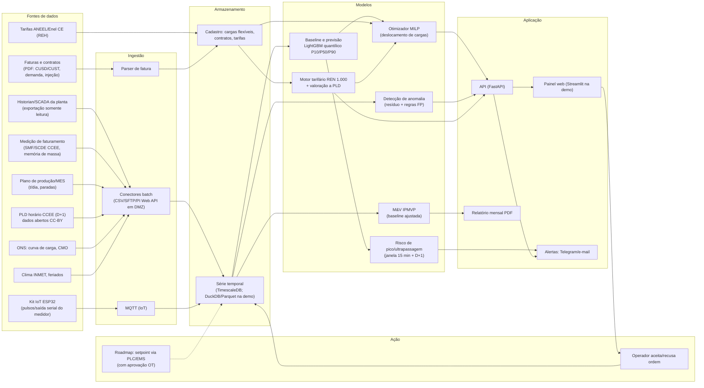

# HoraCerta: gestão de demanda e custo de energia na hora certa

**Solução 2 (Trilha da Inovação Sebrae/CE + ArcelorMittal Pecém, Desafio 8: Eficiência Energética e Fontes Renováveis)**
Pesquisa e desenho feitos em 28/10/2026.

> **Como ler este documento.** Cada afirmação vem marcada de um destes jeitos:
> - **[FATO]**: tem fonte; os links numerados estão na seção 12.
> - **[PREMISSA]**: hipótese razoável que ainda não foi confirmada. Quando envolve a planta, aparece como **"premissa a validar com a ArcelorMittal no Ideathon"**.
> - **[SUGESTÃO]**: proposta de desenho ou de negócio do time.
> - **[ESTIMATIVA]**: conta feita sobre premissas explícitas. Não é resultado medido.

---

## 0. Resumo em 6 linhas

1. O desperdício que ninguém percebe não está só no kWh a mais. Está também no **kWh consumido na hora errada**. Em 15/10/2026, o PLD (preço da energia no mercado de curto prazo) ficou em **R$ 57,31/MWh durante o dia e chegou a R$ 1.437/MWh à noite** [FATO, 1]. Na Enel CE, a indústria do subgrupo A4 na modalidade verde paga **R$ 1.543,97/MWh na ponta contra R$ 369,17/MWh fora da ponta**, sem tributos [FATO, 2].
2. A ArcelorMittal Pecém é **autossuficiente em eletricidade e vende o excedente** [FATO, 3][FATO, 4]. A termelétrica que queima os gases do processo gerou **1.367 GWh em 2024** [FATO, 5]. Para ela, todo MWh consumido no horário caro é um MWh que deixa de ser vendido no horário caro.
3. **HoraCerta** é uma plataforma de software com um kit IoT opcional. Ela **prevê** consumo, geração e risco de pico com 15 min a 48 h de antecedência, **recomenda** o deslocamento das cargas flexíveis e o ajuste dos contratos usando o preço real de cada hora (PLD horário ou tarifa por posto), e **verifica** o ganho em R$ com metodologia IPMVP.
4. Funciona em dois modos com o mesmo motor. O **Modo Autoprodutor** atende a ArcelorMittal: balanço horário de geração menos consumo, PLD horário e limites contratuais de injeção e consumo. O **Modo Grupo A** atende PMEs, fornecedores do Complexo do Pecém e escolas: demanda contratada, ponta, ultrapassagem e reativo, conforme a REN ANEEL 1.000/2021.
5. Ganho estimado (detalhado na seção 8): numa PME A4 verde com 80 kW de carga flexível, **cerca de R$ 77 mil por ano** [ESTIMATIVA]. Na ArcelorMittal, com 5 MW deslocáveis por 3 h/dia, **entre R$ 0,45 e 2,25 milhões por ano**, conforme o diferencial de PLD [ESTIMATIVA]. Os dois números dependem de premissas que precisam ser validadas.
6. O protótipo é viável **sem dados da planta**. Ele usa PLD horário real (CCEE, dados abertos), curva de carga do ONS, tarifas oficiais da Enel CE e uma planta sintética parametrizada. A validação com dados reais fica para um piloto de 90 dias com M&V.

---

## 1. Problema, por que importa na ArcelorMittal e proposta de valor

### 1.1 O problema geral
- **[FATO]** No Grupo A, a conta de energia combina vários componentes. Há energia por posto tarifário (ponta e fora de ponta), **demanda contratada** (o faturamento usa o maior valor entre a demanda medida e a contratada, art. 294 da REN 1.000), **multa de ultrapassagem** e **reativo excedente**. A demanda medida é integralizada em **intervalos de 15 minutos** [6].
- **[FATO]** A ultrapassagem é cobrada quando a demanda medida passa da contratada em **mais de 5%** no caso de consumo, ou em **mais de 1%** no caso de demanda contratada de **injeção** de gerador ou exportador. O valor é **(DAM − DAC) × 2 × tarifa de demanda** (art. 301 da REN 1.000, redação da REN 1.059/2023) [6].
- **[FATO]** O fator de potência de referência é **0,92**. O reativo excedente é apurado hora a hora: capacitivo entre 23h30 e 6h30, indutivo no restante do dia (arts. 302 e 304) [6].
- **[FATO]** Para reduzir a demanda contratada é preciso avisar com antecedência: **90 dias no A4 e 180 dias nos demais**, com no máximo uma redução a cada 12 meses (art. 155) [6]. Errar o contrato custa caro e corrigir demora.
- **[FATO]** No mercado livre, a diferença entre o que foi medido e o que foi contratado é liquidada pela CCEE ao **PLD**, por hora e por submercado [7]. O PLD horário de 2026 tem **piso de R$ 57,31/MWh, teto estrutural de R$ 785,27/MWh e teto horário de R$ 1.611,04/MWh** [8].
- **[FATO]** O dia a dia de 2026 mostra o tamanho da oscilação. Em 15/10/2026, uma queda de cerca de 3 GW na geração eólica do Nordeste levou o PLD de R$ 57,31 durante o dia para **R$ 1.437/MWh à noite**, uma variação de 2.409%. Segundo o ONS, o CMO passou de zero para mais de R$ 1.500/MWh entre 18h e 20h [1]. Em agosto de 2026, os boletins da CCEE registram o Nordeste no piso de R$ 57 fora da ponta e média diária de R$ 121/MWh [9].

**A tese é esta: com PLD horário volátil e tarifa de ponta cerca de 4,2 vezes mais cara, o *quando* pesa tanto quanto o *quanto*.** Medidores comuns mostram quanto foi consumido. Eles não dizem o que fazer amanhã às 18h nem quanto isso vale em reais.

### 1.2 Por que importa na ArcelorMittal Pecém
| O que se sabe | Status |
|---|---|
| Usina integrada (alto-forno e aciaria) com capacidade de 3 Mt/ano de placas, operando a 100% em 2023 e 2024 | [FATO, 5][FATO, 10] |
| Termelétrica de **cogeração** movida a gases siderúrgicos: gera vapor de processo e eletricidade e pode "abastecer a usina e vender o excedente" | [FATO, 4] |
| Geração de **1.367 GWh em 2024** (alta de 7%), o que dá uma média de cerca de 156 MW. Em dez/2023, média de 164,3 MW e picos de 193 MW | [FATO, 5][FATO, 11] |
| Pecém e Tubarão são "autossuficientes em energia elétrica" | [FATO, 3] |
| A produção de eletricidade depende do gás de alto-forno (BFG). O gasômetro de BFG regula a pressão de distribuição, e a planta já precisou criar um "modo de operação sem gasômetro" para não perder geração | [FATO, 4] |
| O oxigênio da usina vinha (2021) de uma planta da White Martins na ZPE do Pecém. Portanto, a grande carga de separação de ar provavelmente **não** é carga elétrica da ArcelorMittal (situação atual a validar) | [FATO, 12] |
| Como a planta se conecta à rede (Rede Básica 230 kV? CUST/MUST com o ONS ou CUSD com a Enel?), quais são os montantes de consumo e de injeção e como o excedente é vendido (PLD ou contrato bilateral) | **Premissa a validar com a ArcelorMittal no Ideathon** |
| Quais cargas internas são flexíveis (moagem de carvão para PCI com silo, bombeamento com reservatório, manuseio de matérias-primas e porto, compressores com pulmão, tratamento de escória) | **Premissa a validar com a ArcelorMittal no Ideathon** |
| Qual sistema de gestão de energia e qual historian/SCADA já existem (PI, EMS próprio), se há certificação ISO 50001 | **Premissa a validar** (não encontrei fonte pública para Pecém) |

**Três consequências diretas:**
1. **[ESTIMATIVA]** Para quem vende o excedente, cada MWh que sai das 18h–21h e vai para as 10h–13h gera um ganho igual ao diferencial de PLD entre esses horários. Se o excedente for liquidado no curto prazo, ou se o contrato for plano e as sobras forem liquidadas ao PLD, o ganho vale por hora [7]. **Premissa a validar:** a forma de venda.
2. **Risco de evento.** Quando a geração cai (indisponibilidade do gasômetro, falha de turbina ou caldeira, variação do BFG), a planta passa de exportadora a importadora. Se isso acontece à noite, com PLD perto do teto, o custo é muito alto. O contrato de demanda ou de reserva de capacidade também pode ser ultrapassado (o § 3º do art. 301 trata da reserva de capacidade) [6]. Prever o risco e ter um **plano de alívio de carga priorizado** reduz essa exposição.
3. **Limite de injeção.** Exportar acima do contratado em mais de 1% gera multa [6]. Maximizar a exportação no horário caro só vale até esse limite, e o otimizador respeita as duas restrições (consumo e injeção).

### 1.3 Proposta de valor
> **"Cada MWh na hora certa, com o ganho provado em reais."**
- **ArcelorMittal (Modo Autoprodutor):** transforma o PLD do dia seguinte (publicado na véspera) e a previsão de geração e consumo em **ordens concretas de deslocamento de carga**, com o valor em R$ de cada ordem. Também dá alerta antecipado de risco de importação ou de ultrapassagem e um **relatório mensal com M&V** que separa ganho real de coincidência.
- **PMEs, fornecedores e escolas (Modo Grupo A):** **diagnóstico grátis a partir da fatura** (simulador da REN 1.000), alerta em tempo real antes de estourar a demanda no intervalo de 15 minutos, recomendação de demanda contratada ótima e de modalidade (verde ou azul) e detecção de fator de potência baixo.
- O mesmo motor de regras e o mesmo pipeline atendem os dois modos. Só muda o "preço de cada hora" (PLD ou tarifa) e o conjunto de restrições contratuais.

---

## 2. Cliente e segmentos

| Segmento | Quem decide e quem usa | Dor | Por que pagaria | Tamanho |
|---|---|---|---|---|
| **1. ArcelorMittal Pecém (âncora e piloto)** | Gerência de Utilidades/Energia (decisor técnico), operadores da central (usuários), Financeiro e ESG (relatório) | Valor do excedente perdido em horas caras; risco de importação em eventos; prova de resultado para metas internas | O ganho é proporcional ao MWh deslocado vezes o diferencial de PLD, sem CAPEX de equipamento (camada de software sobre dados existentes) | 1 planta, que gera cerca de 156 MW médios [5] |
| **2. Outros eletrointensivos e autoprodutores** (siderurgia, gases industriais, cimento, mineração) | Gerente de energia | A mesma dor do segmento 1 | Igual | Exemplo: ArcelorMittal Tubarão (ES) também é autossuficiente [FATO, 3]. Usinas integradas aproveitam gases de processo para gerar energia [FATO, 4]. Número de autoprodutores no país: a levantar (CCEE/ANEEL) |
| **3. PMEs do Grupo A e fornecedores do CIPP** | Dono, gerente industrial | Ponta cara, multa de ultrapassagem, contrato mal dimensionado, reativo | O ganho cobre a mensalidade nos primeiros meses (seção 8) | Cerca de 202 mil UCs do Grupo A no Brasil (jan/2023) [FATO, 14]. No Pecém, a AECIPP passou de 60 empresas associadas (mai/2023) [FATO, 15] e a CIPP S.A. contava 62 empresas na área industrial (jun/2023) [FATO, 33] |
| **4. Escolas e campi (IFCE, por exemplo)** | Diretoria administrativa | Fatura do Grupo A, ar-condicionado | Orçamento público pressionado | Campo para o piloto acadêmico [SUGESTÃO] |

**Por que a ArcelorMittal pagaria** [PREMISSA a validar]: ela já opera geração própria e com certeza tem equipe de energia. O que a ferramenta acrescenta é (a) uma **camada de decisão econômica horária** que conecta produção, utilidades e mercado, (b) **verificação independente do ganho** e (c) um **canal para a cadeia de fornecedores** (Modo Grupo A), que conversa com o papel do Sebrae no edital. Se ela já tiver ferramenta equivalente, o pitch muda para o segmento 3, com a ArcelorMittal como patrocinadora do programa para fornecedores.

---

## 3. Arquitetura ponta a ponta

### 3.1 Diagrama (mermaid)



### 3.2 Versão ASCII (para slide)

```
 FONTES                     INGESTÃO        ARMAZENAR        INTELIGÊNCIA                   ENTREGA            AÇÃO
 Historian/SCADA (RO) ─┐                                   ┌ Previsão P10/P50/P90 ┐
 Medição SMF/memória ──┤──► Batch/SFTP ──► Timescale ──────┤ Risco de pico 15 min  ├──► API ──► Painel   ──► Operador aceita
 Faturas/contratos ────┤    Parser PDF     (Parquet demo)  │ Anomalia             │          Telegram      ou recusa (motivo)
 Produção/MES ─────────┤    MQTT (IoT)     Cadastro cargas │ Otimizador MILP      │          Relatório      │
 PLD D+1 CCEE ─────────┤                   e contratos     │ Motor REN 1.000 + PLD│          mensal         ▼
 ONS/INMET ────────────┤                                   └ M&V IPMVP ◄──────────┴──────────────────── Medição pós-ação
 ESP32 no medidor ─────┘
```

### 3.3 Princípios de arquitetura
- **Somente leitura no MVP.** Nada escreve na rede de automação (OT). A ação é humana: o operador aceita a ordem. A automação em malha fechada fica para o roadmap, com aprovação de segurança OT [SUGESTÃO].
- **Fora do perímetro OT.** Os dados saem do historian por exportação agendada para uma DMZ (modelo de zonas e conduítes da IEC 62443). Também há opção de instalação on-premises na rede corporativa da planta [SUGESTÃO].
- **Preço como dado de primeira classe.** Cada série de kW tem ao lado uma série de R$/MWh: PLD horário, tarifa por posto ou valor marginal da demanda. Toda recomendação sai em R$.

---

## 4. Pipeline de processos (do acesso ao relatório)

| # | Etapa | O que acontece | Saída | Ferramenta |
|---|---|---|---|---|
| 1 | **Acesso a dados** | Termo de confidencialidade (NDA), exportação somente leitura de 12 meses de histórico horário ou de 15 min (geração, consumo por subestação, medição de faturamento), contratos e faturas. Nas PMEs: fatura PDF, memória de massa pedida à distribuidora (serviço previsto no art. 623, VIII, da REN 1.000) ou kit ESP32 nos pulsos do medidor (art. 623, XI) [6] | Data lake com dicionário | Conectores, parser |
| 2 | **Limpeza e baseline** | Tratamento de lacunas e outliers. Modelo de linha de base: consumo/geração = f(produção, calendário, clima, turno). Critério de aceitação no estilo ASHRAE Guideline 14: CV(RMSE) ≤ 15% mensal e ≤ 30% horário [FATO, 16] | Baseline validada | LightGBM, statsmodels |
| 3 | **Previsão** | Previsão de 15 min a 48 h de consumo e geração, com quantis P10/P50/P90. Para o dia seguinte, o **PLD já é conhecido**, porque a CCEE calcula na véspera o preço de cada hora [FATO, 17]. Para D+2 a D+7: cenário a partir do histórico e do CMO | Curvas previstas com banda de incerteza | LightGBM quantílico |
| 4 | **Detecção de risco** | (a) **Intradiário:** projeção da demanda integralizada no intervalo de 15 min em curso, com alerta quando a projeção passa de 95% do limite (contratado + tolerância). (b) **D+1:** probabilidade de pico acima do contrato (P90). (c) **Eventos:** queda de geração prevista ou detectada leva a alerta de importação com valor em R$ | Alertas priorizados | Regras + modelo |
| 5 | **Recomendação** | Otimizador MILP minimiza o custo de energia, demanda e multas sujeito às restrições de cada carga flexível (potência, duração, janela, estoque ou inércia, rampa) e aos limites contratuais (consumo +5%, injeção +1%) | Ordens: "Mover carga X das 18h para as 11h: +R$ Y" | PuLP/CBC ou OR-Tools |
| 6 | **Ação** | O operador aceita, recusa ou adia a ordem e registra o motivo, o que gera aprendizado sobre restrições ocultas. Roadmap: envio de setpoint ao EMS ou PLC | Log de decisões | Painel, Telegram |
| 7 | **Verificação** | M&V: compara o real com a baseline ajustada e valora hora a hora (seção 8). Nos dias de controle do piloto, sem recomendação, mede-se o efeito causal | R$ evitados com intervalo de confiança | Módulo M&V |
| 8 | **Relatório mensal** | PDF e painel: R$ evitados (ponta, demanda, multas, PLD), kWh deslocados, redução de pico, taxa de aceitação das ordens, anomalias abertas e fechadas, recomendação de contrato para o próximo ciclo | Relatório para Financeiro e ESG | Jinja2 + WeasyPrint |

---

## 5. Stack e o que é gratuito na demo

| Camada | Escolha | Por que | Custo na demo |
|---|---|---|---|
| Dados | Python, pandas, **DuckDB + Parquet** (demo); **TimescaleDB** (produção) | Zero infraestrutura no hackathon; Timescale é Postgres com séries temporais | Grátis |
| Fontes públicas | **PLD horário CCEE** (CSV anual 2021–2026, CC-BY-4.0) [17]; **ONS Curva de Carga Horária** (CSV/Parquet 2000–2026, CC-BY) [18]; **tarifas REH 3.574/2026** [2] | Dados reais e oficiais | Grátis |
| ML | **LightGBM** (regressão quantílica), scikit-learn (IsolationForest), statsmodels (STL) | Rápido, roda em notebook comum, explicável (importância de variáveis) | Grátis |
| Otimização | **PuLP + CBC** ou **Google OR-Tools** | MILP de código aberto, adequado para dezenas de cargas × 96 intervalos | Grátis |
| Backend | **FastAPI** | Simples, tipado, documentação automática | Grátis |
| Frontend | **Streamlit** (demo) e **Figma** (fluxo mobile) → React no roadmap | Painel funcional em horas | Grátis |
| Alertas | **Bot do Telegram** + e-mail | Push no celular do operador sem desenvolver app | Grátis |
| IoT (opcional) | **ESP32** com contador de pulsos em hardware [19] e optoacoplador na saída de pulsos do medidor, ou leitura da saída serial do usuário (ABNT NBR 14522) [20]; MQTT (Mosquitto) | Demanda em tempo real no intervalo de 15 min; alternativa barata ao controlador de demanda | Cerca de R$ 80–150 em peças [ESTIMATIVA de varejo; cotar] |
| Hospedagem | Streamlit Community Cloud, Render ou Railway no plano gratuito, ou notebook local | Demo pública | Grátis |
| GenAI (opcional) | LLM para explicar as ordens em linguagem natural e extrair dados de faturas PDF | Ajuda, mas **não é o núcleo**. O núcleo é previsão + otimização + M&V | Opcional |

---

## 6. Telas do painel

| # | Tela | O que mostra | Quem usa |
|---|---|---|---|
| 1 | **Hoje e amanhã** | Gráfico de 48 h com geração prevista, consumo previsto, saldo (exportação ou importação) e banda P10–P90. Sobreposto: PLD horário de D+1 (ou postos tarifários no Modo Grupo A). Semáforo de risco por hora. Cartão "valor em jogo amanhã: R$ X" | Operador da central de utilidades |
| 2 | **Ordens de deslocamento** | Lista de ordens com horário original → sugerido, MW, duração, ganho estimado em R$, restrição verificada (estoque do silo, por exemplo) e botões Aceitar / Recusar (motivo) / Adiar | Operador, supervisor de turno |
| 3 | **Radar de 15 minutos** | Demanda integralizada em tempo real, projeção até o fim do intervalo, limite (contrato + tolerância) e contagem regressiva. Lista de alívio priorizada ("desligue C, depois D") | Operador; na PME, o dono pelo celular |
| 4 | **Cargas flexíveis** | Cadastro e edição das cargas: potência, duração mínima, janela permitida, estoque ou inércia, prioridade no alívio, custo de deslocar. Histórico de aceitação por carga | Engenheiro de energia |
| 5 | **Contrato e fatura** | Simulador REN 1.000 com fatura real × simulada. Curva "custo anual × demanda contratada" com o ponto ótimo, comparação verde × azul, reativo excedente por hora. No Modo Autoprodutor: montantes de consumo e de injeção e exposição ao PLD | Engenheiro de energia, gestor de contratos |
| 6 | **Anomalias** | Medidores com consumo fora do padrão (carga de base noturna subindo, FP < 0,92, desvio contra a baseline), com R$ perdido por dia e status (aberta, em análise, resolvida) | Engenharia de manutenção |
| 7 | **Resultados (M&V)** | R$ evitados no mês e acumulados (com intervalo de confiança), kWh deslocados, pico reduzido em kW, multas evitadas, taxa de aceitação, comparação dias com e sem ação. Botão "Relatório mensal PDF" | Gestor financeiro, ESG, gerência |
| 8 | **Alerta no Telegram** | "⚠ 17h42: projeção de 318 kW para o intervalo das 17h45 (limite 315). Desligue o compressor 2 (−25 kW). Multa evitada: R$ 1.874" | Operador, dono da PME |

---

## 7. Plano de execução

### 7.1 Ideathon (2 dias, presencial)
| Bloco | Entregável |
|---|---|
| Dia 1 de manhã | Problema refinado com dados (seção 1). **Entrevista com mentores da ArcelorMittal** usando a lista de premissas (7.4) |
| Dia 1 à tarde | Mapa de empatia e jornada do operador e do engenheiro de energia; definição dos dois modos |
| Dia 2 de manhã | Business Model Canvas (seção 9); **simulador de fatura REN 1.000 em planilha**, com tarifas reais da Enel CE, que já demonstra o caso PME |
| Dia 2 à tarde | Protótipo de papel ou Figma de baixa fidelidade das telas 1, 2 e 7; pitch de 5 min |

### 7.2 Hackathon online (09 a 12/11/2026, 4 noites)
| Noite | Dados/ML | Backend/otimização | Design/front | Negócios |
|---|---|---|---|---|
| **N1 (09/11)** | Baixar o PLD horário de 2025–2026 (CCEE) e a curva do ONS; gerar a **planta sintética** e a **PME sintética** (7.3) | Motor tarifário REN 1.000 em Python (verde, azul, ultrapassagem, reativo), com testes contra a planilha | Figma de alta fidelidade das telas 1, 2, 3 e 7 | Validar preço com 3 a 5 PMEs ou fornecedores (ligações) |
| **N2 (10/11)** | Previsão LightGBM P10/P50/P90 + métrica (pinball loss contra o modelo ingênuo sazonal) | Projeção de 15 min e alertas (bot do Telegram) | Streamlit: telas 1 e 3 | Canvas v2, cálculo do ponto de equilíbrio |
| **N3 (11/11)** | Anomalias (resíduo + regras de FP) | **Otimizador MILP**, ordens com R$ | Streamlit: telas 2 e 5. ESP32 lendo pulsos simulados, se houver hardware | Exemplo numérico final (seção 8) |
| **N4 (12/11)** | Módulo de M&V e relatório PDF | Deploy, congelar a demo, **gravar um vídeo de backup** | Polimento | Ensaiar o pitch três vezes cronometrado |

### 7.3 Como prototipar sem dados da planta
- **Preço real:** PLD horário do Nordeste da CCEE [17]. Observação: o portal bloqueou download automatizado a partir de servidor durante esta pesquisa (HTTP 403), então o arquivo deve ser baixado pelo navegador. Para a PME, usar as tarifas da REH 3.574/2026 [2].
- **Formato real de carga do sistema:** curva de carga horária do ONS [18], para mostrar o pico das 18h–20h e calibrar a sazonalidade.
- **Planta sintética (Modo Autoprodutor) [PREMISSA, rotular como sintético na demo]:** geração média de 156 MW (coerente com os 1.367 GWh de 2024 [5]) com ruído ligado à disponibilidade de BFG e 1 a 2 eventos de queda por mês. Consumo de base com 3 a 5 cargas flexíveis parametrizadas (por exemplo, "moagem com silo de 5 MW, 3 h/dia, silo de 8 h"). Todos os parâmetros ficam editáveis na tela 4, para que a ArcelorMittal possa trocar pelos valores reais na hora.
- **PME sintética:** curva de 15 min de uma fábrica de 300 kW com turnos, compressor, câmara fria e bomba. Validar o formato com uma fatura real de uma PME ou do próprio campus do IFCE, se a direção ceder.
- **Script para medir o diferencial real de PLD** (rodar no Ideathon para trocar a premissa por um número):
```python
import pandas as pd
df = pd.read_csv("pld_horario_2026.csv", sep=";", decimal=",")   # conferir separadores no arquivo
ne = df[df["SUBMERCADO"].str.upper().str.startswith("NORDESTE")]
ne["HORA"] = ne["HORA"].astype(int)
noite = ne[ne.HORA.between(18, 20)].groupby("DIA")["PLD_HORA"].mean()   # nomes de colunas: conferir no CSV
sol   = ne[ne.HORA.between(10, 12)].groupby("DIA")["PLD_HORA"].mean()
spread = (noite - sol).describe(percentiles=[.25, .5, .75])
print(spread)   # média e quartis do diferencial noite − dia em R$/MWh
```

### 7.4 Perguntas para a ArcelorMittal no Ideathon (transformam premissas em fatos)
1. Ponto de conexão e tipo de contrato (Rede Básica com CUST/MUST ou distribuição com CUSD)? Quais são os montantes de consumo, de injeção e de reserva de capacidade?
2. Como o excedente é vendido: contrato bilateral, leilão ou exposição ao PLD? Quem faz a gestão na CCEE?
3. Com que frequência a geração cai a ponto de importar energia? Isso já gerou multa ou custo elevado?
4. Quais cargas elétricas aceitam mudar de horário sem afetar a produção (silos, reservatórios, pátio, porto)? Quantos MW e por quantas horas?
5. Que sistemas existem (historian, EMS)? É possível exportar 12 meses de dados horários anonimizados para um piloto?
6. Existe meta interna de custo de energia, ISO 50001 ou programa de fornecedores em que o Modo PME se encaixe?

### 7.5 Papéis do time (3 a 5 pessoas)
| Papel | Responsabilidades | Com 3 pessoas |
|---|---|---|
| **Negócios e pitch** | Canvas, preço, entrevistas, exemplo numérico, apresentação | Acumula Design |
| **Design** | Figma, telas, roteiro da demo | Com Negócios |
| **Dados/ML** | Dados públicos, sintéticos, previsão, anomalia, M&V | Acumula Otimização |
| **Backend/otimização** | Motor REN 1.000, MILP, API, alertas | Com Dados/ML ou Front |
| **IoT/front** (opcional) | ESP32, Streamlit | Com Backend |

### 7.6 Roadmap pós-hackathon [SUGESTÃO]
- **0 a 3 meses:** piloto de 90 dias na ArcelorMittal (somente leitura, ordens manuais, M&V com dias de controle) e 3 PMEs com o kit ESP32.
- **3 a 9 meses:** integração com historian/EMS; ordens automáticas para cargas pré-aprovadas; parser de faturas da Enel CE; previsão de PLD para D+2 a D+7.
- **9 a 18 meses:** despacho do gasômetro e da geração orientado a preço (hipótese técnica a avaliar com os engenheiros da termelétrica: o gasômetro de BFG como pequeno "armazenamento" para deslocar minutos de geração para horas caras); expansão para outros autoprodutores e comercializadoras (white label).

### 7.7 Riscos e mitigação
| Risco | Probabilidade/impacto | Mitigação |
|---|---|---|
| **Sem acesso a dados reais** durante o hackathon | Alta/médio | Planta e PME sintéticas com parâmetros editáveis; preços e tarifas reais; deixar claro na demo que os dados são sintéticos |
| **A ArcelorMittal já tem EMS equivalente** | Média/alto | Posicionar como camada de decisão econômica + M&V independente sobre o que já existe; alternativa: Modo Grupo A para fornecedores patrocinado pela ArcelorMittal |
| **Pouca carga realmente flexível** | Média/alto | O diagnóstico mede isso antes de vender; o ganho em contrato, ultrapassagem e eventos não depende de flexibilidade |
| **Segurança de dados industriais e OT** | Baixa (MVP)/alto | Somente leitura, DMZ, sem escrita em PLC, NDA, criptografia em trânsito e em repouso, opção on-premises, IEC 62443 como referência |
| **LGPD** | Baixa | Dados de medição de empresas, em geral, não são dados pessoais. Os dados pessoais são login e decisões dos operadores: coleta mínima, base legal de execução de contrato, política de retenção. Residências ficam fora do escopo inicial |
| **Previsão errada leva a ordem ruim** | Média/médio | Usar P90 para risco, deixar a decisão com o humano, limitar ordens a cargas pré-aprovadas, monitorar acerto e pinball loss |
| **Mudança regulatória** (tarifa, PLD, regras de Rede Básica) | Média/baixo | Motor tarifário parametrizável por arquivo; a ANEEL discute regras de acesso de consumidores à Rede Básica (CP 23/2024) [21] |
| **Superestimar o ganho no pitch** | Média/alto (credibilidade) | Toda conta rotulada como estimativa, cenários conservador/base/otimista, pedir os dados para fechar o número |

---

## 8. Como medir o ganho na ArcelorMittal

### 8.1 Metodologia: IPMVP
- **[FATO]** O IPMVP (EVO) define quatro opções: A (isolamento com medição do parâmetro-chave), B (isolamento com medição de todos os parâmetros), C (instalação inteira) e D (simulação calibrada). A **energia evitada = baseline ajustada − energia do período de relato ± ajustes não rotineiros** [22]. A ANEEL usa diretrizes do IPMVP nos projetos do PEE/PROPEE [23].
- **Opção escolhida:**
  - **ArcelorMittal: Opção B** nas cargas flexíveis (submedição já existente ou medidor dedicado) para medir o MWh deslocado, mais a medição de faturamento para conferir o saldo exportado. Os ajustes rotineiros consideram produção (t/dia de gusa/placa), calendário e paradas.
  - **PME: Opção C** (medidor de faturamento) e regras da fatura.
- **Diferença importante:** deslocar carga **não reduz kWh, reduz R$**. Por isso o M&V é feito **em reais, hora a hora**: cada MWh da baseline ajustada e do real é valorado pelo preço daquela hora.
- **Prova causal no piloto [SUGESTÃO]:** **dias de controle sorteados** (por exemplo, 1 em cada 4 dias sem recomendações). O ganho é a diferença entre dias tratados e dias de controle, com a mesma baseline. Isso elimina o argumento de que "o PLD caiu sozinho".
- **Qualidade do modelo de baseline:** CV(RMSE) ≤ 15% mensal e ≤ 30% horário, com viés (NMBE) controlado, segundo o ASHRAE Guideline 14 [16]. As fontes divergem nos limites de NMBE; adotar ±5% mensal e ±10% horário e citar a edição usada.

### 8.2 KPIs e fórmulas
| KPI | Fórmula |
|---|---|
| **R$ evitados por arbitragem de preço (autoprodutor)** | Σ_h (C_base,h − C_real,h) × PLD_h, onde C é o consumo líquido (consumo − geração). Equivale a MWh deslocados × (PLD_origem − PLD_destino) |
| **R$ evitados em ponta (Grupo A verde)** | E_deslocada,ponta × [(TUSD_P + TE_P) − (TUSD_FP + TE_FP)] |
| **R$ evitados em ultrapassagem** | Σ_meses [(DAM_base − DAC) × 2 × VRDULT + (DAM_base − max(DAM_real, DAC)) × T_demanda], aplicado só quando DAM_base > 1,05 × DAC (consumo) ou 1,01 × DAC (injeção) [6] |
| **R$ evitados em contrato** | (DAC_atual − DAC_ótima) × T_demanda × 12, descontada a ultrapassagem esperada com DAC_ótima |
| **R$ de reativo detectado** | ERE = Σ_T EEAM_T × (0,92/f_T − 1) × VRERE, com VRERE = TE B1 de bandeira verde [6]; na Enel CE, R$ 260,99/MWh [2] |
| **kWh deslocados** | Σ das ordens aceitas e confirmadas pela medição |
| **Redução de pico (kW)** | max(D_base) − max(D_real) no intervalo de 15 min |
| **Taxa de aceitação** | ordens aceitas / ordens emitidas |
| **kgCO2e evitados** | kWh **reduzidos** (não deslocados) × fator médio do SIN. MCTI: **0,0385 tCO2/MWh em 2023** (anual) [FATO, 24]; 2025 mensal entre 0,0215 e 0,0289 tCO2/MWh, com metodologia ampliada [FATO, 25] |
| **Payback (meses)** | Custo da solução / economia mensal verificada |
| **ROI (ano 1)** | (Economia anual − custo anual) / custo anual |

**Nota honesta sobre CO2:** com a rede brasileira limpa (38,5 kg/MWh em 2023), **deslocar carga quase não muda as emissões pelo fator médio**. Pode haver ganho marginal, porque o CMO acima de R$ 1.500/MWh entre 18h e 20h indica despacho térmico [1], mas não existe fator marginal horário oficial. **Não vamos prometer CO2 no pitch**; o argumento principal é custo e confiabilidade.

### 8.3 Exemplo numérico A: PME do Grupo A (A4 verde, Enel CE) [ESTIMATIVA]
**Tarifas reais** da REH ANEEL 3.574/2026, vigentes de 22/04/2026 a 21/04/2027, **sem tributos** (ICMS, PIS/COFINS e bandeira aumentam os valores) [FATO, 2]:

| A4 Verde | TUSD | TE | Total |
|---|---|---|---|
| Energia na ponta (R$/MWh) | 1.134,77 | 409,20 | **1.543,97** |
| Energia fora de ponta (R$/MWh) | 123,86 | 245,31 | **369,17** |
| Demanda (R$/kW, posto único) | 20,82 | — | **20,82** |

Observação: existe notícia de recálculo do reajuste da Enel CE com vigência a partir de 26/08/2026 [26]. **Conferir a tabela vigente antes do pitch.**

**Premissas hipotéticas da PME:** demanda contratada de 300 kW; 80 kW de carga flexível (câmara fria com inércia, bomba de reservatório, compressor com pulmão, recarga de empilhadeiras) funcionando hoje 3 h na ponta (horário de ponta mais citado na Enel CE: 17h30–20h30 em dias úteis; confirmar na fatura); 21 dias úteis por mês; 2 meses por ano com pico medido de 345 kW (acima do limite de 315 kW).

| Item | Conta | R$/ano |
|---|---|---|
| Deslocar a ponta | 80 kW × 3 h × 21 d = 5,04 MWh/mês × (1.543,97 − 369,17) = R$ 5.920,99/mês | **71.051,90** |
| Ultrapassagem evitada (pico controlado em ≤ 300 kW) | Multa (345 − 300) × 2 × 20,82 = R$ 1.873,80 + demanda excedente 45 × 20,82 = R$ 936,90 → R$ 2.810,70 × 2 meses | **5.621,40** |
| **Total direto** | | **≈ 76.673** |
| Achado à parte: reativo (FP 0,85 em 200 h/mês a 250 kW) | 50 MWh × (0,92/0,85 − 1) × 260,99 = R$ 1.074,67/mês. **A solução exige banco de capacitores (CAPEX fora da conta)** | 12.896 (potencial) |
| Custo HoraCerta Pro | R$ 590/mês × 12 + kit IoT instalado R$ 1.500 [SUGESTÃO de preço] | 8.580 |
| **Payback** | 8.580 / (76.673/12) | **≈ 1,3 mês** |
| **ROI no ano 1** | (76.673 − 8.580) / 8.580 | **≈ 7,9×** |

**Sensibilidade (só o deslocamento de ponta):** 20 kW → R$ 17,8 mil/ano · 50 kW → R$ 44,4 mil/ano · 80 kW → R$ 71,1 mil/ano.
**Ressalva:** muitas PMEs no A4 verde já desligam cargas na ponta ou usam gerador a diesel. Se não houver carga flexível na ponta, o valor vem do contrato, da ultrapassagem e do reativo. O diagnóstico grátis mostra isso antes da venda.

### 8.4 Exemplo numérico B: ArcelorMittal Pecém (Modo Autoprodutor) [ESTIMATIVA ILUSTRATIVA]
**Premissas, todas a validar com a ArcelorMittal no Ideathon:**
- Existem **5 MW de cargas flexíveis**, por exemplo moagem com silo, bombeamento com reservatório e manuseio de pátio, deslocáveis **3 h por dia** da janela 18h–21h para 10h–13h, em **25 dias por mês**.
- O saldo horário da planta (excedente ou déficit) é valorado ao **PLD horário do Nordeste**, seja por venda no curto prazo, seja por liquidação das diferenças de um contrato plano [7].
- O deslocamento não viola o limite de injeção (+1%) nem a produção.
- **Diferencial médio de PLD (noite − meio-dia), em cenários:** conservador R$ 100/MWh, base R$ 250/MWh, otimista R$ 500/MWh. Referências reais: um único dia (15/10/2026) teve diferencial de cerca de R$ 1.380/MWh [1]; em dias de agosto, o PLD ficou no piso de R$ 57 fora da ponta, com média diária de R$ 121 [9]. **Substituir pelo valor calculado com o script da seção 7.3.**

| | Conservador | Base | Otimista |
|---|---|---|---|
| MWh deslocados por mês (5 MW × 3 h × 25 d) | 375 | 375 | 375 |
| MWh por ano | 4.500 | 4.500 | 4.500 |
| % da geração anual de 2024 (1.367 GWh) | 0,33% | 0,33% | 0,33% |
| **Ganho anual** (4.500 × diferencial) | **R$ 450 mil** | **R$ 1,125 milhão** | **R$ 2,25 milhões** |
| Custo HoraCerta (licença R$ 20 mil/mês) [SUGESTÃO] | R$ 240 mil | R$ 240 mil | R$ 240 mil |
| **ROI no ano 1** | 0,9× | 3,7× | 8,4× |
| **Payback** | ≈ 6,4 meses | ≈ 2,6 meses | ≈ 1,3 mês |
| Alternativa: shared savings de 25% | R$ 112,5 mil | R$ 281 mil | R$ 562,5 mil |

**Exposição a eventos (ordem de grandeza, fora do total):** uma queda de 50 MW por 2 h numa noite com PLD de R$ 1.000/MWh custa cerca de **R$ 100 mil por evento** se o déficit for liquidado ao PLD [ESTIMATIVA; a regra contratual precisa ser validada]. O alerta antecipado e a lista de alívio de carga atacam esse risco. O valor só entra no relatório depois de medido.

**Mensagem para a banca:** mudar **0,33% da energia de horário** paga a ferramenta várias vezes no cenário base. O número exato sai em 90 dias de piloto com M&V e dias de controle.

---

## 9. Modelo de negócio (Canvas resumido)

| Bloco | Conteúdo |
|---|---|
| **Segmentos** | (1) ArcelorMittal Pecém como âncora; (2) autoprodutores e eletrointensivos; (3) PMEs do Grupo A e fornecedores do CIPP; (4) escolas e campi |
| **Proposta de valor** | Cada MWh na hora certa, com ganho provado em R$ (seção 1.3) |
| **Canais** | Piloto via Trilha da Inovação; AECIPP e programa de fornecedores da ArcelorMittal; Sebrae (possível enquadramento no Sebraetec, a verificar); comercializadoras e ESCOs (white label); diagnóstico grátis a partir da fatura como funil |
| **Relacionamento** | Onboarding assistido, relatório mensal, revisão trimestral de contrato |
| **Receita** [SUGESTÃO] | **PME:** Diagnóstico grátis (fatura → simulador); *Essencial* R$ 290/mês (fatura, contrato, alertas a partir da memória de massa); *Pro* R$ 590/mês (IoT em tempo real, otimização, M&V) + kit R$ 1.500. **Enterprise/autoprodutor:** piloto pago de 90 dias (R$ 60–90 mil) + licença R$ 15–25 mil/mês **ou** shared savings de 20–30% do ganho verificado |
| **Recursos-chave** | Motor tarifário REN 1.000 + valoração a PLD, modelos de previsão, otimizador, módulo M&V, kit IoT |
| **Atividades-chave** | Integração de dados, ciência de dados, suporte ao operador, atualização regulatória |
| **Parcerias** | ArcelorMittal (dados e piloto), IFCE (pesquisa, campus como laboratório), Sebrae, comercializadoras, integradores de automação |
| **Custos** [ESTIMATIVA] | Fixo inicial de cerca de R$ 17 mil/mês: pró-labore de 3 sócios a R$ 4 mil, nuvem e ferramentas R$ 1,5 mil, contabilidade e jurídico R$ 1,5 mil, comercial e deslocamento R$ 2 mil. Variável: kit IoT, suporte, cerca de 15% da receita |

**Ponto de equilíbrio básico [ESTIMATIVA]:** com margem de contribuição de cerca de 85%:
- Só PMEs no plano Pro: 17.000 / (590 × 0,85) ≈ **34 clientes**.
- **1 contrato enterprise de R$ 20 mil/mês** (cerca de R$ 17 mil de margem) cobre o custo fixo sozinho.
- Plano realista: âncora (ArcelorMittal ou outro autoprodutor) + 10 a 20 PMEs no primeiro ano.

---

## 10. Diferencial

| Comparação | O que fazem | O que a HoraCerta faz de diferente |
|---|---|---|
| **WeVoltz** (1º lugar em 2025) e **Enerlize** (2º lugar em 2025) | Monitoramento inteligente de consumo e localização de falha (kWh), sem detalhe público de implementação [27] | **Preço por hora** (PLD D+1 e tarifa) em vez de só kWh; **prescreve** a ação (MILP) e diz quanto vale; **Modo Autoprodutor**, feito para uma planta que gera e vende energia; **M&V IPMVP** com dias de controle |
| **Predicta** (COPPE/UFRJ 2026) | Prevê picos e sugere tarifas dinâmicas, do ponto de vista da rede e da distribuidora [27] | Lado do consumidor e do autoprodutor: o preço horário vira ordem operacional e o ganho é verificado |
| **Siemens SIMATIC Energy Suite / Energy Manager PRO** | Gestão de carga via PLC para respeitar limites de demanda, KPIs de energia [28] | Não concorre no chão de fábrica; foca em **economia de mercado brasileiro** (PLD horário, REN 1.000, injeção a +1%) e M&V. Pode até consumir dados do Siemens. Preço acessível a PMEs |
| **Way2 PowerHub** (Brasil) | Plataforma de dados de medição, estudos de demanda e reativo em vários sites [29] | Previsão e otimização prescritiva com ordens ao operador; modo autoprodutor; shared savings |
| **GreenAnt** (agora da TYR Energia, desde fev/2026) e **CUBi Energia** | Medição IoT e analytics de consumo para empresas [30][31] | Foco em **quando** consumir (preço e contrato), e não em desagregação de kWh; produto voltado a eletrointensivo e autoprodutor |
| Demais vencedores de hackathons (NexoWatt, reefers, FSU…) | Caso específico + IoT + painel | Mantém a lição de transformar kWh em R$ e escolher um caso concreto, e acrescenta a **prova de ganho** |

**Em uma frase:** os outros mostram onde a energia é gasta; a HoraCerta diz **em que hora gastar, quanto isso vale e prova o ganho no fim do mês**.

**Ressalva honesta:** existem consultorias e plataformas no Brasil que já fazem análise de fatura e alerta de demanda. O espaço da HoraCerta está na **combinação** de modo autoprodutor com PLD horário, otimização prescritiva e M&V com shared savings, a um preço acessível a PMEs. Antes de afirmar "ninguém faz isso", é preciso validar com a ArcelorMittal o que ela já usa.

---

## 11. Mapeamento para os 5 critérios da banca

| Critério | Como a HoraCerta responde | Evidência no pitch |
|---|---|---|
| **(a) Problemática** | Desperdício escondido no **horário**: PLD de R$ 57 a R$ 1.437 no mesmo dia; ponta 4,2× mais cara; autoprodutor que perde valor de excedente e corre risco em eventos | Fatos com fonte (CCEE/Agência Infra, REH 3.574, REN 1.000, geração de Pecém) |
| **(b) Proposta de valor** | Prever → recomendar → verificar, com ganho em R$ por ordem e relatório M&V | Demo: ordem "+R$ X", tela de resultados |
| **(c) Segmento de clientes** | ArcelorMittal como âncora (Modo Autoprodutor); escala para eletrointensivos e cerca de 202 mil UCs do Grupo A; fornecedores do CIPP | Tabela de segmentos, mais de 60 empresas associadas à AECIPP |
| **(d) Monetização** | SaaS por tiers para PME; licença ou shared savings para enterprise; ponto de equilíbrio em 34 PMEs ou 1 âncora | Canvas e ponto de equilíbrio |
| **(e) Viabilidade** | Stack gratuita, dados públicos reais, protótipo em 4 noites, somente leitura (sem risco OT), kit IoT barato; ROI de 3,7× no cenário base da ArcelorMittal e cerca de 7,9× na PME [ESTIMATIVAS]; plano de piloto de 90 dias | Demo funcionando, cronograma, matriz de riscos |

---

## 12. Fontes

1. Agência Infra, 16/10/2026: PLD de R$ 57,31 (dia) a R$ 1.437/MWh (noite), variação de 2.409%, teto 2026 de R$ 1.611, CMO > R$ 1.500 entre 18h e 20h. https://agenciainfra.com/blog/?p=48954
2. ANEEL, Resolução Homologatória 3.574/2026, reajuste da Enel CE (Tabela 1, Grupo A; Tabela 2, Grupo B), vigência de 22/04/2026 a 21/04/2027. https://www.enel.com.br/content/dam/enel-br/Tarifas/2026/04-abril/Resolu%C3%A7%C3%A3o%20Homologat%C3%B3ria%203574%20(002)%20-%20Reajuste%20Tarif%C3%A1rio%20CE.pdf
3. Diário do Nordeste, 22/08/2024: ArcelorMittal e Casa dos Ventos; Pecém e Tubarão autossuficientes em eletricidade. https://diariodonordeste.verdesmares.com.br/opiniao/colunistas/egidio-serpa/arcelormittal-e-casa-dos-ventos-tornam-se-parceiros-em-energia-1.3549088
4. ABM Proceedings (Seminário de Energia, Utilidades e Transição Energética, 2024): "Operação dos sistemas de combustível com o gasômetro de BFG fora de operação na ArcelorMittal Pecém". https://abmproceedings.com.br/en/article/operao-dos-sistemas-de-combustvel-com-o-gasmetro-de-bfg-fora-de-operao-na-arcelormittal-pecm
5. O Povo, 11/01/2025: 3 Mt de placas e geração de 1.367 GWh (+7%) em 2024. https://mais.opovo.com.br/jornal/economia/2025/01/11/arcelormittal-pecem-produz-3-mi-de-toneladas-de-placas-de-aco-e-amplia-exportacoes.html
6. ANEEL, REN 1.000/2021 (texto compilado): art. 2º XIII (15 min), art. 155, art. 294, art. 301 (ultrapassagem, redação da REN 1.059/2023), arts. 302 e 304 (FP 0,92, ERE), art. 623 (memória de massa, pulsos). https://www.cemig.com.br/wp-content/uploads/2025/08/ren20211000.pdf
7. CCEE, material sobre MCP e liquidação de diferenças ao PLD. https://www.ccee.org.br/documents/80415/30877851/Bloco%203%20-%20CCEE_2025_Objetiva.pdf/7084e745-607b-0728-a0e7-ba0b90ee36c4 e Cenário Energia sobre liquidações no MCP: https://cenarioenergia.com.br/2025/01/10/mercado-de-curto-prazo-registra-r-106-bilhoes-em-liquidacoes-entre-julho-e-novembro-de-2024/
8. Cenário Energia, 26/12/2025: PLDmin de R$ 57,31, PLDmax estrutural de R$ 785,27 e PLDmax horário de R$ 1.611,04 em 2026. https://cenarioenergia.com.br/2025/12/26/aneel-define-tarifas-de-otimizacao-servicos-ancilares-e-pld-para-2026-e-reforca-previsibilidade-ao-setor-eletrico/
9. CCEE, InfoPLD diário de 21/08/2026 (Nordeste: média de R$ 121; piso de R$ 57 fora da ponta). https://www.ccee.org.br/documents/80415/35700553/InfoPLD_Diario21082026.pdf/cf80d25f-9446-141a-b22f-3f33347c8e5b
10. Diário do Nordeste: "ArcelorMittal repete produção de 3 milhões de tons de placas de aço". https://diariodonordeste.verdesmares.com.br/opiniao/colunistas/egidio-serpa/arcelormittal-repete-producao-de-3-milhoes-de-tons-de-placas-de-aco-1.3605004
11. Diário do Nordeste: "Siderúrgica do Pecém produz 100% de sua capacidade instalada" (geração média de 164,3 MW e picos de 193 MW em dez/2023). https://diariodonordeste.verdesmares.com.br/opiniao/colunistas/egidio-serpa/siderurgica-do-pecem-produz-100-de-sua-capacidade-instalada-1.3467312
12. Portal IN (jan/2021): "esse oxigênio é produzido para atender à demanda de outra empresa instalada na região: a Companhia Siderúrgica do Pecém". https://www.portalin.com.br/in-loco/white-martins-da-zpe-ceara-envia-70-000m%c2%b3-de-oxigenio-semanais-para-abastecer-aos-hospitais-de-manaus/
13. (Fonte removida: não foi possível verificar a citação do Instituto Aço Brasil sobre a participação da autogeração. Levantar em dados do Aço Brasil/CCEE antes de usar.)
14. CCEE: "Potencial de liberação de UCs" (cerca de 202 mil UCs do Grupo A, jan/2023). https://www.ccee.org.br/documents/80415/25552621/Potencial%20de%20libera%C3%A7%C3%A3o%20de%20UCs_2022_V2.pdf/b6f561d1-c965-b7e3-27c3-be847d0aca7a
15. Diário do Nordeste, 18/05/2023: AECIPP "ultrapassou recentemente a marca de 60 empresas associadas". https://diariodonordeste.verdesmares.com.br/opiniao/colunistas/egidio-serpa/arcelormittal-visita-aecipp-e-promete-parceria-para-gerar-negocios-1.3370387
16. ASHRAE Guideline 14, limites citados em fontes secundárias (CV(RMSE) de 15% mensal e 30% horário). https://web.eecs.utk.edu/~jnew1/publications/2016_ASHRAE_G14.pdf e https://unmethours.com/question/15/when-calibrating-an-energy-model-what-are-the-typical-metrics-to-show-proper-calibration/
17. CCEE Dados Abertos, PLD_HORARIO (CSV 2021–2026, CC-BY-4.0, "calculado diariamente para cada hora do dia seguinte"). https://dadosabertos.ccee.org.br/dataset/pld_horario
18. ONS Dados Abertos, Curva de Carga Horária (CSV/XLSX/Parquet 2000–2026, CC-BY). https://dados.ons.org.br/dataset/curva-carga
19. ESPHome, Pulse Counter (contador de pulsos em hardware do ESP32). https://esphome.io/components/sensor/pulse_counter/
20. Elipse, documentação do driver ABNT NBR 14522 (saída serial do usuário). https://docs.elipse.com.br/documents/pt-br/driver/nbr14522_su/latest/nbr14522_su_ptb.pdf
21. Lefosse: ANEEL abre consulta pública (CP 23/2024) sobre acesso de consumidores à Rede Básica. https://lefosse.com/noticias/aneel-abre-consulta-publica-sobre-acesso-de-consumidores-a-rede-basica
22. EVO, IPMVP (opções A–D; energia evitada). https://evo-world.org/en/products-services-mainmenu-en/protocols/ipmvp e guia de M&V de NSW (2023): https://www.energy.nsw.gov.au/sites/default/files/2023-09/Measurement_and_Verification_Guide_Module2_Aug_2023.pdf
23. Caso de M&V em projeto PEE ANEEL seguindo IPMVP/PROPEE (citado em O Setor Elétrico). https://www.osetoreletrico.com.br/?p=165218
24. Cenário Energia, 15/02/2024: fator médio do SIN de 38,5 kgCO2/MWh em 2023 (MCTI). https://cenarioenergia.com.br/2024/02/15/emissoes-de-co2-na-geracao-de-energia-atingem-minima-em-onze-anos-no-brasil/
25. Canal Solar e Cenário Energia, jun/2025: fatores mensais de 2025 (21,5 a 28,9 kg/MWh) e mudança de metodologia do MCTI. https://canalsolar.com.br/emissoes-de-co%e2%82%82-geracao-eletrica-mcti/ e https://cenarioenergia.com.br/2025/06/13/brasil-reduz-intensidade-de-carbono-na-geracao-eletrica-com-inclusao-de-novas-renovaveis-na-base-de-calculo-oficial/
26. Atlas Público: ANEEL homologa recálculo do reajuste (Despacho 3.324/2026), não verificado em outra fonte. https://atlaspublico.com.br/noticias/aneel-homologa-recalculo-do-reajuste-tarifario-anual-de-82434
27. Relatório interno: `/home/luansilvera/workbench/hackathon_arcelor/reports/2026-10-27-hackathons-eficiencia-energetica.md` (WeVoltz, Enerlize, Predicta e demais, com fontes originais lá citadas).
28. Siemens, SIMATIC Energy Manager PRO / Energy Suite. https://www.siemens.com/us/en/products/automation/industry-software/automation-software/energymanagement/simatic-energy-manager-pro.html e https://siemens.com/energysuite
29. Way2, caso PowerHub. https://www.way2.com.br/?p=25
30. Cenário Energia, 19/02/2026: TYR Energia adquire a GreenAnt. https://cenarioenergia.com.br/2026/02/19/tyr-energia-adquire-greenant-e-reforca-posicao-estrategica-para-abertura-total-do-mercado-livre-de-energia/
31. Startupi: CUBi Energia, gestão de energia com IoT e dados. https://startupi.com.br/2021/07/startup-que-oferece-gestao-de-energia-baseada-em-ciencia-de-dados-recebe-aporte/
32. Literatura de resposta da demanda em plantas de separação de ar (referência para a ideia de carga com estoque): AIChE 2018, "Optimal demand response operation of an industrial air separation unit". https://aiche.org/conferences/aiche-annual-meeting/2018/proceeding/paper/136b-optimal-demand-response-operation-industrial-air-separation-unit-using-data-driven-scheduling

33. CIPP S.A., apresentação na Câmara dos Deputados (jun/2023): 62 empresas na área industrial, 80 mil empregos diretos e indiretos. https://www2.camara.leg.br/atividade-legislativa/comissoes/comissoes-temporarias/especiais/57a-legislatura/transicao-energetica-e-producao-de-hidrogenio-verde/apresentacoes-em-eventos/2023.10.06HUGOFIGUEIREDOCIPP.pdf

**Não confirmado nesta pesquisa (não usar como fato):** capacidade instalada da termelétrica de Pecém (o GEM wiki cita "≥ 200 MW", sem fonte ANEEL); consumo elétrico próprio da usina; ponto de conexão e contratos; ISO 50001 em Pecém; regra vigente de ultrapassagem de MUST para consumidores na Rede Básica; fator de emissão anual do SIN em 2024 e 2025.
