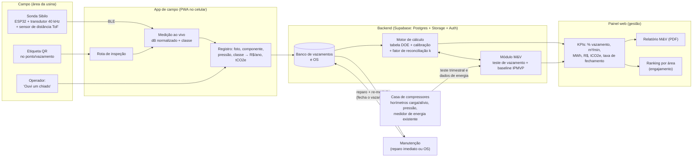

# Solução 3 — SIBILO: caça, conserto e prova de ganho em vazamentos de ar comprimido

> Trilha da Inovação Sebrae/CE + ArcelorMittal Pecém — Desafio 8 (Eficiência Energética e Fontes Renováveis)
> Documento de 28/10/2026.
>
> **Como ler:** **[Fato]** traz fonte (lista na seção 13). **[Premissa]** é hipótese do time, a validar com a ArcelorMittal no Ideathon. **[Estimativa]** é conta feita a partir de premissas. **[Sugestão]** é escolha de projeto do time. Nada aqui é dado interno da planta do Pecém.

---

## 0. Resumo em 6 linhas

- **Problema:** vazamentos de ar comprimido não aparecem e quase não fazem barulho que se ouça no meio da planta, mas costumam desperdiçar **20–30 % do que o compressor produz** [Fato, CAC/DOE]. Ar comprimido é uma das formas de energia mais caras da fábrica.
- **Solução:** o **Sibilo** junta três coisas. (1) Uma **sonda ultrassônica de 40 kHz**, com materiais de cerca de R$ 350, que encontra o vazamento à distância. (2) Um **app de rota e ordem de serviço** que converte cada vazamento em **R$/ano e tCO₂e/ano** e acompanha até ele ser consertado. (3) Um **método de verificação padronizado** (teste de vazamento CAC/DOE + M&V IPMVP Opção A/B) que **prova** o ganho.
- **Por que agora e por que no Pecém:** a usina gera a própria energia com os gases do processo e vende ou transfere o excedente [Fato]. Então **cada kWh economizado vira kWh disponível para venda**. Não é só "custo evitado".
- **Exemplo numérico (estimativa, cenário base):** numa área-piloto com 60 vazamentos típicos, consertar 47 deles evita cerca de **360 MWh/ano, R$ 84 mil/ano e 20 tCO₂e/ano**, com payback de cerca de 3 meses. O cenário conservador também está calculado: R$ 24 mil/ano e payback de 9 meses.
- **Diferencial frente a WeVoltz/Enerlize:** eles medem *quanto* se consome. O Sibilo acha *onde a energia está vazando fisicamente*, diz *o que consertar* (este engate, nesta linha) e *prova* quanto se ganhou depois do conserto.
- **Viável no Hackathon:** hardware simples (ESP32 + transdutor + amp-op), PWA gratuito e uma bancada de calibração com furos de tamanho conhecido. Os furos são comparados com a tabela oficial do DOE.

---

## 1. Por que este ângulo, o problema e a proposta de valor

### 1.1 Comparação com os ângulos candidatos

| Ângulo candidato | Ganho mensurável? | Aplicável à siderurgia / Pecém? | Protótipo em 2 dias + 4 noites? | Sobrepõe 01/02? | Decisão |
|---|---|---|---|---|---|
| **Vazamentos de ar comprimido (ultrassom + rota + verificação)** | **Sim**: há teste padronizado (CAC/DOE) para medir antes e depois | **Sim**: toda usina tem rede de ar de instrumento e de serviço [Premissa sobre o porte no Pecém] | **Sim**: sonda de ~R$ 350 + bancada | Não: a 01 mede corrente por máquina e a 02 trata de tarifa/pico | **ESCOLHIDO** |
| Aproveitamento de calor residual | Sim, mas exige projeto térmico | O Pecém já aproveita os gases do processo numa termelétrica (1.367 GWh em 2024) [Fato]; o "ganho fácil" já foi capturado | Não: capex alto, sem demo real | Não | Descartado |
| Água de resfriamento / bombeamento | Sim | Sim | Difícil: exige dados hidráulicos da planta e acesso a bombas grandes | Parcial: monitorar bombas é o terreno da 01 | Descartado |
| Iluminação/climatização inteligentes | Sim | Pouco peso numa usina integrada; genérico | Sim | Não | Descartado: ganho pequeno frente ao consumo da planta |
| Manutenção preditiva de motores com foco em energia | Difícil de provar em 4 noites | Sim | Parcial | **Sim**: sensores por equipamento são a 01 | Descartado |
| Gamificação de operadores (sozinha) | Fraco: ganho comportamental é difícil de isolar | Sim | Sim | Não | **Incorporado** como módulo de engajamento. O CAC lista "envolvimento dos funcionários" como pilar do programa de vazamentos |
| Solar para cargas auxiliares | Sim | O Pecém já é autossuficiente, e o grupo já investe em grandes parques solares/eólicos [Fato] | Só simulação | Parcial com a 02 | Descartado |

**Motivo da escolha:** é o único ângulo que tem **ao mesmo tempo** (a) perda física comprovada e grande (20–30 % da produção de ar em sistemas mal mantidos) [Fato], (b) **método reconhecido para medir o antes e o depois** (teste de vazamento CAC/DOE e exemplo IPMVP específico de "gestão de vazamentos de ar comprimido") [Fato], (c) hardware barato e seguro, sem mexer em painel elétrico, e (d) ação concreta e barata no fim: apertar ou trocar um engate.

### 1.2 O problema (com dados)

- **Energia pesa no aço.** Segundo a worldsteel, energia responde por **15–20 % do custo total de produção do aço** [Fato].
- **Ar comprimido é um grande consumidor.** Na UE, ar comprimido chegou a **~10 % da eletricidade industrial (>80 TWh/ano)**, com potencial econômico de economia **acima de 30 %** (estudo Fraunhofer ISI, dados de 1999–2001) [Fato, dado antigo]. No Brasil, o MME/ENBPar/Procel cita estudos em que o ar comprimido pode chegar a **até 30 % do consumo de energia de uma indústria**. Em 2024 o governo abriu uma chamada pública **só para eficiência em ar comprimido**, para até 170 indústrias, com redução de vazamentos como medida típica [Fato].
- **O vazamento é invisível e crônico.** Pelo Compressed Air Challenge (Fact Sheet #7, rev. maio/2026), vazamentos podem desperdiçar **20–30 %** da produção do compressor. Uma planta típica sem boa manutenção fica em torno de **20 %**, e um programa ativo leva a **menos de 10 %** [Fato]. O DOE diz que **consertar uma vez não basta**: o programa precisa de identificação/etiquetagem, acompanhamento, reparo, verificação e envolvimento das pessoas [Fato].
- **Onde os programas falham:** "muitas plantas localizam vazamentos, etiquetam e nunca voltam para consertar", o que apaga boa parte do benefício [Fato, fonte secundária]. **O gargalo não é achar. É fechar o ciclo e provar o ganho.**
- **Medir o tamanho do vazamento pelo som é impreciso.** Distância, ângulo, ruído e geometria do furo alteram a leitura em decibéis. Num estudo, o mesmo vazamento mudou **20 dB** entre 0° e 30° [Fato, preprint]. Por isso o Sibilo **usa o ultrassom para achar e priorizar** e **usa o teste do sistema para provar** (seção 8).

### 1.3 O problema na ArcelorMittal Pecém

| Item | O que se sabe | Status |
|---|---|---|
| Porte | Capacidade de 3 Mt/ano de placas, atingida em 2023 e repetida em 2024 | [Fato] |
| Energia | Termelétrica movida a gases do processo (218 MW outorgados); usina autossuficiente; 1.367 GWh gerados em 2024; excedente vendido ao SIN e/ou transferido a outras unidades do grupo | [Fato] |
| Consequência | **1 kWh economizado ≈ 1 kWh a mais de excedente vendável**, desde que a geração dependa da disponibilidade de gás e não da demanda interna | [Premissa a validar] |
| Rede de ar comprimido | Tamanho, nº e tipo de compressores, pressão de trabalho, existência de medidores de vazão/energia na casa de compressores | **[Premissa a validar no Ideathon]** |
| Programa de vazamentos existente | Se existe, quem executa (equipe própria ou terceirizada), com que frequência, se há detector ultrassônico e sistema de manutenção (CMMS) | **[Premissa a validar no Ideathon]** |
| Regime | Usina integrada operando 24/7 (8.760 h/ano) | [Premissa a validar] |

### 1.4 Proposta de valor

> **"Cada chiado que ninguém ouve é dinheiro saindo pelo cano. O Sibilo encontra o vazamento à distância, diz quanto ele custa em R$ e CO₂, garante que ele seja consertado e prova o ganho com um teste padronizado, usando uma sonda de cerca de R$ 350 em vez de uma câmera acústica de US$ 22 mil."**

- **Para a gerência de utilidades/energia:** MWh a mais de excedente para vender, com relatório de M&V que a área financeira e a de ESG aceitam.
- **Para a manutenção:** fila de reparos priorizada por R$/ano, cada vazamento com foto, local e QR. Menos "caça ao tesouro".
- **Para a operação:** um botão "ouvi um chiado" e reconhecimento por área.
- **Para ESG:** tCO₂e evitado calculado com fator oficial e trilha de auditoria.

---

## 2. Cliente e segmento

### 2.1 Quem usa e quem paga

| Persona | Papel no Sibilo | Dor | Por que pagaria |
|---|---|---|---|
| **Gerente de utilidades / energia** (comprador) | Aprova o piloto e lê o painel e o relatório de M&V | Precisa mostrar MWh e R$ economizados; o ar comprimido é uma "caixa-preta" | Ganho verificável, payback de meses, aumento do excedente de energia |
| **Supervisor de manutenção** (usuário-gestor) | Recebe a fila de OS priorizada e acompanha o fechamento | Vazamentos etiquetados e esquecidos; nenhuma prova de que o reparo valeu a pena | Prioriza pelo valor; KPI de fechamento |
| **Inspetor / mecânico / técnico de utilidades** (usuário de campo) | Faz a rota com a sonda e conserta ou abre OS | Ruído de planta; linhas no alto (risco de altura) | Acha à distância e do chão; registro em 30 s |
| **Operador de área** | Reporta chiados pelo QR | Não tem canal para avisar | Reconhecimento, ranking de área |
| **Sustentabilidade / ESG** | Consome o relatório de tCO₂e | Precisa de dado rastreável | Relatório pronto, com fator de emissão citado |

### 2.2 Segmentos (ordem de entrada)

1. **Âncora: ArcelorMittal Pecém.** Piloto numa área, depois escala para a planta. Valor alto por MWh e visibilidade.
2. **Indústrias médias do Complexo do Pecém e da RMF** que compram energia da distribuidora (alimentos, bebidas, têxtil, metalmecânica, cerâmica, plásticos) [Premissa: tamanho do mercado a levantar]. Para elas o kWh é mais caro: a média e alta tensão da Enel Ceará teve reajuste médio de **+9,61 % em abril/2026** [Fato]. O ganho por vazamento em R$ é maior do que no Pecém.
3. **PMEs com 1–3 compressores** (oficinas, gráficas, lavanderias, pequenas fábricas). Entrada via diagnóstico, possivelmente com subsídio **Sebraetec**, que no Ceará costumava subsidiar 70–90 % [Fato, dado de 2023; regra de 2026 a confirmar].
4. **Canal: prestadores de manutenção e ESCOs** (white-label do app + método de M&V).

---

## 3. Arquitetura e fluxo ponta a ponta

### 3.1 Diagrama (mermaid)



### 3.2 Versão ASCII (para slide)

```
 COLETA            PROCESSAMENTO          PAINEL/APP            ALERTA/RECOMENDAÇÃO      AÇÃO               VERIFICAÇÃO
 ┌──────────┐ BLE  ┌──────────────┐       ┌─────────────┐       ┌──────────────────┐    ┌────────────┐     ┌──────────────────────┐
 │ Sonda    │─────▶│ dB → distância│──────▶│ Registro com│──────▶│ Fila priorizada  │───▶│ Mecânico   │────▶│ 1) Re-medição do ponto│
 │ 40 kHz   │      │ normalizada → │       │ foto + QR + │       │ por R$/ano:      │    │ aperta/    │     │    (fecha o ticket)   │
 │ + ToF    │      │ classe P/M/G  │       │ R$ e tCO2e  │       │ "G: engate linha │    │ troca peça │     │ 2) Teste de vazamento │
 └──────────┘      │ → m³/min (DOE)│       └─────────────┘       │  7, R$ 5,6 mil/a"│    └────────────┘     │    trimestral (CAC)   │
 Operador (QR) ───▶└──────────────┘                              └──────────────────┘                       │ 3) M&V IPMVP A/B      │
                                                                                                            │    → R$, MWh, tCO2e   │
                                                                                                            └──────────────────────┘
```

### 3.3 Componentes

- **Sonda Sibilo (coleta):** capta o ultrassom do escape de ar (o CAC recomenda detector ultrassônico como melhor método [Fato]). 40 kHz é a mesma faixa de trabalho de detectores comerciais, como o Testo LD pro [Fato]. Mede a distância até o ponto (ToF) para normalizar a leitura e envia {dB, distância, timestamp} por BLE.
- **App de campo (PWA):** rota, medição ao vivo, registro, reparo, re-medição. Funciona offline e sincroniza depois [Sugestão; a conectividade na área é premissa a validar].
- **Motor de cálculo:** converte a classe do vazamento numa vazão estimada usando a tabela do DOE (vazão × diâmetro × pressão) e um coeficiente de orifício. A vazão vira kW, kWh, R$ e tCO₂e. Um **fator de reconciliação k** ajusta todas as estimativas para que a soma bata com o vazamento total medido no teste do sistema.
- **Módulo M&V:** assistente do teste de vazamento (carga/alívio ou decaimento de pressão) e modelo de linha de base de energia da casa de compressores (Opção B).
- **Painel de gestão:** KPIs, ranking, relatório.

---

## 4. Pipeline de processos: quem faz o quê em campo

### 4.1 Fases

| Fase | O que acontece | Quem | Encaixe na rotina |
|---|---|---|---|
| **0. Preparação (1 vez por área)** | Mapear a rede da área em setores e colar QR nos pontos de rota (manifolds, painéis pneumáticos, filtros-reguladores, drenos, válvulas). Fazer o **teste de vazamento de linha de base** (seção 8) | Utilidades + manutenção + time Sibilo | Na próxima **parada programada** da área, com permissão de trabalho (PT) |
| **1. Rota de inspeção** | O inspetor percorre a rota com a sonda e varre engates, mangueiras, FRLs, drenos e flanges. O app guia ponto a ponto | Inspetor/técnico de utilidades (ou lubrificador/preditivo) | Rota **quinzenal ou mensal** por área, junto da inspeção sensitiva/preditiva que já existe [Premissa] |
| **2. Registro e priorização** | Detectou vazamento: foto, componente, pressão local, leitura normalizada → classe **P/M/G**, R$/ano e tCO₂e/ano. Etiqueta física com QR | Inspetor | 30–60 s por vazamento |
| **3. Reparo** | **Conserto imediato** se for simples e seguro (aperto de conexão, troca de engate rápido, fita veda-rosca), sem intervenção em equipamento energizado ou pressurizado fora do procedimento. **OS** se exigir bloqueio, peça ou parada | Mecânico / manutenção | Fila de OS ordenada por R$/ano. Os grandes primeiro: no exemplo do DOE, 10 vazamentos de 1/4" deram quase 70 % da economia [Fato] |
| **4. Verificação do ponto** | Re-medir no mesmo QR. Se o ultrassom cair ao nível de fundo, o vazamento fica "fechado" e o R$/ano entra como "evitado estimado" | Quem consertou | Fecha o ticket |
| **5. Verificação do sistema** | **Teste de vazamento trimestral**, frequência recomendada pelo CAC [Fato]. **M&V mensal** da energia da casa de compressores (Opção B). Recalcular k | Utilidades + time Sibilo | Painel mensal e relatório trimestral |
| **6. Ajuste do compressor** | Com menos demanda, o controle dos compressores precisa responder (desligar, aliviar, reduzir a pressão de trabalho), senão a economia não aparece no medidor [Fato, CAC] | Utilidades / fornecedor do compressor | Quando a vazão total cair de forma relevante |
| **7. Engajamento** | Botão "ouvi um chiado" via QR. Ranking **por área** (nunca individual punitivo): R$ recuperado, % fechado em 30 dias | Operação + supervisão | Reconhecimento mensal na reunião de segurança/DDS [Sugestão] |

### 4.2 RACI resumido

| Atividade | Utilidades/Energia | Manutenção | Operação | Inspetor | Time Sibilo |
|---|---|---|---|---|---|
| Teste de linha de base / trimestral | **A** | C | I | R | R (assistente) |
| Rota de inspeção | I | A | I | **R** | C |
| Reparo | I | **A/R** | I | C | — |
| Fechamento (re-medição) | I | A | — | **R** | — |
| Relatório M&V | **A** | I | I | — | **R** |
| Reporte de chiado | — | I | **R** | — | — |

(R = executa, A = responde, C = consultado, I = informado)

---

## 5. Hardware e software

### 5.1 Sonda Sibilo v0: lista de materiais (preços consultados em 28/10/2026 ou faixa típica de varejo)

| Item | Função | Preço aprox. (R$) | Status do preço |
|---|---|---|---|
| ESP32 DevKit 30 pinos | MCU + BLE + ADC | 54,90 (Eletrogate) | Pesquisado |
| Transdutor ultrassônico **receptor 40 kHz** 16 mm (ex.: 400SR16), ou o receptor de um módulo HC-SR04 | Captação do ultrassom do vazamento | 72–110 (avulso, MF Rural); 15–25 (receptor do HC-SR04) | Pesquisado (avulso) / faixa típica (HC-SR04) |
| Amp-op duplo (TL072 ou MCP6002) + resistores/capacitores + diodos | Pré-amplificador com ganho de ~60 dB, passa-banda em 40 kHz e detector de envoltória | 15–25 | Faixa típica |
| Sensor de distância ToF VL53L0X (I2C) | Normaliza a leitura pela distância | 30–50 | Faixa típica |
| Display OLED 0,96" I2C | Mostra dB e classe na sonda | 51–81 (Magazine Luiza) | Pesquisado |
| Buzzer/fone P2 | Tom audível proporcional à intensidade | 10–20 | Faixa típica |
| Bateria 18650 + carregador TP4056 + step-up | Autonomia | 30–45 | Faixa típica |
| Cone/tubo direcional (PVC 25 mm ou impressão 3D) + caixa | Direcionalidade e proteção | 15–30 | Faixa típica |
| Ponteira laser 5 mW (opcional) | Mostra para onde a sonda aponta | 10–15 | Faixa típica |
| **Total da sonda** | | **≈ R$ 300–420** | Estimativa |

**Bancada de calibração (Hackathon):** compressor pequeno (preferir **emprestado do laboratório do IFCE**; se comprar, faixa de R$ 700–1.000 a confirmar), regulador + manômetro (R$ 40–80), 4 bicos/tampões com furos de 0,4, 0,8, 1,6 e 3,2 mm (≈ 1/64", 1/32", 1/16", 1/8") feitos com broca (R$ 50–80). **Total ≈ R$ 100–160 sem o compressor.** A bancada reproduz pontos da tabela do DOE e gera a curva "dB normalizado → classe".

**Comparação de custo (por que a sonda faz sentido):** câmera acústica Fluke ii900 custa **US$ 22–32 mil** no varejo dos EUA [Fato]. Um detector portátil básico (Inficon Whisper) custa **~US$ 280** [Fato] e não tem app, R$/ano nem M&V. O Sibilo é **método + workflow + prova**, e a sonda própria só barateia a entrada. **O app aceita leitura manual de qualquer detector comercial que a planta já tenha** [Sugestão].

### 5.2 Processamento de sinal (v0 → roadmap)

- **v0 (Hackathon):** transdutor ressonante em 40 kHz → 2 estágios de ganho → retificador de precisão + filtro RC (~10 ms) → ADC do ESP32 a ~1 kHz → RMS em janela de 250 ms → **dB relativo**. Normalização por distância: `dB_norm = dB_medido + 20·log10(d / d_ref)`, com d_ref = 15 cm. É aproximação de propagação esférica [Sugestão; a calibração na bancada corrige].
- **Protocolo de medição:** 15 cm e ~30° do eixo, quando houver acesso. Uma tese de mestrado (Waikato) achou nível máximo a 30° e leitura mais consistente a 150 mm [Fato]. De longe, a sonda **só localiza**: a classificação exige aproximação segura.
- **Roadmap:** microfone MEMS ultrassônico (até ~80 kHz) com amostragem I2S e FFT para separar vazamento de ruído mecânico; classificador simples (vazamento × fundo); heterodinagem real para fone. Um trabalho de 2025 mostra detector de baixo custo com MEMS + filtro IIR + RMS [Fato].

### 5.3 Software (tudo gratuito para a demo)

| Camada | Escolha | Custo na demo |
|---|---|---|
| Firmware | Arduino-ESP32 (C++), serviço BLE GATT com {dB, d, t} | Gratuito |
| App de campo | **PWA** (React + Vite ou HTML/JS puro) com **Web Bluetooth** (Chrome Android). Fallback: o ESP32 cria um Wi-Fi local ou leitura manual (iOS não tem Web Bluetooth) | Gratuito |
| Backend | **Supabase** free tier (Postgres + Auth + Storage para fotos) | Gratuito |
| Painel | Mesma PWA (rota /gestao) com gráficos (Chart.js) | Gratuito |
| Cálculo/calibração | Python (Colab) para a curva da bancada; regras em SQL/JS | Gratuito |
| Protótipo de telas | Figma (plano educacional gratuito) | Gratuito |
| Relatório | Geração de PDF no navegador | Gratuito |
| Hospedagem | Vercel/Netlify/GitHub Pages | Gratuito |

### 5.4 Modelo de dados mínimo

`area(id, nome)` · `ponto(id, area_id, qr, descricao, foto)` · `vazamento(id, ponto_id, data, dB_norm, distancia, pressao_bar, componente, classe, q_est_m3min, kwh_ano, rs_ano, tco2_ano, status, foto_antes, foto_depois, data_fechamento)` · `teste_vazamento(id, area_id, metodo, T, t, V, P1, P2, resultado_pct, q_m3min, data)` · `parametros(sp_kw_por_m3min, horas_ano, preco_mwh, fe_tco2_mwh, fc, k)`.

---

## 6. Telas do app e do painel

| # | Tela | O que mostra | Quem usa |
|---|---|---|---|
| 1 | **Minhas rotas** | Rotas do dia por área, % concluído, vazamentos abertos na área | Inspetor |
| 2 | **Rota em andamento** | Lista/mapa de pontos (QR), próximo ponto, pontos já varridos | Inspetor |
| 3 | **Medição ao vivo** | Barra de intensidade (dB normalizado), distância, classe sugerida P/M/G, tom. Botão "registrar" | Inspetor |
| 4 | **Registrar vazamento** | Foto, componente (engate, mangueira, FRL, dreno, flange, válvula), pressão local, classe → **"≈ 0,44 m³/min · R$ 5,6 mil/ano · 1,3 tCO₂e/ano"**, ação: "Consertei agora" ou "Abrir OS" | Inspetor |
| 5 | **Fila de reparos** | OS ordenadas por R$/ano, idade da OS, local, foto, peça provável | Supervisor/mecânico |
| 6 | **Fechar vazamento** | Re-medição no QR, foto "depois", confirma queda ao nível de fundo | Mecânico/inspetor |
| 7 | **Ouvi um chiado** | Formulário de 3 toques via QR do local (foto opcional) | Operador |
| 8 | **Assistente de teste de vazamento** | Passo a passo do método CAC: cronômetro de carga/alívio (T, t) ou decaimento (V, P1, P2, T). Calcula % e m³/min. Guarda o histórico | Utilidades |
| 9 | **Painel de gestão** | % de vazamento (último teste × linha de base), m³/min, MWh/ano, R$/ano e tCO₂e/ano evitados (estimado × verificado), taxa de fechamento em 30 dias, tempo médio até reparo, reincidência | Gerente de utilidades |
| 10 | **Ranking de áreas** | R$ recuperado por área, % fechado no prazo, chiados reportados | Supervisores, operação |
| 11 | **Relatório M&V** | PDF com método IPMVP, linha de base, ajustes, economia, incerteza, fatores usados e fontes | Gerência, ESG, financeiro |

---

## 7. Plano de execução, papéis e riscos

### 7.1 O que fica pronto em cada etapa

| Etapa | Entrega concreta | Critério de "pronto" |
|---|---|---|
| **Ideathon (2 dias)** | (a) **Perguntas de validação** aos mentores da ArcelorMittal (seção 7.4). (b) Canvas + mapa de empatia do inspetor e do gerente de utilidades. (c) Storyboard do fluxo achar → consertar → provar. (d) **Prova de conceito rápida**: ESP32/Arduino + receptor de HC-SR04 "ouvindo" o escape de uma bomba de bicicleta ou de um spray. (e) Pitch de 5 min com o exemplo numérico | Mentor confirma que vazamento de ar é uma dor real e indica a ordem de grandeza da rede |
| **Hackathon, noite 1** | Sonda v0 na protoboard: leitura dB + distância no OLED. Bancada com 4 furos funcionando | Leitura muda com o furo e com a distância |
| **Noite 2** | PWA: login, rota, QR, medição ao vivo via Web Bluetooth, registro com foto no Supabase | Registrar um vazamento ponta a ponta no celular |
| **Noite 3** | Curva de calibração (Colab) → classes P/M/G; motor de cálculo (DOE + R$ + tCO₂e); fila de OS + fechamento; assistente de teste de vazamento | Bancada: "furo de 1,6 mm" vira classe certa e mostra R$/ano coerente com a tabela do DOE |
| **Noite 4** | Painel de gestão + ranking + relatório PDF; vídeo de demo de 60 s (o hackathon é online); ensaio do pitch | Demo gravada e pitch em ≤ 5 min |
| **Roadmap (pós-evento)** | Piloto pago numa área do Pecém; caixa IP54; MEMS + FFT; integração com o CMMS da planta (ex.: SAP PM, premissa); módulos **vapor (purgadores)**, **N₂/argônio** e **vácuo**; versão PME | Relatório M&V do piloto aprovado pela ArcelorMittal |

### 7.2 Papéis no time (3 a 5 pessoas)

| Papel | Responsabilidades |
|---|---|
| **Negócios (1)** | Validação com mentores, Canvas, preços, exemplo numérico, pitch e perguntas da banca |
| **Design (1)** | Figma das 11 telas, identidade "Sibilo", vídeo da demo, slides |
| **Dev hardware (1)** | Sonda, bancada, firmware BLE, calibração |
| **Dev software (1–2)** | PWA, Supabase, motor de cálculo, painel, PDF |

Com 3 pessoas: negócios+design juntos e um dev em cada frente.

### 7.3 Riscos e mitigação

| Risco | Mitigação |
|---|---|
| **Segurança elétrica (NR-10)** | A sonda é a bateria e **não toca circuito nenhum**. Dados de energia vêm de medidores já existentes. Qualquer instalação de alicate de corrente fica com eletricista autorizado da planta (fora do escopo do protótipo) |
| **Máquinas (NR-12)** | A inspeção é feita **sem abrir proteções** e a distância de partes móveis. O cone direcional permite achar à distância |
| **Vasos de pressão (NR-13)** | Reservatórios de ar são vasos de pressão. O teste de decaimento **só reduz** a pressão, dentro da faixa normal e por procedimento da planta, nunca acima da PMTA |
| **Trabalho em altura (NR-35)** | Linhas aéreas são varridas **do chão** (direcional + laser). A classificação de perto só com PT e acesso seguro |
| **Áreas classificadas (atmosfera explosiva)** | A sonda **não é certificada Ex** (ABNT NBR IEC 60079). **Proibido usar em áreas classificadas** ou em linhas de gás combustível. O app bloqueia rota em área marcada como classificada. Versão Ex só com equipamento certificado (roadmap/parceiro) |
| **Gases tóxicos (ex.: gás de alto-forno, com CO)** | **Fora do escopo.** O Sibilo trata de ar comprimido, e vazamento de gás de processo é questão de segurança com detectores próprios da planta. Treinamento explícito sobre isso |
| **Ruído/EPI** | Uso com protetor auricular. O tom da sonda é visual (OLED) + fone opcional |
| **Estimativa por som imprecisa** | Usada **só para priorizar**. O ganho oficial vem do teste de sistema + M&V (seção 8) e do fator k de reconciliação |
| **A economia "não aparece" no medidor** | Ajuste do controle dos compressores (fase 6). Fator f_c explícito nas estimativas |
| **Vazamentos registrados e não consertados** | Fila por R$/ano, KPI de fechamento em 30 dias no painel do gerente, ranking de área |
| **Planta sem janela para teste** | Teste **setorial** na parada da área. Opção B por regressão sem precisar parar |
| **Dados (LGPD e sigilo industrial)** | Ranking só por área; dados da planta em projeto Supabase dedicado. Termo de confidencialidade no piloto. Nenhum dado interno vai para o pitch sem autorização |
| **Online no hackathon** | Demo gravada + bancada ao vivo na câmera; plano B com dados simulados |

### 7.4 Perguntas para validar com a ArcelorMittal no Ideathon (transformam premissas em fatos)

1. Quantos compressores, de que potência e com que controle (carga/alívio, VSD, start/stop)? Há sala de compressores central ou várias?
2. Pressão de trabalho da rede? Existem medidores de vazão e de energia na casa de compressores? Há horímetros de carga e alívio?
3. Existe programa de vazamentos hoje? Interno ou terceirizado? Com qual detector? Qual a taxa de reparo?
4. Qual CMMS a manutenção usa? (Para integrar as OS.)
5. Calendário de paradas por área; mapa de áreas classificadas.
6. Como a empresa valora internamente 1 MWh economizado (preço de venda do excedente / transferência intragrupo)?
7. Regime de operação (8.760 h/ano?) e quais áreas usam mais ar (filtros de mangas, acionamentos pneumáticos, instrumentação, sopro) [Premissa].
8. Como contabilizam escopo 2 com autoprodução? Qual fator de emissão usam?

---

## 8. Como medir o ganho na ArcelorMittal (M&V)

### 8.1 Princípios

- O protocolo de referência é o **IPMVP** (EVO): economia = consumo da linha de base **ajustado** às condições do período de relatório − consumo medido no período de relatório [Fato, IPMVP]. O documento "IPMVP Issues & Examples" tem um exemplo específico de **"Compressed-Air Leakage Management: Option B"** [Fato].
- Para projetos com medição, valem as **Opções A** (medição parcial + parâmetros estipulados) **ou B** (medição de todos os parâmetros do sistema isolado) [Fato, ACEEE 2013].
- Em ar comprimido, **normalizar pela demanda/produção pesa mais na precisão do que a classe do medidor** [Fato, ACEEE 2013]. Guia de referência citado: medir compressores por **4 semanas**, com intervalos de 15 min (medidor de potência) ou 2 min (corrente) [Fato, Uniform Methods Project via ACEEE].

### 8.2 Três níveis de verificação

| Nível | O que mede | Método | Quando | Opção IPMVP |
|---|---|---|---|---|
| **N1: ponto** | Vazamento sumiu? | Re-medição ultrassônica no QR (cai ao fundo) | A cada reparo | — (evidência operacional) |
| **N2: setor/sistema** | Vazamento total da área (m³/min e %) | **Teste de vazamento CAC/DOE** antes e depois, na parada da área | Linha de base + trimestral | **A**: vazão medida; horas e potência específica estipuladas |
| **N3: planta** | Energia da casa de compressores | Regressão da linha de base: kWh/dia ~ produção (t placa/dia) + outras variáveis relevantes; baseline ≥ 4 semanas | Mensal | **B** |

### 8.3 Fórmulas

**Teste de vazamento (CAC Fact Sheet #7, 2026) [Fato]**

- Compressor start/stop ou carga/alívio, sem consumo produtivo na rede:
  `Vazamento (%) = T × 100 / (T + t)`, com T = tempo em carga (min) e t = tempo em alívio (min).
  `Q_vaz = Vazamento(%) × Q_nominal do compressor`
- Outros controles (decaimento de pressão), em unidades do original:
  `Q_vaz (cfm ar livre) = [V × (P1 − P2) / (T × 14,7)] × 1,25`
  com V em ft³ (volume de reservatórios + tubulação), P1 e P2 em psig (P2 ≈ metade de P1), T em min. O 1,25 corrige para a pressão normal.
  *Versão SI (conversão do time):* `Q_vaz (m³/min) = [V(m³) × (P1 − P2)(bar) / (T(min) × 1,013)] × 1,25`.
- Referências: < 10 % = sistema bem mantido; 20–30 % = mal mantido; repetir trimestralmente [Fato].

**Vazamento individual (estimativa para priorizar) [Fato: tabela e fórmula do DOE Tip Sheet #3]**

- `Q_i = Q_tabela(diâmetro equivalente, pressão) × C`. A tabela vai de 0,40 cfm (1/64") a 227 cfm (3/8") a 100 psig. C = 0,61 para orifício de aresta viva (conservador) ou 0,97 para orifício arredondado.
- `P_i (kW) = Q_i × SP`. SP é a potência específica, com padrão DOE de **18 kW/100 cfm ≈ 6,36 kW por m³/min** (substituir pelo dado do compressor real).
- `Q_i,ajustado = k × Q_i`, com `k = Q_vaz(teste) / Σ Q_i(estimados)` (reconciliação) [Sugestão].

**Energia, dinheiro e carbono**

- `E_evitada (kWh/ano) = ΔQ × SP × h × f_c`
  - ΔQ = vazão eliminada (medida no teste N2, ou Σ Q_i dos vazamentos fechados × k)
  - h = horas/ano com a rede pressurizada (8.760 h = premissa para usina contínua)
  - **f_c = fator de resposta do controle** (0 a 1): fração da redução de ar que de fato vira redução de kW. Em parafusos com carga/alívio, compressor aliviado ainda consome cerca de **20–35 % da potência plena** [Fato, fontes secundárias], então f_c < 1 até o controle ser ajustado. **Valor 0,7 = premissa**, substituída pelo valor medido na Opção B.
- **Opção B (planta):** `E_evitada = Σ_meses [ f(produção_mês, …)_baseline − E_medida_mês ]`.
- `R$ evitados = E_evitada (MWh) × preço do MWh`. No Pecém o preço é o **valor do excedente vendável** [Premissa a validar]. Referência pública: contratos de longo prazo de energia convencional a **R$ 233/MWh (mar/2026, Abraceel)**; faixa recente R$ 135–320/MWh [Fato]. Para PMEs, usar a tarifa da distribuidora.
- `tCO₂e evitado = E_evitada (MWh) × FE`. **FE = 0,0545 tCO₂/MWh**, fator médio do SIN em **2024** (MCTI, citado em inventários GHG de StoneX e Bradesco) [Fato]. Em 2023 era 0,0385 [Fato]. Como o Pecém se autoabastece, o kWh economizado vira excedente exportado que **desloca** geração da rede, por isso usamos o fator do SIN. O fator médio subestima o efeito quando a margem de operação é térmica, então é uma escolha **conservadora** [Premissa/escolha metodológica a validar com o ESG da empresa].
- `Payback (meses) = Investimento / (R$ evitados/ano) × 12`
- `ROI ano 1 = (R$ evitados/ano − Investimento) / Investimento`

### 8.4 KPIs do painel

| KPI | Fórmula/fonte | Meta sugerida |
|---|---|---|
| % de vazamento do sistema/área | Teste CAC | < 10 % (CAC) |
| Vazão de vazamento (m³/min) | Teste CAC | ↓ trimestral |
| MWh/ano evitados (estimado × verificado) | 8.3 | — |
| R$/ano evitados | 8.3 | — |
| tCO₂e/ano evitados | 8.3 | — |
| Nº de vazamentos achados / fechados | App | — |
| Taxa de fechamento em 30 dias | fechados ≤ 30 d / achados | ≥ 80 % [Sugestão] |
| Tempo médio até reparo | App | ↓ |
| Reincidência no mesmo ponto | App | < 10 % [Sugestão] |
| R$ recuperado por hora de inspeção | App | — |
| Payback e ROI | 8.3 | — |

### 8.5 Exemplo numérico — **ESTIMATIVA ILUSTRATIVA, não é dado do Pecém**

**Premissas (todas a validar):**

| Premissa | Valor | Base |
|---|---|---|
| Área-piloto com **60 vazamentos** encontrados: 30 × 1/32" (0,8 mm), 20 × 1/16" (1,6 mm), 8 × 1/8" (3,2 mm), 2 × 1/4" (6,4 mm) | — | [Premissa] distribuição inspirada no exemplo do DOE (muitos pequenos, poucos grandes) |
| Pressão da rede | 100 psig (≈ 6,9 bar) | [Premissa]; linha da tabela do DOE |
| Coeficiente de orifício | 0,61 (aresta viva, conservador) | [Fato, DOE] |
| Potência específica | 0,18 kW/cfm (6,36 kW por m³/min) | [Fato, padrão DOE] |
| Horas/ano | 8.760 | [Premissa: operação contínua] |
| Reparados | 100 % dos 1/4" e 1/8"; 80 % dos 1/16"; 70 % dos 1/32" → **47 vazamentos** | [Premissa] |
| f_c | 0,7 (base); 1,0 (otimista) | [Premissa] |
| Preço do MWh | R$ 233 (base); R$ 135 (conservador); R$ 320 (otimista) | [Fato: referências de mercado 2026]; valor interno a validar |
| FE | 0,0545 tCO₂/MWh | [Fato, MCTI 2024] |
| Custo do piloto Sibilo | R$ 15.000 (campanha de 1 área) | [Sugestão de preço] |
| Custo de reparo | R$ 150 por vazamento (peça + mão de obra) | **[Premissa fraca, validar com a manutenção]** |

**Passo a passo (cenário otimista, f_c = 1, para mostrar a conta):**

| Diâmetro | Qtd. | cfm/vaz. (tabela × 0,61) | cfm total | cfm reparado |
|---|---|---|---|---|
| 1/32" | 30 | 1,55 × 0,61 = 0,95 | 28,4 | 19,9 |
| 1/16" | 20 | 6,31 × 0,61 = 3,85 | 77,0 | 61,6 |
| 1/8" | 8 | 25,22 × 0,61 = 15,38 | 123,1 | 123,1 |
| 1/4" | 2 | 100,9 × 0,61 = 61,55 | 123,1 | 123,1 |
| **Total** | **60** | | **351,5 cfm (≈ 10,0 m³/min)** | **327,6 cfm (≈ 9,3 m³/min)** |

- Potência evitada = 327,6 × 0,18 = **59,0 kW** contínuos
- Energia = 59,0 kW × 8.760 h = **516,6 MWh/ano**
- Observação: os 10 vazamentos de 1/8" e 1/4" (17 % da quantidade) respondem por **~70 % da vazão**, o mesmo padrão do exemplo do DOE [Fato]. Daí a fila priorizada por R$/ano.

**Cenários:**

| Cenário | Premissas | MWh/ano | R$/ano | tCO₂e/ano | Investimento ano 1 | Payback | ROI ano 1 |
|---|---|---|---|---|---|---|---|
| **Conservador** | metade dos vazamentos (o mesmo mix), f_c 0,7, R$ 135/MWh | 181 | **R$ 24,4 mil** | 9,9 | R$ 18,5 mil | **9,1 meses** | 32 % |
| **Base** | 60 vazamentos, f_c 0,7, R$ 233/MWh | 362 | **R$ 84,3 mil** | 19,7 | R$ 22,1 mil | **3,1 meses** | 282 % |
| **Otimista** | 60 vazamentos, f_c 1,0, R$ 320/MWh | 517 | **R$ 165,3 mil** | 28,2 | R$ 22,1 mil | **1,6 mês** | 650 % |

**Regra de bolso para o pitch [Estimativa com dados do DOE]:** um único vazamento de **1/8" (3 mm) a ~7 bar** gasta cerca de **15 cfm (0,44 m³/min) ≈ 2,8 kW contínuos ≈ 24 MWh/ano ≈ R$ 5,6 mil/ano (a R$ 233/MWh) ≈ 1,3 tCO₂e/ano**.

**Como o exemplo vira número real no piloto:** (1) o teste CAC na parada da área mede a vazão de vazamento antes e depois. ΔQ medido substitui a soma estimada. (2) A potência específica real vem da placa/curva do compressor ou da medição. (3) f_c sai da comparação de energia (Opção B). (4) O preço do MWh vem da própria ArcelorMittal.

**Ordem de grandeza da planta (só referência, sem dado do Pecém):** se uma rede tem vazamento de 20 % (planta típica sem boa manutenção, CAC) e chega a 10 % (bem mantida), a energia dos compressores cai cerca de **10 % × f_c**. Saber quanto isso representa em MWh depende do consumo da casa de compressores do Pecém, que é premissa a levantar.

---

## 9. Modelo de negócio (Canvas resumido)

| Bloco | Conteúdo |
|---|---|
| **Segmentos** | 1) ArcelorMittal Pecém (âncora); 2) indústrias médias do CIPP/RMF; 3) PMEs com compressor; 4) prestadores de manutenção/ESCOs (canal) |
| **Proposta de valor** | Achar, consertar e **provar** a economia dos vazamentos de ar comprimido, com R$ e tCO₂e por vazamento e relatório M&V IPMVP |
| **Canais** | Piloto via Trilha da Inovação/ArcelorMittal; Sebrae/CE (Sebraetec); FIEC/sindicatos industriais; fornecedores de compressores e manutenção |
| **Relacionamento** | Campanha inicial presencial + assinatura com relatório mensal; treinamento das equipes; ranking/engajamento |
| **Receitas** | (a) **Campanha Sibilo** por área (diagnóstico + linha de base + treinamento + relatório M&V); (b) **assinatura** do app/painel por planta; (c) venda/aluguel de sondas; (d) **opção por desempenho**: % da economia verificada no 1º ano |
| **Recursos-chave** | Método de M&V, motor de cálculo calibrado, sonda, app, base de dados de vazamentos (benchmark por tipo de componente) |
| **Atividades-chave** | Calibração, campanhas de campo, desenvolvimento do app, relatórios M&V |
| **Parceiros** | IFCE (laboratório, bancada), Sebrae/CE, ArcelorMittal (piloto), distribuidores de conexões/engates (kit de reparo), ESCOs |
| **Custos** | Equipe, cloud, componentes da sonda, deslocamento, certificação futura (IP/Ex) |

### 9.1 Preços sugeridos [Sugestão, a testar com clientes]

| Plano | Preço | Inclui |
|---|---|---|
| **Campanha Sibilo, indústria** | R$ 15.000 por área | 2 semanas de campo, teste de linha de base e pós-reparo, treinamento, 2 sondas emprestadas, relatório M&V |
| **Assinatura planta** | R$ 2.500/mês | App + painel ilimitados, 3 sondas, suporte, relatório mensal, teste trimestral assistido (remoto) |
| **Desempenho (alternativa)** | 20 % da economia **verificada** no 1º ano | Para clientes que preferem não ter custo fixo; só é possível porque existe M&V |
| **PME** | R$ 2.900 por diagnóstico ou R$ 249/mês | Sonda + app + 1 visita; elegível a subsídio Sebraetec [Premissa] |

### 9.2 Custo unitário e ponto de equilíbrio [Estimativa]

- **Custo variável:** sonda ≈ R$ 350 (amortizada em 24 meses ≈ R$ 15/mês); cloud ≈ R$ 150/mês até dezenas de clientes (Supabase Pro ≈ US$ 25/mês; câmbio = premissa); deslocamento por campanha ≈ R$ 1.500. Margem bruta estimada: **~90 % na assinatura** e **~60 % na campanha**.
- **Custo fixo mensal (time de 3 sócios em início de operação):** pró-labore 3 × R$ 3.000 + ferramentas/infra R$ 500 + contador/administrativo R$ 1.000 + marketing/deslocamento R$ 1.500 ≈ **R$ 12.000/mês**.
- **Ponto de equilíbrio (exemplo de mix):** 2 indústrias na assinatura (R$ 5.000) + 20 PMEs (R$ 4.980) + 1 campanha a cada 2 meses (R$ 15.000 × 60 % ÷ 2 = R$ 4.500) ≈ **R$ 14.480/mês de margem > R$ 12.000**. Ou seja, o equilíbrio vem com **~2 indústrias + ~16–20 PMEs + 1 campanha bimestral**.
- **Para o cliente**, no cenário base a campanha (R$ 15 mil) se paga em ~3 meses só com a área-piloto (seção 8.5).

---

## 10. Diferencial

| Frente a | O que eles fazem | O que o Sibilo faz diferente |
|---|---|---|
| **WeVoltz (1º/2025)** | Sensores + IA + plataforma que "identifica onde ocorre a falha" no consumo elétrico | Não mede consumo. **Acha uma perda física específica** (o vazamento), com local exato, foto e QR, e **prova** o ganho com teste padronizado |
| **Enerlize (2º/2025)** | Monitoramento inteligente do consumo industrial | Medidor diz *quanto*; o Sibilo diz *onde, o quê consertar e quanto valeu* |
| **NexoWatt / reefers / CooL-LLM (outros hackathons)** | kWh em R$ ligado a evento operacional (porta aberta) / liga-desliga / previsão | Leva a lição do NexoWatt mais longe: **cada vazamento vira R$/ano e tCO₂e/ano** e uma OS com dono |
| **Câmeras acústicas (Fluke ii900 etc.)** | Hardware excelente, US$ 22–32 mil | Sonda ~R$ 350 + **workflow de fechamento + M&V**. Aceita leitura de detectores que a planta já tem |
| **Serviços de "leak audit" de fabricantes de compressores** | Auditoria pontual | **Programa contínuo** (rota, fila, re-medição, teste trimestral), que é o que o DOE/CAC recomenda |
| **CMMS genéricos / sensores de vibração com ultrassom (ex.: Tractian)** | Manutenção de ativos rotativos | Foco no **vazamento de utilidade**, com cálculo energético e M&V embutidos |
| **Soluções 01 e 02 deste time** | 01: ociosidade por equipamento (corrente); 02: demanda/tarifa/deslocamento de carga | 03 ataca uma **perda contínua 24/7 de uma utilidade**, que não depende de tarifa e vale também numa planta autoprodutora como o Pecém |

---

## 11. Mapeamento para os 5 critérios da banca

| Critério | Como o Sibilo responde | Onde está |
|---|---|---|
| **(a) Problemática** | Vazamentos desperdiçam 20–30 % do ar comprimido, são invisíveis e os programas falham por não fechar o ciclo. Energia é 15–20 % do custo do aço. No Pecém, kWh economizado vira excedente vendável | 1.2, 1.3 |
| **(b) Proposta de valor** | Achar → consertar → provar; R$ e tCO₂e por vazamento; sonda de ~R$ 350 em vez de câmera de US$ 22 mil | 1.4, 10 |
| **(c) Segmento de clientes** | ArcelorMittal (âncora, persona gerente de utilidades) → indústrias médias do CIPP → PMEs (Sebraetec) → canal ESCO | 2 |
| **(d) Monetização** | Campanha por área + assinatura + opção por desempenho (viável por causa do M&V); equilíbrio com ~2 indústrias + ~20 PMEs | 9 |
| **(e) Viabilidade** | *Desenvolver:* hardware de prateleira, stack gratuito, plano noite a noite. *Operar:* encaixe na rota de inspeção existente e regras de segurança (NR-10/12/13/35, áreas classificadas). *Demanda real:* chamada pública federal só para ar comprimido (170 indústrias), DOE/CAC recomendam programa contínuo. *Custo/benefício:* payback de 1,6–9 meses nos cenários estimados | 5, 7, 8.5, 9 |

---

## 12. Premissas consolidadas (checklist para o Ideathon)

1. Tamanho da rede de ar comprimido do Pecém, compressores, controle, pressão, medidores.
2. Existência e desempenho de um programa de vazamentos atual.
3. Valor interno do MWh economizado (excedente vendido/transferido).
4. Regime de 8.760 h/ano e calendário de paradas por área.
5. Mapa de áreas classificadas e regras de PT para inspeção.
6. Custo médio de reparo de vazamento.
7. Distribuição real de tamanhos de vazamento (a área-piloto define).
8. f_c real (resposta do controle dos compressores).
9. Fator de emissão que a empresa usa no inventário.
10. Disposição a pagar: campanha × assinatura × desempenho.

---

## 13. Fontes

**Ar comprimido: perdas, métodos, programa**
- DOE, *Compressed Air Tip Sheet #3 – Minimize Compressed Air Leaks* (rev. ago/2004): tabela de vazão × orifício × pressão, coeficientes 0,61/0,97, 18 kW/100 cfm, exemplo dos 10 vazamentos de 1/4" ≈ 70 %, "fixing leaks once is not enough". https://docs.nlr.gov/docs/fy04osti/36493.pdf (NREL)
- Compressed Air Challenge / DOE Sourcebook, *Fact Sheet #7 – Compressed Air System Leaks* (rev. 1, maio/2026): 20–30 %, planta típica 20 %, < 10 % bem mantida, fórmulas de carga/alívio e decaimento, teste trimestral, componentes do programa, ultrassom como melhor método, reavaliar controles. https://www.compressedairchallenge.org/data/sites/1/media/library/factsheets2026/fact-sheet-7-compressed-air-system-leaks_updated2026.pdf
- Radgen & Blaustein, *Compressed Air Systems in the European Union* (Fraunhofer ISI, 2001): ~10 % da eletricidade industrial, > 80 TWh, potencial > 30 %. https://publica.fraunhofer.de/handle/publica/290894
- ReliaMag, falha de programas que etiquetam e não consertam (fonte secundária). https://reliamag.com/topics/guides/compressed-air-leak-statistics
- Potência de compressor aliviado (20–35 % / 20–40 %), fontes secundárias: https://www.fluidpowerworld.com/?p=131735 · https://www.plantservices.com/home/blog/11314272/basic-compressed-air-auditing-techniques

**Medição por ultrassom e baixo custo**
- Hojjati & Radgen, preprint EasyChair (variação de 20 dB com o ângulo; limitações de quantificação). https://easychair.org/publications/preprint/5Mf2
- Wolstencroft, *Ultrasonic air leak detection: an investigation to improve accuracy of leak rate estimation* (Univ. Waikato, 2008): 30°, 150 mm, coeficientes de descarga. https://researchcommons.waikato.ac.nz/entities/publication/edc1a226-d071-423d-8787-a7ee71d6f200
- Gulgonul, *Development and Testing of a Low Cost Ultrasonic Leak Detector* (arXiv, 2025). https://arxiv.org/abs/2506.04862v1
- *Ultralow-power standoff acoustic leak detection* (arXiv, 2025), uso do MEMS Knowles SPU0410. https://arxiv.org/pdf/2511.00348
- Testo LD pro (ficha BR): 40 kHz, 30 microfones MEMS. https://static.testo.com/image/upload/BR/datasheet-leakdetector-LD-pro-ultra-BR.pdf
- Fluke ii900, preço de varejo (CDW, US$ 22.887,99). https://www.cdw.com/product/fluke-ii900-industrial-acoustic-imager/7337687
- Inficon Whisper (~US$ 280). https://trutechtools.com/Inficon-Whisper-Ultrasonic-Leak-Detector
- Tractian, ultrassom em sensores de condição. https://tractian.com/solucoes/monitoramento-condicao
- ifm, detector portátil de vazamentos com relatório ISO 50001. https://www.ifm.com/br/pt/shared/productnews/2025/hmi/hand-held-device-for-an-easy-location-of-leaks

**M&V**
- EVO, *IPMVP Generally Accepted Principles* (2018). https://evo-world.org/images/corporate_documents/IPMVP-Generally-Accepted-Principles_Final_26OCT2018.pdf
- EVO, *IPMVP – M&V Issues and Examples* (sumário com o exemplo 5.6 "Compressed-Air Leakage Management: Option B"). https://www.evo-world.org/images/denisdocuments/Issues-TOC.pdf
- DOE FEMP, *M&V Guidelines 5.0* (2024). https://www.energy.gov/sites/default/files/2024-10/mv_guide_5_0.pdf
- Kleinhenz et al., *Comparison of Metering and Verification Methodologies of Compressed Air Systems…* (ACEEE 2013): Opções A/B, normalização, 4 semanas de medição. https://www.aceee.org/files/proceedings/2013/data/papers/4_214.pdf

**Siderurgia e ArcelorMittal Pecém**
- worldsteel (via Mining Weekly): energia = 15–20 % do custo do aço. https://www.miningweekly.com/article/no-single-solution-for-decreased-energy-consumption-worldsteel-2015-02-27
- Diário do Nordeste: Pecém repete 3 Mt de placas. https://diariodonordeste.verdesmares.com.br/opiniao/colunistas/egidio-serpa/arcelormittal-repete-producao-de-3-milhoes-de-tons-de-placas-de-aco-1.3605004
- O Povo (01/05/2025): 1.367 GWh em 2024, excedente e vendas. https://mais.opovo.com.br/jornal/economia/2025/05/01/arcelormittal-pecem-tem-lucro-de-rs-115-bilhao-em-2024-aponta-balanco.html
- Diário do Nordeste (2016): termelétrica da CSP com 218 MW e excedente injetado no sistema. https://diariodonordeste.verdesmares.com.br/negocios/termeletrica-da-siderurgica-entra-em-operacao-1.1634642
- Cenário Energia (09/12/2025): Pecém e Tubarão autossuficientes em energia elétrica. https://cenarioenergia.com.br/2025/12/09/arcelormittal-conclui-parque-solar-de-315-mwp-em-mg-e-avanca-na-estrategia-de-autossuficiencia-energetica/

**Energia, preços e emissões (Brasil)**
- Abraceel via Cenário Energia (01/04/2026): longo prazo R$ 147 → R$ 233/MWh; PLD médio R$ 236/MWh. https://cenarioenergia.com.br/2026/04/01/mercado-livre-precos-da-energia-saltam-ate-121-em-dois-anos-e-acendem-alerta-para-abertura-total/
- Fator médio do SIN 2024 = 0,0545 tCO₂/MWh (MCTI, citado por StoneX e no inventário GEE 2024 do Bradesco). https://www.stonex.com/pt-br/insights/inventarios-de-emissoes-o-que-sao-e-por-que-as-empresas-estao-divulgando-cada-vez-mais-esses-relatorios/ · https://assets.bradesco/content/dam/portal-bradesco/assets/classic/pdf/sustentabilidade/bradesco-inventario-de-emissoes-GEE-2024.pdf
- Fator 2023 = 38,5 kgCO₂/MWh (MCTI, via O Povo). https://mais.opovo.com.br/jornal/economia/2024/02/15/geracao-de-energia-no-brasil-atinge-menor-emissao-de-co2-em-11-anos.html
- Reajuste Enel Ceará 2026 (+9,61 % média/alta tensão). https://istoedinheiro.com.br/aneel-aprova-alta-tarifaria-media-de-578-para-consumidores-da-enel-ceara
- MME/ENBPar/Procel, chamada de eficiência em ar comprimido (até 170 indústrias; ar comprimido até 30 % do consumo de uma indústria). https://cenarioenergia.com.br/2024/10/30/procel-industrias-de-cinco-estados-poderao-receber-apoio-financeiro-para-diagnosticos-energeticos-em-sistemas-de-ar-comprimido/ · https://noticias.portaldaindustria.com.br/noticias/infraestrutura/eficiencia-energetica-procel-libera-r-65-milhoes-para-melhorias-em-sistemas-de-ar-comprimido/
- Sebraetec: subsídio de 70–90 % no Ceará (dado de 2023). https://monitormercantil.com.br/sebraetec-quase-23-mil-negocios-foram-beneficiados-em-2023/

**Preços de componentes (consultados em 28/10/2026)**
- ESP32 30 pinos, Eletrogate (R$ 54,90). https://www.eletrogate.com/modulo-wifi-esp32-bluetooth-30-pinos
- Transdutor ultrassônico 40 kHz, MF Rural (R$ 71,88–110,24). https://www.mfrural.com.br/busca/ultrassonico
- Display OLED 0,96", Magazine Luiza (R$ 51–81). https://m.magazineluiza.com.br/busca/display+oled+0+96+i2c/

**Contexto do evento**
- Pesquisa interna: `reports/2026-10-27-hackathons-eficiencia-energetica.md` (WeVoltz, Enerlize, NexoWatt etc.).
- Sebrae/CE, lançamento da Trilha 2026. https://ce.agenciasebrae.com.br/inovacao-e-tecnologia/sebrae-ce-e-arcelormittal-lancam-trilha-da-inovacao-para-400-estudantes-do-ifce/
- SGA Notícias, premiação 2025. https://www.sganoticias.com.br/2025/10/arcelormittal-sebraece-e-ifces-premiam.html
